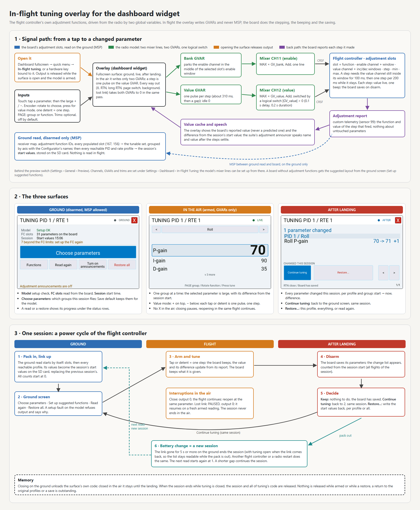
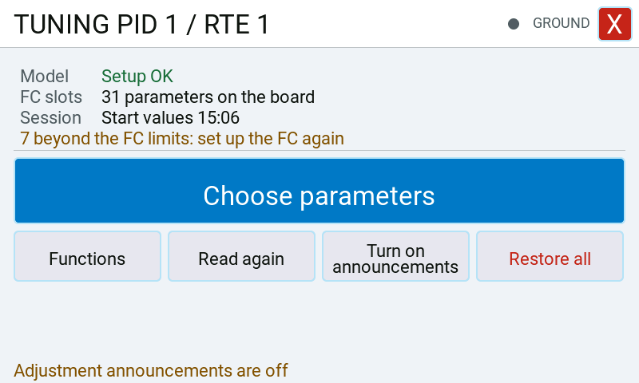
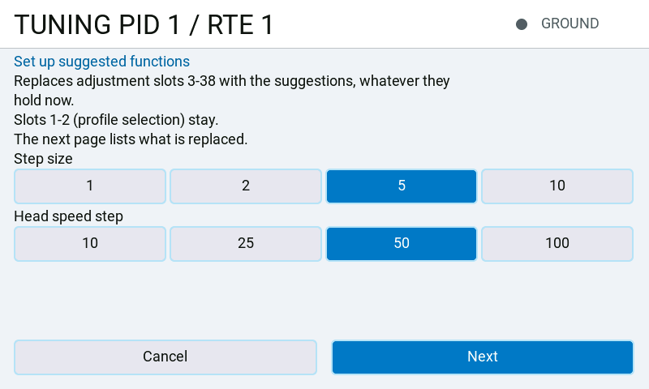
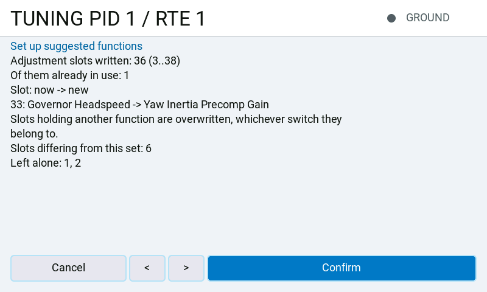
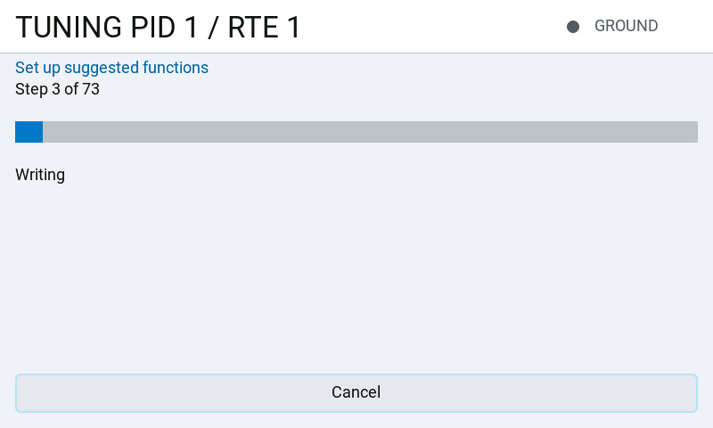
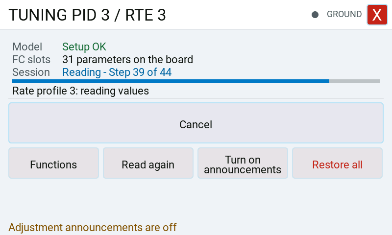
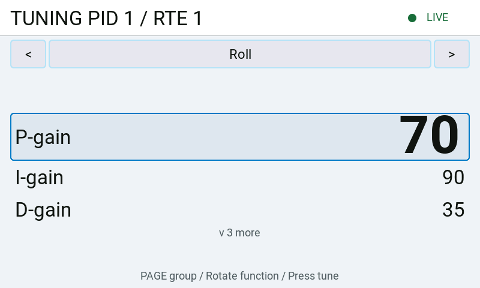
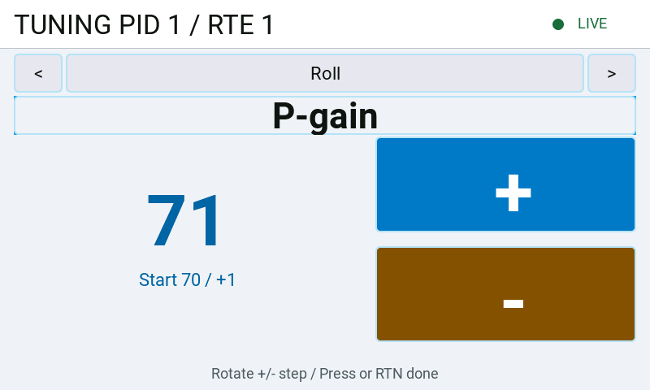
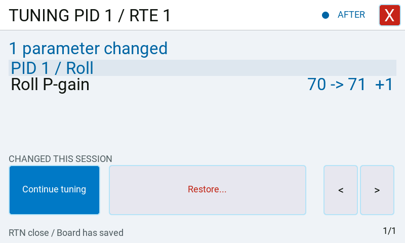

# In-flight tuning overlay

A fullscreen surface opened from the dashboard's quick menu, so that the flight controller's
own adjustment functions can be driven from the air. Tuning is released only while this surface
is open in the foreground; the dashboard zone continues to draw its theme.

It is a **preview feature**: it is hidden until *System* → *Settings* → *General* →
*Preview* → *In-flight tuning* is switched on, and switching it on asks first. It changes the
flight controller's parameters in flight.

## What it drives, and what it does not

The overlay never speaks MSP in the air. Everything it does while the model is armed is a
write to two EdgeTX global variables, which two mixer lines put on two channels; the flight
controller's own adjustment functions do the stepping, the beeping and the saving. That is
what makes it work while armed at all — the suite's MSP queue is cleared on every armed tick,
so anything that needed a reply would simply be dropped.

MSP is used on the ground only, and refused while the board is armed, while the rotor is
turning, and while the arm state has not been read at all.

## Setting it up

### What it needs

On the radio:

- The RFSuite dashboard widget, opened in full screen; **In-flight tuning** is in its quick menu, or
  on a hardware key bound to it under *System* → *Settings* → *Dashboard* → *Keys*.
- The preview switch: *System* → *Settings* → *General* → *Preview* → *In-flight tuning*.
- The master switch under *System* → *Settings* → *Dashboard* → *In-Flight Tuning*, with two
  channels and two global variables the model does not use otherwise (by default channel 11 for
  the bank, channel 12 for the value, GV6 and GV5). Both channels have to reach the flight controller.
- The model wired for them: **Set up the model** on that page writes the two mixer lines, the
  logical switch, the variables' range and precision and, with trims in use, the trim settings. The
  **Model** line on the ground screen has to read **Setup OK** before tuning drives anything.

On the flight controller:

- Adjustment slots on those two channels: your own, or the suggested set written from the ground
  screen (*The suggested functions* and *Your own adjustment functions* below).
- [Telemetry](../pages/setup/telemetry.md) with these sensors selected:
  - **Arming Flags** (90) or **System Status** (120). Without an arm reading the ground screen
    refuses everything, because a model that is never seen armed cannot be told from one in the air.
  - **PID Profile** (95) and **Rates Profile** (96). Tuning follows the active profiles; while one is
    unknown, steps are refused.
  - **Adjustment Function** (99). The board reports each step with it; without it the values on
    screen are not updated after a step.
- The model disarmed and connected on the ground when a session begins, for its read.

Optional: *Adjustment Announcements*, which speak each name and value (the ground screen offers to
turn them on), and **Drive rows from the trims** (off by default).

### Wiring and the setup check

The radio wiring stays in
[*System* → *Settings* → *Dashboard* → *In-Flight Tuning*](../pages/settings/dashboard/inflight.md):
the master switch, channels, variables and optional trims.
**Set up the model** shows its proposed mixer, pulse-timer, variable and trim changes before writing.
A model set up by an earlier version needs this once more if its value line has no logical
switch and the check reports **Mixer line missing or wrong**.

A model whose board carries tuning slots is tunable while the radio's master switch is on and
the tuning fullscreen is open. Open the dashboard in fullscreen, then choose **In-flight tuning**
from its quick menu. Stored interlock-switch and set-layout values are ignored.
On the first opening after the widget starts, the previous view stays visible for a few widget
passes while tuning becomes ready. Output stays inactive throughout this wait. Later openings
reuse the loaded surface.
The model setup check must still pass before the surface can drive the channels. A setup fault
is shown on the fullscreen ground surface.

With **Drive rows from the trims** on, the check also needs to know which of the radio's
switch positions are its trims. The first time tuning is opened after the widget starts, or after
these settings change, the surface shows **Model: Checking trims** while the radio's switch list
is read, a slice per pass. Output stays refused until that is done — about one pass of the widget
for every 32 positions the radio lists, plus one. The setup check follows on the next pass.
Settings changed while the model is armed take effect after the landing. The setup check is made
again then (with trims in use, after the trims are read again) before anything is driven on the
ground, also when the link was lost during the flight and came back after the landing.
Close tuning and open it again from the quick menu to repeat the setup check after a repair.
A trim the overlay
claims has to be off in every flight mode, not only the active one. A flight mode that uses
another mode's trim (EdgeTX's default for FM1 to FM8, which follow FM0) counts as that mode;
one with a trim of its own, or with an offset of its own on top of another mode's, counts as
trimming. The fault reads **Trim still active**.

The set is always derived from the board's adjustment slots during the ground read; no
parameters are offered before that read. The slots determine both the parameter names and
the channel values used to step them. Plus and minus use their increment and decrement
windows independently, including when they are not mirrored about channel centre. Touch
buttons and trims use the same values for the selected bank and row. A step window that is
missing, unreachable, outside the range the flight controller reads, or shared with another
slot of the same bank is refused, so one press never steps two parameters.

A bank is offered only when the value that parks the enable channel in it -- the middle of its
enable window, held inside the channel's reach of 988 to 2012 µs -- lies inside that window and
inside no enable window of another slot on the same two channels. A window that lies beyond
988 to 2012 µs, or one whose middle also lies in another slot's window, could otherwise step
another slot's parameter while the screen names this bank's, and a continuous slot sharing
the bank's own window could move as well. Such a bank contributes no entries to the flying
list and no press, trim or hold steps anything in it; its slots are counted as **skipped** on
the **FC slots** status line. An empty or wholly unusable read shows **No usable slots on the
board** and clears the old row names. Before the read the line says **Not read yet**.

**Set up suggested functions** on the ground screen writes the suggested set (see *The
suggested functions* and *Your own adjustment functions* below), with each parameter's
full range as its slot minimum and maximum. The overlay still derives its set from the next
ground read. A cell whose current value lies outside its slot's minimum and maximum refuses
its step until the flight controller is set up again; the **FC slots** warning counts these
cells. This prevents the FC's clamp from jumping an out-of-range value to a slot boundary.

## The three surfaces

Open the dashboard in fullscreen and choose **In-flight tuning** from the quick menu, or press a
hardware key set to **In-flight tuning** under *Settings* → *Dashboard* → *Keys*. What it
shows follows the flight. Opening releases tuning on that pass, with no switch or debounce.
Tuning opens only while the model is disarmed: armed, the quick menu does not list the entry and a
bound key does nothing, so a mis-press in the air cannot open it. A surface opened on the ground
stays open through arming and the flight.
On the ground, X or RTN closes tuning and returns to the quick menu; the session persists.
In the air there is no X, and RTN only leaves value mode. A firmware fullscreen exit (long RTN)
or a page switch pauses tuning immediately: both variables go to zero, and tuning can be opened
again only after the landing; the flight's steps stay for the post-flight list. Link loss removes the
release immediately but keeps the tuning visit open, showing **PAUSED** and **No FC link**
while tuning. After landing, the post-flight comparison stays visible while the pack is
unplugged; when the link comes back after a battery change a new session begins (see *Sessions*).
When the link and arm telemetry return, the same visit resumes automatically at the same group
and parameter, subject to the existing flight-controller identity and session checks. A link
that returns while the model is still armed resumes as soon as the radio receives a fresh armed
reading, without waiting for landing: the flight controller is not identified again while armed,
and a controller that rebooted would report disarmed. Disabling
the feature closes the visit; enabling it again requires opening tuning from the quick menu.
Every link loss also requires a full ground read of the receiver map, adjustment function IDs,
populated slot records, profile status and parameter values, even when the same FC returns.
An armed continuation defers that read until the model is disarmed and connected. Until it
succeeds, the ground surface marks the retained readings as unread and refuses tuning steps;
a different identified FC starts its own read and cannot reuse the previous FC's values.

### Sessions

A session is one power cycle of the flight controller. It begins with the ground read after the
board comes up: the values read are the session's **start values**, stored on the SD card. The
change displays (the difference beside each row, the post-flight list) count from them, and
**Restore all** and the profile restores write them back. A session ends when the link has been
gone for five seconds while the model is on the ground (a battery change), when another flight
controller answers, or when the radio restarts. The next read then begins a new session: its
start values replace the earlier ones on the card and every count starts at zero. In the air a
session never ends, and a shorter link gap on the ground continues it. With tuning open, the
session ends when the link comes back, so a post-flight list stays readable while the pack is out.
Nothing ends while a profile job, a pending return to the original profiles or a save is outstanding,
or while tuning still holds its bank selection. Such a pending end is only taken on the ground: if
the model is armed first, the session is kept through the flight. While such an end is pending the
**Session** status reads **Battery changed: new session at next read** (on the post-flight list, its
bottom line), and the restores are shown disabled. Any read that begins then, the automatic one or
**Read again**, ends the old session as it starts and begins a new one, also if it is interrupted
by arming; the old start values are not written back. A read answers every read still due, so none
follows it.

### On the ground, before the flight

One filled status panel shows **Model** (the setup verdict), **FC slots** (the number of parameters
read from the board, plus skipped slots, or the slot that blocks tuning), and **Session** (the time this session's start values
were read, for example **Start values 14:32**, a pending session end, or a not-read/refused status). Dim labels sit
beside values. Each status takes one line on 480x272, 480x320 and 800x480 displays, and a second
one only where its text needs it and the actions keep their room; where they would not, the status
is cut to one line, the slot count first, then the session, the model verdict last. The rows are
placed by the standard font's measured line, so a long status never runs into the actions. The model verdict is green when setup passes, amber while
unchecked or checking, and red for a setup fault. Warnings about FC bounds and an unsaved model
default stay in the panel. Secondary actions sit two to a row where both captions fit half the
width and one to a row otherwise, in the same encoder order, above **Restore all**. The space down
to the footer is shared out; the full-width primary action is a little taller where there is room
(on 480x272 with every warning shown it can equal the others). On 800x480, status rows and
secondary captions use the standard font, with a larger primary caption when it fits.

When **Adjustment Announcements** is off, the footer warns that adjustment announcements
are off and **Turn on announcements** enables and saves the existing radio-wide preference.
Opening tuning changes nothing. A failed save leaves the switch off, shows **Announcements
were not saved** in the footer in place of the hint, and allows another press. The hint and button are ground-only; model audio
overrides do not control this switch, and its default remains off. When announcements are on,
the footer shows **Rotate select / Press open**, or **Rotate / Press** where space is limited.

**Choose parameters** is the large, full-width primary action. It opens the session parameter
picker and is visible and active only after the board supplies at least one usable parameter.
The picker lists everything the board carries, six rows a page; the arrows turn the pages through
the groups, and a tap chooses or drops a parameter, at least one staying chosen. It starts from
what is offered now: the session's choice, else the model's flight list, else everything.
**Apply** keeps the choice for this session only (see *Sessions*) and is
never written to the model by itself. **Save default** also stores it as this
model's flight list on the next pass; the ground surface says if that write failed. **Cancel**
changes nothing. The picker closes when the model is armed.
The flight list is edited only here, on the ground screen; the radio settings have no second editor.

**Set up suggested functions** is a secondary grid action when the board offers parameters.
After a completed read with no tunable slots on the configured channel pair, a line explains
that the FC has no adjustment functions for in-flight tuning and this becomes the large primary
action in place of **Choose parameters**. It is absent while armed; during a read or restore it is shown disabled.

The setup surface says what it writes before anything is read: adjustment slots 3 to 38 are
replaced with the suggestions whatever they hold now, and slots 1 and 2 (the profile selection)
stay. It then offers **Step size** (1, 2, 5 or 10) and
**Head speed step** (10, 25, 50 or 100), prefilled from this model's saved choices; the defaults
are 5 and 50. Touch and the hardware encoder select them. **Next** reads the receiver map and
slot function IDs and shows how many slots will be written and how many hold another function. It names
up to six slots holding other functions and counts the rest: those functions are overwritten,
regardless of which switches use them. Slots are numbered from 1, as on the Adjustments page;
slots 1 and 2 are kept. Channels and windows are checked
by the read-back, since the plan reads function IDs only. Pages break between complete sentences
and slot entries; **Confirm** follows the last plan entry.

Only the function of each slot was read. Which channel it watches is checked after the write.
The values only come back to the radio with telemetry sensor 99 selected and CRSF custom telemetry on.

**Confirm** writes each suggested slot, saves once on the FC, then reads back and compares every
written record. One progress screen shows **Step x of y**, a bar and the current operation.

Only a matching read-back saves the selected step sizes to this model, on a separate idle pass.
It then drops the old board set and starts a fresh ground read continuing the session.
An error is shown in words with **Back**. **Cancel** is available until the write is verified;
the success result then closes itself into the fresh read. Cancelling after
some writes requires another ground read; it does not undo slots already written. Arming, link
loss or a different board cancel the job without another request. Setup is ground-only and
never sends MSP while armed.

#### The suggested functions

**Set up suggested functions** replaces adjustment slots 3 to 38, numbered as on the Adjustments
page, with the functions below; slots 1 and 2 (the profile selection) stay. They use the two
channels set under *System* → *Settings* → *Dashboard* → *In-Flight Tuning*. Each one is limited to the
function's full range and steps by the chosen **Step size** (default 5); the head speed steps by the
**Head speed step** (default 50). On the tuning screen they appear in these groups, in this order:

| Group | Functions, in the order shown | Range |
|---|---|---|
| Roll | P, I, D, F, B and O gain | 0 to 250 |
| Pitch | P, I, D, F, B and O gain | 0 to 250 |
| Yaw | P, I, D, F and B gain; CW and CCW stop gain; cyclic and collective precomp; inertia precomp gain; precomp cutoff | 0 to 250, stop gains 25 to 250 |
| Governor | P, I, D and F gain; PID gain; TTA gain; cyclic and collective precomp; head speed | 0 to 250, head speed 0 to 10000 |
| Cross Coupling | gain, cutoff | 0 to 250 |
| Rescue & Level | rescue climb collective, rescue hover collective | 0 to 1000 |

Cyclic master gain, rates, filters and accelerometer trim are not part of this set; they can be
tuned when the board carries slots of your own for them.

#### Your own adjustment functions

Tuning does not need the suggested set. Every session reads the board's own adjustment slots on the
ground and offers what it can step, so a layout made in the Configurator works as it is. A slot is
used when:

- its enable channel is the bank channel and its value channel the value channel set under
  *System* → *Settings* → *Dashboard* → *In-Flight Tuning* (by default channels 11 and 12). Slots with both
  channels elsewhere, such as your own profile switches, are left alone and are not shown;
- it steps. A continuous slot on these two channels is not offered;
- the bank channel can be parked in its enable window without enabling another slot's window on
  the same channels. Otherwise the whole window is refused, with every slot in it;
- its window is among the first six enable windows (lowest first) and the first six increment
  windows (furthest from centre first); further windows are not used.

Slots that are left out this way are counted as skipped on the **FC slots** line. A step direction
whose window would also fire a second slot, including a slot whose enable is always on, is refused;
the function stays listed when its other direction is safe.

A slot that uses only one of the two channels, or both the other way round, stops tuning
altogether: for example a slot on the value channel that another switch enables, or a slot
enabled by the bank channel that reads some other channel. The flight controller would step it
beside the parameter on the screen, and the overlay cannot hold that other channel still. No
parameter is offered until the slot is changed in the Configurator: **FC slots** names the slot,
for example **Slot 40 blocks tuning**, numbered as the Adjustments page numbers its ranges, and the
screen says to change it. **Set up suggested functions** clears it as well when it is one of the
slots 3 to 38 that it overwrites. A slot whose function is off, or whose enable range the flight
controller never reads, does not count. Nor does a slot that is enabled and stepped by the same
channel while its enable range shares no value with its step ranges (for a continuous slot, its
first range and the margin around it): the flight controller can never step it.

Your functions get the Configurator's names and are grouped and ordered as above; a function the
suite does not know is listed under **Other** as *Function* and its number. Profile selection
functions (rate, PID, LED, OSD and battery profile) are never offered. Each one steps by the slot's
own step and stays within the slot's own minimum and maximum; while its current value lies outside
them its step is refused and the ground screen warns how many such values there are.

**Set up suggested functions** replaces slots 3 to 38 whatever they hold, so do not use it on a
board whose own layout you want to keep. **Choose parameters** narrows either set to what a session
flies, without changing the board.

Below it, **Read again** refreshes the session's profiles without changing its start values.
**Restore all** is set apart at the bottom in the destructive-action colour and opens the
confirmation naming its targets; it writes back the session's start values. No spare FC profile
is reserved; old stored spare-slot settings are ignored. There is no separate action to replace
the start values: every session reads its own.

A read or restore on the ground runs inside the ground surface. The **Session** row shows
**Reading** or **Restoring** with **Step x of y**, a bar and the current operation follow in the
panel, and the other actions stay on screen, disabled, until it ends. In the place of the primary
action, **Cancel** is offered only during a read, before the return to the original profiles (a
restore must finish its writes and return), and **Read again** while that return is held. Within a
session, its stored start values are checked on the SD card before the first profile is read
(*Checking the saved session*).

A read or restore started from the post-flight screen takes its own progress screen with a
**Reading** or **Restoring** title, so the change list it was started from is still there when it
ends.

The reachable set is the union of `adjMin..adjMax` from all PID-profile (function 2)
and rate-profile (function 1) adjustment slots, capped to 1..6 and the FC-reported counts,
plus the active profiles. With no selector slot, only the active profile of that kind is read.
The FC implements these switch slots as continuous adjustments; two slots can add disjoint ranges.

The ground job selects every reachable PID profile with MSP 210, then reads PID tuning,
PID profile, governor profile and rescue profile. Rate profiles use the same select command
with bit 7 (`0x80`) and read RC tuning. Governor configuration and accelerometer trim are
read once globally. Profile indices on the wire are zero-based. STATUS checks bracket each
profile's records. Work is sliced per widget pass and a partial read never replaces the cache.

The job always returns to the pair active at its start, including after errors/timeouts.
Arming aborts the read immediately; no MSP is queued while armed. A disconnected/armed return
is retained until the same FC is connected and disarmed. The surface says **Original profiles:
return pending**. If the return itself fails, **Read again** requests another return; no start-value reset
or restore can replace the pending transaction. A switch held in the same position does
not undo an MSP selection: firmware applies that switch only when its computed position changes.

Snapshots live beside the suite's MCU-keyed model preferences, under
`RFSUITE/user/<model-id>.inflight.lua`. They contain a version, UID/FC signature, craft name,
clock timestamp, a profile manifest and tunable values per scope. A complete temporary Lua-data
file is verified in slices before promotion with the suite's FAT delete/rename convention.
A session's start writes its start values, replacing the previous session's; adjustment reports
do not write the card. A read within the session, after a short link gap, reads the union of
currently reachable profiles and profiles held in the session's start values. Existing start values
and the session time stay unchanged; a newly reachable profile gets its start values from that read
and is added to the stored start values after the read and return succeed. Restore targets only
profiles held in the start values. A stored profile above the FC's current profile count refuses the
transaction. Missing/incomplete/foreign start values refuse restoration. They are an undo for the
session's tracked parameters, not a full FC configuration backup.

### In the air

The overlay uses a Rotorflight dark palette with a blue accent.

The current group is the title, for example **Pitch**. Tapping it replaces the list with a
picker of every group, two to a row, the current one highlighted. Tapping a group, or turning
the encoder to it and pressing, jumps straight to its first function; RTN or the title again
closes the picker and keeps the group. Opening the picker leaves value mode. It is part of the
tuning screen rather than a radio menu, so the encoder returns to the list when it closes. The arrows beside the title select the previous/next
function of the group, in browse and in value mode, and stop at its ends with the end tone.
There is no permanent bank strip. The
fixed order is **Cyclic, Roll, Pitch, Yaw, Governor, Rates, Filter, Cross Coupling, Rescue & Level,
Acc Trim, Other**; groups with no safe cells are absent. Cyclic contains Cyclic Master Gain (83) only when the FC has a safe slot for it. Within an axis, **P, I, D, F, B, O**
come first, followed by the other functions in the function table's order. Profile selectors
are excluded. Unknown function ids appear under Other with their number.

The list comes from the board's ground-read adjustment slots. Each full function name retains its
original bank and row on the channel pair; grouping changes no FC adjustment slot. A cell
with only one safe direction remains listed, and its other direction refuses. A cell with
neither safe direction is absent. The current row occupies a one-row scroll sensor; the
neighbouring rows use non-focusable labels with current values and signed session differences.
The selected row has a blue outline and fill, is taller than its neighbours and shows its value
in a larger font; it stays at the second list position and the neighbours scroll around it.
Counts above and below identify hidden functions. Larger surfaces show more rows and larger
selected figures. Touching the sensor row selects its value.

**Touch is primary.** Tap a parameter to enter value mode. The value is large; the large
minus and plus targets send steps. Tapping the parameter name leaves value mode. A tap
starts one pulse. A held touch target retains the existing pulse/gap repetition and the
five-second maximum hold; a lost release is bounded by that maximum. Values are the last
FC reports, never predicted changes. Under the value, **Start N / +/-difference** compares
against the session's start value of the active PID/rate/global scope. An unknown start value
leaves that line empty. The value is drawn in the largest font the radio has, on the left.

Plus and minus are stacked in one column on the right, as large as the surface allows: plus on
top in the accent blue, minus below in orange, so the two can be told apart without reading the
glyph. The full-width name remains the
one-row encoder sensor. The footer gives PAGE, encoder and RTN hints. Reports update snapshot
text without rebuilding the scene.

After a touch action in browse or value mode, the live scene is rebuilt to return encoder
focus to the tuning sensor. A held plus/minus target waits until release before rebuilding.
This also applies when a touch step is refused during a pulse or cooldown; the next encoder
detent uses the tuning sensor again and remains subject to the same pulse/cooldown rules.

**PAGE up/down** selects the previous/next group in browse. In value mode it selects the previous/next function within the current group, keeps value mode, and announces the new name and current value. Group ends give an end tone without wrapping. PAGE during a step, pulse or cooldown is refused and spent, never queued. Function navigation and value reports retain the scene.
**RTN** leaves value mode. While the model is armed it does nothing more, and no tuning surface
carries a Close, including busy reads, setup and restore dialogs before the live phase.
On the ground and after landing RTN from browse, and the Close in the header,
return to the dashboard's fullscreen quick menu. Fullscreen stays open, and the session's start
values, steps and post-flight comparison remain available when tuning is reopened from that menu.
Every flight starts at the first function of the first group. The overlay
owns these release events ahead of pending builds and theme bindings. Navigation stops at list ends and gives end feedback; a request during a pulse or
cooldown is refused and never queued. Closing clears the variables, cancels pending speech and
leaves value mode. Opening tuning again from the quick menu on the ground releases it
immediately. A link-loss pause within the same flight keeps the selected group and parameter.

**Encoder:** rotate to highlight the previous/next function and request its settled name
announcement. Press once to select it. In value mode, rotate one row to request one signed
step and press once to return to browse. No native number editing or number keyboard is used.
The sensor viewport is exactly one button high: LVGL scrolling a newly focused button into
view supplies `scrolled(x, y)`. Duplicate positions do nothing. A jump of more than one row
never becomes steps: browse gives end feedback and keeps the selection; value mode only
re-baselines. Busy detents are spent and never replayed. The 64-row value ladder starts in
the middle. Selection/value text stays reactive; function navigation and value reports rebuild
no sensor.

**The ladder is endless.** The encoder walks the scene's focusable objects in creation order and
wraps, and moving buttons on screen does not change that order: past the last row of a ladder
half the walk would continue into the minus/plus targets and the group controls, where a press
changes the selection. So when the focus comes within four rows of a half's end, or reaches a
guard row, the live scene is rebuilt: the selection, value mode and the step state are kept, the
new ladder starts in the middle again, and the first detent after the build lands on a half's
entry row. In one direction that is one build of the live surface about every 28 steps. In
browse the same happens at the list ends, after the end feedback. A detent that arrives while
the build is pending is absorbed by the rows left before the end.

Lua buttons expose no focus-disable property, so the touch controls stay in the focus group;
the rebuild keeps the encoder from reaching them. The fullscreen widget itself also remains a
native focus target between the last and first sensor buttons. Rotation onto that target emits
no sensor callback, so a reversal across it can consume a detent without a step. ENTER there
still selects or leaves value mode. Touching a sensor row or using PAGE in browse recovers the
selection, and RTN keeps its level-back role.

The focus/scroll mechanism is supported by the firmware sources; physical delivery, native
layout and recenter event ordering still need a simulator/radio bench run. Debug tag
`rfsuite.inflight.input` records every scroll (y, row, delta, decision) and sensor press.
Lua cannot distinguish an exact-row touch scroll from a focus scroll; fractional drags are
ignored. No raw rotary event handler is used.

**Trims are optional and off by default for everyone.** Existing users who tuned with trims turn them on again in the settings; their saved assignments remain supported. In
Walk and adjust, the group trim changes group and the walk trim highlights functions inside
it; the adjust trim steps the highlighted function. One-trim-per-row keeps its hidden slot-row
addresses. A trim cannot step a parameter excluded from the flying list. A trim press is one
step however long it is held; touch, encoder and trims share the same pulse ownership guards.

**Session profiles can switch freely on the ground and in flight.** The header prominently
shows both active PID and rate numbers. Every profile edge ends pulse/hold ownership and clears
the value output. Cached values follow their PID profile, rate profile, or global scope.
An AdjF/AdjV report is attributed to the profile active when sampled. Since these reports carry
no profile ID and remain held, an edge fences reports and steps until AdjF is explicitly idle.
**Waiting for fresh adjustment telemetry** explains that refusal. No scene is rebuilt on reports.

Rotorflight remembers the last value written by each stepped adjustment; switching profiles
does not reset that memory. If a step on the new profile would produce that remembered value
(for example, after copying profiles), the first step in the same direction does nothing.
Further steps in that direction can also be ignored until a step in the opposite direction
changes the value and clears the tie.

An unread PID/rate profile or unknown PID#/RTE# refuses steps with a clear reason and
`inflight/paused.wav`. Returning to read profiles resumes without closing and reopening tuning; the held
report fence still applies. A profile that was not reachable when the session began is read
after the next short link gap on the ground, or with the next session.

**Speech uses the existing Adjustments announcer and its audio setting.** A selected group
or highlighted function waits **700 ms**; every newer selection replaces the pending name.
Selecting a function for tuning plays `inflight/selected.wav` before its name and current known value. Profile edges belong to the general *PID Profile* and *Rate Profile* announcements when those events are enabled; the overlay supplies `evt/profile.wav` plus the number only when the corresponding general event is disabled. In flight, unread/unknown profiles play `inflight/paused.wav`; returning to a read profile plays `inflight/resumed.wav`. Neither session cue plays on the ground. Every function and every group is spoken as one recording of the name the screen shows, `inflight/fn/<id>.wav` and `inflight/group/<id>.wav`. The names are the Rotorflight Configurator's own adjustment-function names in each language (for example *Heck B-Gain* / *Yaw B-gain*), so the pilot hears and reads the same words as in the Configurator. Under the group title a name does not repeat it (*P-Gain* under *Drehzahlregler*, not *Drehzahlregler P-Gain*); a name that does not begin with the title, and every spoken name, stays whole. In the selected row a name too long for one line breaks onto a second line; the neighbouring rows cut it.
Critical alarms suppress advisory adjustment/navigation speech. Already handed-over firmware
audio is not cancelled. Encoder browse scrolls use this same settled-name path.
The end-of-list tone is input feedback and plays with adjustment announcements disabled;
the existing critical-alarm guard still applies.

A per-model **flight_list** scalar can restrict the list to comma-separated adjustment function
ids; an empty string means all safe parameters. A stored id no longer driveable on the FC
is named by the setup check and refuses output. Choose the list with **Choose parameters** on the
tuning ground screen after the ground slot read for this FC and channel pair has completed.
Choose a group, then toggle parameters; Previous/Next pages through groups longer than six rows.
Stored unavailable IDs remain checked and marked **(missing)** until removed. **All parameters**
clears the filtered list; at least one parameter must remain selected in a filtered list.
**Apply** changes this session's list; **Save default** also stores it for this model with the
same FC connected. The picker sends no MSP. Native acceptance of the controls remains pending.

### After landing

The complete change list is grouped by **PID profile**, **rate profile**, then **Global**;
each profile contains the same function groups as the flying list. Rows show SD start value,
last reported value and signed difference. The count is since the session start, so it covers
every flight of the session. Each page repeats its profile/group heading and stays within one profile.
Blue Previous/Next controls (or PAGE/the walk trim) page the list. **Continue tuning** returns to
the ground surface in the same session, to choose other parameters or fly again. **Restore...**
opens the action menu with **Restore all**, **Read again**, the displayed profile/global restore,
and **Back to changes**. Neither sends MSP. Rate-profile pages state that a PID-profile restore
does not cover their values; their own restore and Restore all do.
**Read again** selects and rereads all session profiles while disarmed, returning to the original
pair, to replace reported values with exact FC records. It keeps the session's start values.

**Restore profile PID N**, **Restore profile RTE N**, and **Restore global** refer to the profile
on the displayed page. **Restore all** covers every profile of the session's start values and the
global values; both write back the values from the session start.
A confirmation names the target profiles before any restoration starts. Restoration is refused
while armed, without a known disarmed/rotor-stopped state, while another transaction is pending,
or with foreign/incomplete start values.

For each target, the job selects it, reads the affected current MSP records, changes only tracked
fields with the matching set commands, and compares the RAM read-back. Untracked fields retain
their just-read values. There is no EEPROM write between targets. After all targets, the job
selects the original pair, writes EEPROM once, and confirms the active pair by STATUS. Continuous
profile switches can reassert their channel-selected pair at this save; the original pair is
accepted. The job then selects and rereads each restored target without another write, comparing
the complete records again, and returns to the original pair.

Per-target results distinguish RAM verification with an unconfirmed save, an acknowledged save
with read-back pending, and verified read-back after the save. The last case proves a save
acknowledgement plus immediate rereading, not survival of a power cycle. A failed restore may
already have written some fields: this is not an atomic FC rollback. An uncertain save is not
repeated automatically. Return recovery remains deferred while armed, disconnected, or tuning
is closed. Reopen tuning on the ground to let an outstanding original-profile return continue.

A read or restore started here shows its current target on its own progress screen instead of the
change list; restore/read actions are unavailable until the job finishes. Temporary profile selections and the final return are
silent in both the overlay and the general profile announcer, including while tuning is closed.
Ordinary in-flight profile announcements remain enabled.

Closing tuning on the ground or in the air keeps the session. Closed on the ground, the surface's
own code is unloaded and loads again on the next opening, which takes a few passes; closed in the
air it stays loaded until the landing. When the
session ends (see *Sessions*) while tuning is closed, the session and all of tuning's code leave
memory at once, unless another dashboard on the radio still shows tuning, holds a session or has
the configuration tool open; the next opening reads the board and begins a new session. Nothing is unloaded
while armed, while a profile return or a save is still outstanding, or while the suite's tool is
open. A link interruption shorter than a session's end keeps the session and the fullscreen visit,
resuming automatically once the link and arm state are known. Closing,
backgrounding, link loss and profile edges clear
pulse/hold ownership and GVAR output in the flight mode where it was written. MSP never runs
while armed. Existing setup, collision, range, trim, pulse and input ownership refusals remain.
The encoder has two scroll windows sharing one input owner and the same row set. Their creation
order brackets the touch controls, so first focus entry in either direction scrolls a window.
ENTER before native child focus selects the current function. End guards give feedback and keep
ENTER usable. Duplicate unchanged scroll callbacks do not add input or trace noise. Navigation
and telemetry reports retain both windows. Native encoder ordering, rendered layout, SD power-loss
behaviour and FC acceptance still need an isolated simulator/radio/FC retest. Historical screenshots
show the former UI.

An always-active adjustment slot on the tuning value channel can fire in every bank. A step direction whose pulse would also trigger that slot is unavailable; other safe directions remain available. The slot is included in the skipped count. For a continuous slot of that kind only its first range counts, widened the way the flight controller widens it: by the range width divided by twice the slot's value span, and at least 5 µs on each side. Its second range is never used by the flight controller and refuses nothing.

Ground reads accept the firmware range of PID gains and rescue altitude P/I/D gains (0 to 1000) and of the governor head speed (0 to 50000), even when a value exceeds the Configurator's standard-slot range. Values outside the firmware range refuse the read with the function name and value. The standard-layout writer retains its Configurator limits.

After a link interruption on the ground, tuning waits for the flight controller's UID to answer; in the air a fresh armed reading continues the same flight instead (see above). A matching identity allows the required full ground read before tuning can resume; the post-flight history remains visible while waiting. Another identified controller ends the previous session, and so does a gap of five seconds or more on the ground (see *Sessions*). If a read or restore was suspended, its original-profile return is still owed to the disconnected controller and is logged; it does not block a new read on the connected controller.

Closing fullscreen or backgrounding the widget in flight pauses tuning, clears both variables,
and retains the flight's steps for the post-flight list, including when the widget returns after
landing. Tuning can be opened again after the landing. Ground MSP
work runs only while tuning is open. The ground model-status sentence updates as setup faults are
repaired. The session row shows the time its start values were read; the SD snapshot keeps the full date and time, and existing snapshots remain compatible.

## Related

- [Rotorflight documentation](https://doc.rotorflight.org/) — the adjustment functions
  themselves: what each one changes, its range, and how the slots are addressed.
