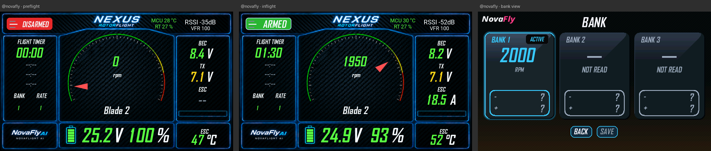

# @NovaFly RC theme

*@NovaFly RC* is a dashboard theme drawn from code for 800 x 480 radios: one cockpit, the same in every
flight phase, which takes the full screen for itself, a bank view of its own for the governor head speed of
the active PID bank, and the colour of the cockpit as its one setting. Its lettering is drawn as pictures,
which is why it is drawn for one screen size and listed on that size only.

## Where to find it

*System* → *Settings* → *Dashboard* → *Theme*: choose *@NovaFly RC*. The theme is listed on an 800 x 480
radio (TX16S, TX16S MK3, T16, TX15 and the like) and on no other screen size. Its one setting is under
*System* → *Settings* → *Dashboard* → *Settings* → *@NovaFly RC*; a model with per-model settings
switched on keeps its own colour under
[*Per-Model Settings*](../pages/settings/dashboard/overrides.md).

## What it shows

One screen before, during and after the flight; nothing changes shape at arming or spool-up, and the
figures a reading has not supplied yet are drawn as dashes:

- **Head** — the arm state at the left (*NO LINK* while the flight controller does not answer, then
  *DISARMED* in red or *ARMED* in green), the MCU temperature and the flight controller's load (*RT*
  where the RT load sensor answers, *CPU* otherwise) in the middle, and the link at the right: the
  RSSI of the first antenna in dB and *VFR*, the link quality (the *RQly* sensor on an ExpressLRS
  link).
- **Left** — the flight timer, as the suite counts it, and the PID bank and the rate profile the
  flight controller is on; the two numbers turn red while they differ.
- **Middle** — the head speed on a dial, its needle scaled to the highest head speed seen since the
  theme was loaded (2 000 rpm at least), with the model's name under it.
- **Right** — the BEC voltage (amber below 5.0 V), the radio's own battery voltage, the current the
  speed controller reports and the ESC temperature, which turns amber at 60 °C and red at 80 °C.
- **Foot** — the pack voltage, the battery as a percentage of the cell voltage between 3.5 V and
  4.2 V, with a bar of five segments beside it, and, where the speed controller reports no
  temperature, the cell voltage in its place. Voltage, percentage and bar take the colour of the cell
  voltage: green above 3.75 V, yellow, orange, and red below 3.45 V.

Every figure keeps its own node on screen; a new reading changes a picture and builds nothing anew.

## Full screen

With *@NovaFly RC* selected, full screen shows the cockpit itself rather than the quick menu. The
theme draws no close button: a **long press on RTN** leaves full screen, which the radio always allows.
Three places on the screen take a press:

- **The arm field** at the top left opens the [quick menu](quick-menu.md) over the cockpit; so do
  TELE and the page keys as they come.
- **The bank field** (the PID bank and the rate profile) opens the bank view below.
- **The head** in the middle, on a long press, changes the colour of the cockpit to the next of its
  ten colours and keeps it (see *Settings*). On the ground only: while the model is armed the press
  does nothing.

Outside full screen the cockpit draws the same picture without the three controls, as a widget zone
receives no touch. The picture is laid out for the whole 800 x 480 screen, so the widget wants a
full-screen zone (a layout without the radio's top bar); in a smaller zone the lower part of the
cockpit is cut off.

## The bank view

The bank view shows the three PID banks as cards. When it opens it reads the governor profile of
the bank the flight controller is on and shows its head speed in rpm, or, in the governor modes
*LIMIT* and *DIRECT*, which keep no head speed, its maximum throttle in percent. The other two
banks read *NOT READ* until the flight controller is switched to them (the bank switch on the
radio), which makes the view read that bank in turn. A press on the active bank's card opens **-**
and **+**, which change its figure in steps of 10 rpm or 1 %; a press on another card only marks
it. **SAVE** writes the whole governor profile of the active bank with the one changed value, reads
it back, compares it, and only then asks the flight controller to keep it. A read-back that differs
is reported and nothing is kept. **BACK** and a short press on RTN close the view.

The view talks to the flight controller through the suite's MSP service (`rfsuite.msp`), so its
requests take their turn in the suite's own queue. A read the view has given up (its timeout, BACK)
is taken out of that queue. A save is different: once its write is queued, the view carries it
through to the end (read back, compare, revert or keep), even if the view has reported a timeout
or has been closed in the meantime, and then reads the bank again, so the screen never says one
thing while the flight controller holds another. A second SAVE while the first is still under way
only shows the progress bar. It asks and writes nothing while the model is armed: the active
bank's card then follows the live head speed, a press on a card, **-**, **+** or **SAVE** answers
that the model is armed, and the view reads the profile again once the model is disarmed. The view
never switches the active bank.

## Settings

| Setting | What it does |
| --- | --- |
| Colour | The colour of the cockpit: Blue, Turquoise, Green, Yellow, Gold, Orange, Red, Magenta, Violet or Silver. The long press on the head changes the same value. |

The colour is a theme setting like any other: saved from the tile it is the radio's standard value,
saved from [*Per-Model Settings*](../pages/settings/dashboard/overrides.md) it is the connected
model's own. The long press writes to whichever of the two the cockpit is drawing from.

## Languages

The words and figures of the cockpit and the bank view are pictures. The theme carries them in
German, English, French, Spanish, Italian and Dutch and picks the set by the radio's own language
(*System* → *Radio setup* → *Language*); a radio in another language gets English. The sentences at
the foot of the bank view follow the same choice. The settings page speaks the language of the
installed package, like every other page of the suite.

## What it does not do

- It draws for 800 x 480 only, and is not offered on a 480 x 272 or 480 x 320 radio.
- It has no screen of its own for the time after the flight: the cockpit stays, with the timer
  stopped and the last readings.
- It offers no Keys page and binds no key itself beyond the three presses above; the radio-wide
  [Keys](../pages/settings/dashboard/keys.md) choices apply as on every theme.
- Its bank view edits the governor head speed or maximum throttle only. The rest of the governor is
  on *Setup* → *Governor*.
- A copy of the theme in the pilot's own folder beside the shipped one is not supported: the copy
  draws from the shipped folder, and its long press writes the shipped theme's colour. Without the
  shipped theme, a copy under `user/dashboard/novafly` works on its own.

## Related

- [Themes](themes.md) — every shipped theme, and choosing one.
- [Quick menu](quick-menu.md) — what the arm field opens.
- [Adding a dashboard theme](../developer/dashboard-themes.md) — the manifest, including the `screen`
  key this theme declares.
- [Rotorflight documentation: Governor](https://www.rotorflight.org/docs/Tutorial-Setup/Governor)

*Documented against RFSuite 0.2.2.*
