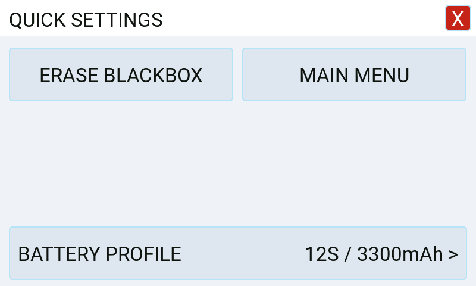
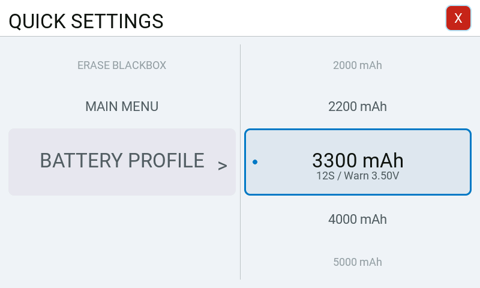
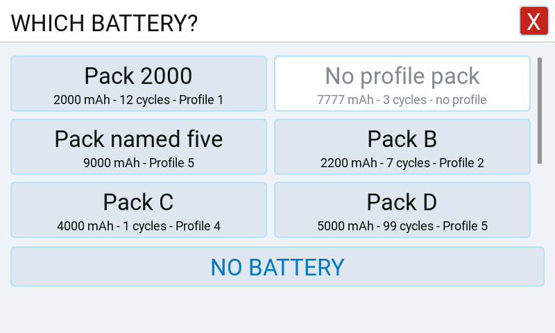
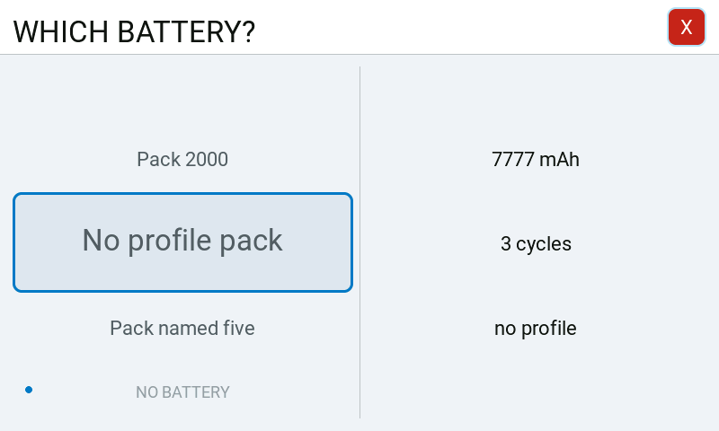

# Quick menu

A short list of things a pilot wants to reach from the flight line without leaving the
dashboard for the tool. It opens over a theme that takes fullscreen, including Default, or
directly when a theme leaves fullscreen to the menu.

## Where to find it

Put the *RFSuite* widget full screen the way EdgeTX puts any widget full screen — the widget's
own context menu on the screen it sits on, then *Full screen*. With Default, fullscreen
shows the dashboard; press the menu control in its info bar (at the top left as it comes), TELE or a page key (the default
global shortcuts) to open the quick menu. Default binds no keys: a key put on **Theme** does
nothing while the dashboard itself is showing.
Closing the menu returns to the dashboard.

Other themes can also take full screen for themselves (a theme author's choice, see
[dashboard themes](../developer/dashboard-themes.md#a-theme-that-takes-fullscreen)); their
menu control or page-key bindings open the quick menu over the theme. A theme that does not
take fullscreen opens the quick menu directly.

One exception is the [in-flight tuning overlay](inflight-tuning.md): while the interlock
switch has brought it up, it takes full screen instead and the quick menu is not drawn.

The other is the battery prompt. With *Write a flight log* on (the
[Flight Log](../pages/tools/flight_log.md) page, *Settings*) and a pack in the registry for
this model, full screen shows the battery picker instead of the quick menu once per connection,
until the pilot has picked a pack, closed it or armed the model. The registry is read a dozen
lines at a time once the connection is up, so with many packs the picker comes up a moment
later.

The menu has its own colours, Rotorflight's, in a light or a dark scheme: *System* → *Settings* →
*General* → *Appearance* → *Color scheme*, light as it comes. So it looks the same whichever
dashboard theme is selected and whatever the radio's theme is, a dark theme included: the scheme is
the pilot's choice and does not follow the theme.

Hardware shortcuts are set on [Keys](../pages/settings/dashboard/keys.md), for every theme and
model. They can also open the core menu on the connection screen, before the FC is ready.

## What it offers

| Entry | What it does |
| --- | --- |
| **ERASE BLACKBOX** | Asks first, because the erase cannot be undone — see [the erase confirmation](#the-erase-confirmation). Its **ERASE** answer erases the flight controller's blackbox storage, then reads the storage summary back so the dashboard shows the free space it has now, closes the menu and leaves full screen (over a theme that takes full screen: closes the menu and shows the theme again). Only listed while the connection is ready and the model is disarmed. |
| **IN-FLIGHT TUNING** | Opens the in-flight tuning surface at full size. It stays full screen rather than closing. Only listed while the feature is switched on and the model is disarmed — see below. |
| **BATTERY** | Brings the battery prompt back, with this model's packs. It stays full screen, the picker taking the menu's place. Only listed while the battery registry has a pack for this model and the model is disarmed. |
| **MAIN MENU** | Opens the suite's tool, with its whole menu, inside the widget — see [the tool from full screen](#the-tool-from-full-screen). Only listed while the model is disarmed. |
| **FLIGHT LOG** | Opens the suite's tool inside the widget on its [Flight Log](../pages/tools/flight_log.md) page; the back key there closes it again. Not in the menu as it comes — the pilot adds it on the *Quick Settings* page — and then only listed while the model is disarmed. |
| **BATTERY PROFILE** | Opens [the battery profile page](#the-battery-profile-page), where pressing a profile makes it the one in force. Not one of the entries above: a row of its own under them — see [the layout](#the-layout). Only shown while the connection is ready, the model is disarmed and the flight controller has reported at least one battery profile with a capacity. |

That is the menu as it comes, *FLIGHT LOG* aside. Which of the first five entries it shows, and in which order, is the
pilot's to choose on *System* → *Settings* → *Dashboard* →
[*Quick Settings*](../pages/settings/dashboard/quick_menu.md). An entry chosen there still hides
where the table says it is not listed. BATTERY PROFILE is not chosen there; the menu always draws
it where it is offered.

**ERASE BLACKBOX and BATTERY PROFILE are not offered before the connection is ready or while
the model is armed.** Before the connection is ready — at start, or with the link lost and the
battery profile page still open — a write would wait for the next connection, which can be a
different board; the battery profile page then draws its profiles without a press, as while armed
(see [the battery profile page](#the-battery-profile-page)). While the model is
armed nothing they send would arrive: the suite sends no configuration messages to
the flight controller and drops the ones waiting, so an erase or a profile change pressed in the
air would never reach the board. A menu that was already open when the model armed still shows
what it showed; a press on an entry that is no longer offered does nothing, keeps full screen,
and draws the menu again without it. The same holds for an **ERASE** answered after the model
armed, and for a theme that draws these entries itself and asks whether each is offered, as
Urban does.

**IN-FLIGHT TUNING is a preview entry.** It appears only while *System* → *Settings* →
*General* → *Preview* → *In-flight tuning* is on, the radio's own switch under *Settings* →
*Dashboard* → *In-Flight Tuning* is on, **and** the model is disarmed. With either switch off the
entry is not listed at all, so the menu offers no route into a feature the widget has stopped
driving; while armed it is not listed either, so a mis-press in the air cannot open the tuning. A
surface opened on the ground stays open through arming. What the surface itself does is in
[in-flight tuning](inflight-tuning.md).

## The layout

The entries the pilot has chosen are laid out on six places of equal size: two columns on a
widget zone at least 300 pixels wide, one column on a narrower one. They fill the places row by
row, left to right, in the pilot's order. An entry that is not offered now takes no place, so
there are no gaps; with an odd number of entries in two columns the place beside the last one
stays empty. The places keep their size whatever is shown, so with fewer entries the room below
them stays free. An entry past the sixth place is not drawn.

BATTERY PROFILE is always on the row after the last row of places, across the whole width and as
tall as one of them. Its title is on the left; on the right is the profile in force, with a `>`
to say the row opens a page:

`6S / 2000mAh / Warn 3.50V >`

— the cell count, the capacity and the warning voltage per cell. Where that does not fit, the
warning voltage is left out first, then the cell count; the capacity always stays. On firmware
that does not report a cell count and cell voltages per battery profile, the row shows the
capacity alone. With no profile known to be in force, it shows the title and the `>` only.

On every theme, ERASE BLACKBOX shows under its title how full the blackbox is, where the flight
controller has reported it.

## The rotary style

*System* → *Settings* → *General* → *Appearance* → *Menu style* → *Rotary* draws the widget's menu
and its battery picker as rolling lists instead of buttons, on every theme. The card is what they
are as they come.

The left list holds the entries of the quick menu, BATTERY PROFILE last. The current one always
stands in the larger row in the middle, and the list ends where it ends: it does not wrap, and the
rows past either end stay empty. The right list shows what the current entry leads to, where it
leads to something. On opening, the first row that can be pressed now is the current one.

- **The wheel** moves the list that has the focus.
- **A press** runs the current entry. Where it leads to a choice, a question or a further list, the
  focus moves to the right list instead. A press on a right row that leads on shifts both columns
  by a level; any other press there finishes, and the menu closes.
- **RTN** takes back one press: from the right list the focus returns left, and nothing shifts or moves; from
  the left list at depth both columns shift back a level; on the first level it closes the menu.
- **A swipe** rolls the list it starts on, one row for a row's height. A list on the right takes
  the focus when it is swiped.
- **A tap on the middle row** is a press. **A tap on any other row** brings it to the middle and
  runs nothing. The X closes the menu.

ERASE BLACKBOX asks its question in the right list, with the focus on its CANCEL, so a double press
cannot erase. A battery profile is written as on [its page](#the-battery-profile-page): the header
says *SENDING...*, the menu closes when the flight controller has answered, and it stays up with
*NOT SAVED* where it did not.

BATTERY shows this model's packs in the right list, each with its capacity, cycles and profile under
its name; where that does not fit, the profile is left out first. The focus starts as it does in
[the battery picker](#the-battery-picker).

**MAIN MENU rolls on through the suite's whole menu** in the same two columns, and the header holds
the path, shortened from the front where it does not fit (`... > Setup > Mixer`). A press on a page
opens it inside the widget, as [the tool from full screen](#the-tool-from-full-screen) does, and RTN
from the page comes back to the same place in the roll. The tool's tile home stays what it was: it is
what the card style's MAIN MENU opens, and what a key set to *Suite: Main menu* opens in either style.

A press that opens a page says *Opening...* under its row at once, in the accent colour, because loading the suite
holds the screen for a moment; the page follows.

Three places open in the tool with their tiles instead of rolling on, and RTN walks the tool's levels
before it comes back to the roll: **ESC & Motors**, whose entries depend on the ESC protocol, **Helicopter
Setup**, whose steps show on their tiles which are done, and the **dashboard theme settings**, a list made
while the tool runs.

**A row that cannot work now stays in the list, grey**, and says why on the right: *Needs the flight
controller* with no connection, *Not while armed* while the model is armed, where every row is grey.
It rolls, and a press on it does nothing. The place in the lists stays through both. What is not set
up is not listed at all: a feature switched off, no packs for this model, or firmware too old while
connected. Without a connection the firmware's version is not known, so a row that needs a newer one
is grey rather than gone.

**The header's line says how things stand**, one message by rank: *SENDING...* or *NOT SAVED*, or *Could
not open* for a page the tool could not open, until the next detent or press; then *Connection error*,
*Not connected* or *Connecting*, in the warning colour; then *Connected*, in green. A tap on it shows the details the tool's connection
button shows; the wheel does not reach it. Back from a page the roll is where it was with these rules
applied: a row that has gone in the meantime leaves the wheel on the level above it, and no other row
takes its place under the press. A lost link on a page returns to the roll, greyed, and an open question
or a running *SENDING...* does not survive it. A battery prompt comes up over the roll as it does over
the menu, and the place is there again behind it.

The roll is forgotten, and the dashboard shows, when the model arms on a page, full screen is left or
the widget goes to the background. A key's visit to a page never returns into the roll.

The middle row and its neighbours carry a picture, in near-black in the light scheme and in the
scheme's blue in the dark one; grey rows and the outer rows carry none. Pictures are drawn for 800x480
and the radio scales them on a 480 wide screen.

The wheel moves the focus rather than reporting a turn, and the focus passes the widget itself at
the point where the list was last at rest. A detent onto that point shows on the next detent. The
list settles the focus there again once the wheel has rested for a moment.

## The erase confirmation

Erasing the blackbox is irreversible and sits one tap from the flight line, so the row asks
before it acts. Tapping **ERASE BLACKBOX** opens a question over the menu: a title, a sentence
naming what is about to go, and, where the flight controller has reported the storage summary
(on connecting, and after every erase), a line saying how full it is as *% used*. **ERASE** is
on the right, in the warning colour; **CANCEL** is on the left.

Nothing is sent and full screen is not left until **ERASE** is pressed. **CANCEL** does nothing
and shows the menu again; a short press on the return key does the same while a theme takes full
screen, and on a radio whose return key leaves full screen the question is discarded with the
visit. Either way the logs are left alone. A model that has not reported a summary yet is asked
the same question without the *% used* line.

## The tool from full screen

EdgeTX gives a widget no way to start a tool script, so the dashboard opens the tool itself: it
runs the same tool inside the widget, at full screen, until it is closed, and then shows the
theme again — or, over a theme that does not take full screen, this menu. A view of the theme's
that was showing, or that the pilot had closed, does not come back on its own when the tool is
closed. It is reached three ways, all of them only while the model is disarmed:

- **MAIN MENU** in the quick menu, and **FLIGHT LOG**, which opens it on its *Flight Log* page;
- the tool control — three slider lines — beside the menu control, over a theme that takes full
  screen and binds no control of its own;
- the same control on the connect screen, when the widget is put full screen before the link is
  up, so the tool is there for a model that does not connect.

In the rotary style MAIN MENU leads on through the menu in place of the first of these: see
[the rotary style](#the-rotary-style).

While it is open the tool works as it does when started from the radio's tool list, on the
widget's own connection to the flight controller. The return key at the top of its menu closes
it, and so does the return key on the *Flight Log* page where *FLIGHT LOG* opened it there. Arming the model closes it as well, because while it is open the dashboard does not run and
nothing is announced. So does leaving full screen with a long press on the return key. In both
cases the tool's own closing sequence runs, so a page's changes that were already sent still
reach the flight controller. A save, or a **Restart FC** after a failed save, that is still running
when the tool closes is finished by the dashboard, and its outcome is shown the next time the tool
opens; a save that gave up sends nothing more from the dashboard either (see
[Saving configuration](../reference/saving.md)).

Two things are different from the tool started from the tool list:

- **A page that builds a lot can take a moment longer to appear.** A widget is stopped when one
  call runs too long, where the tool started from the tool list is paused and resumed, so such a
  page is finished over the next few frames. For the same reason, when **FLIGHT LOG** or a row of
  the rolling menu opens the tool on a page, the page is drawn on the frame after the tool has
  loaded, not in the same one.
- **Some memory stays in use after it is closed.** The pages are released, but the parts of the
  tool the dashboard shares stay loaded until the widget is.

## The battery profile page

Tapping the BATTERY PROFILE row opens a page with one button per battery profile the flight
controller carries a capacity for — profiles 1 to 6, and a profile whose capacity is zero is left
out rather than shown as an empty one. Each button is labelled with that profile's capacity in
mAh and, in smaller letters under it where the firmware reports them, its cell count and warning
voltage per cell (`6S / Warn 3.50V`). The profile the flight controller reports is highlighted.
Which one that is comes from the *BatP* telemetry sensor; a model that is not sending it keeps
the last profile that was read, and none is highlighted until one has been read at all.

Pressing a capacity sets that battery profile on the flight controller and writes the setting
to the board's own storage, which is what makes the board apply the change and tell the rest of
the radio about it. The page stays open, and the line at its foot says how the change went:
*SENDING...*, then *SET AND SAVED*, or *NOT SAVED* where it failed.

The buttons are two wide, one wide on a narrow widget zone, and three wide on a screen at least
400 pixels across when there are more than four profiles; their rows share the room between the
header and the foot line.

The **<** at the left of the header returns to the quick menu; the **X** at the right leaves full
screen, or, over a theme that takes full screen, closes the page and shows the theme again.

While the model is armed the page stays open, but its buttons cannot be pressed: the profile in
force stays highlighted, and the foot line says *CHANGEABLE ONLY WHEN DISARMED*. A change pressed
in the air would never reach the board, for the same reason given for ERASE BLACKBOX above.

Before the connection is ready — with the link lost while the page is open, or the page opened by
a key on the connection screen — it looks the same, and the foot line says *CHANGEABLE ONLY WHEN
CONNECTED*. That note wins over the armed one: the arm state is the last one the board sent, and
a lost link does not clear it.

## The battery picker

The picker asks which pack is on the craft: on its own once per connection, or from BATTERY in the
menu. Each pack shows its capacity, its cycles where they are recorded and its battery profile, and
*NO BATTERY* always has the last place.

As **cards** the packs stand in two columns from two packs up, with *NO BATTERY* on the row of its
own at the foot. Where more packs exist than fit, the grid scrolls, by a swipe or the wheel, so every
pack can be reached. Past forty packs the picker rolls whichever style is chosen, because the cards are
all built at once and the rolling list only draws the rows on screen. In the **rotary style** the packs and *NO BATTERY* roll on the left and what is
known about the current one stands on the right. It starts on the pack in force, and on *NO BATTERY*
where there is none, so a stray press does no harm.

With *Set the pack's battery profile* on (the [Flight Log](../pages/tools/flight_log.md) page), a
pack only counts once its profile has reached the flight controller:

- **A pack with no clear profile on this board cannot be picked.** It is still listed, paler, with
  *no profile*: no profile has its capacity, more than one has, or the board has not reported its
  configuration yet. It can be picked as soon as that has arrived. A pack with `profile=` in the
  registry can be picked at once.
- **A pick that moves the board says *SENDING...* and stays up.** When the flight controller has
  answered, the pack is recorded and the picker closes. Closing it meanwhile does not cancel: an
  answer that arrives later still records the pack.
- **A write that fails says *NOT SAVED* and records nothing.** The pack that was in force stays in
  force. Another press tries again, and the **X** or a short press on the return key closes the
  picker. A lost answer does not say what the flight controller did: it may have taken the profile,
  and the next connection reads it again.
- **A pack in force that has lost its profile stays in force**, marked and paler, until another
  answer replaces it.

With that setting off, every pack can be picked and the picker closes at once.

## Closing it

The **X** in the header closes the menu and leaves full screen. So does every entry except
in-flight tuning, BATTERY, MAIN MENU, FLIGHT LOG and BATTERY PROFILE, which swap one full-screen surface for another. The battery
picker's packs, *NO BATTERY* and its own X leave full screen as well, and the next entry into
full screen shows the quick menu, with BATTERY to bring the picker back. EdgeTX's own way out of
full screen — a long press on the return key — works as it does anywhere else.

Over a theme that takes full screen, the same X, entries and picker answers close what is open
and show the theme again instead; the theme's own close control, or a long press on the return
key, leaves full screen. With a view open, a page key on **Quick menu**, its default on the
radio-wide [Keys](../pages/settings/dashboard/keys.md) page, or on **Theme** closes the quick
menu or opens it over another view (over the battery profile page it goes back to the menu); one the theme binds to the view on top closes that view
instead. A page key set there to another action does that action, and on **Nothing** nothing:
the view stays. A key bound to the quick menu also opens and closes it, and a short
press on the return key closes the menu or the picker, and on the battery
profile page does what its **<** does.

## For contributors

The menu's content is a list rather than drawing code. `M.entries(widget)` in
`src/rfsuite/widgets/dashboard/fullscreen_menu.lua` returns it, and
`M.build(children, widget, entries)` draws whatever list it is given; with the third argument
omitted it draws `M.entries(widget)`, which is what the dashboard runtime asks for.

An entry carries the vocabulary `src/rfsuite/app/manifest.lua` already uses for the tool's own
menus:

| Key | What it says |
| --- | --- |
| `id` | The entry's name, for anything that has to refer to it. |
| `title` | The text on the row, already translated. |
| `kind` | `action` for a single press, `choice` for a set of options. |
| `view` | For a `choice`: the id of the view its options are drawn and pressed in. Every `choice` has one; the menu draws the entry as the single button that opens it (its `after`), and the view draws the options. |
| `visibleWhen` | The name of a condition that decides whether the row exists at all, and whether a press on it is run (`M.run` refuses a row whose condition does not hold now). Omitted, the row is always there. |
| `press` | The work an `action` does when it is pressed, and nothing else. Optional: a row whose whole effect is its `after` has none. |
| `after` | What follows the press, as data: `done`, `openView:<id>`, `closeView`, `exitFullscreen`, `openTool` or `none`. Missing means `none`. The actions are described in [dashboard views](../developer/dashboard-views.md). |
| `confirm` | Optional, the question the row asks before its press is performed: a table of already-translated strings — `title`, `message`, the optional `detail`, and the labels `confirmLabel` and `cancelLabel`. Present, the press is held until the pilot answers — see [the erase confirmation](#the-erase-confirmation). |
| `options` | For a `choice`: a list, or a function returning one, of `{ id, label, detail, current, selectable, press, after }`. `selectable = false` is shown and refused. `id` is what a run is matched by: a battery profile's number, 1 to 6, and a pack's registry id. `detail` is an optional second, smaller line under the label. The battery profiles are one, and the battery picker's packs are the other. |
| `values` | Optional, a function `values(w)` returning texts for a row that shows a value beside its title, longest first, each a shortening of the one before. BATTERY PROFILE has one: the profile in force as `6S / 2000mAh / Warn 3.50V`, then `6S / 2000mAh`, then `2000mAh`, from the parts the flight controller reports; an empty list where no profile is known to be in force. |
| `armedNote` | Optional, already translated: what a page of the entry's options says while the model is armed and none of them can be pressed. BATTERY PROFILE has one. |
| `notReadyNote` | Optional, already translated: what that page says before the connection is ready, when none of them can be pressed either; it is shown in place of `armedNote` when both apply. BATTERY PROFILE has one. |
| `close` | Optional, `{ press, after }`: what closing the surface that draws the options does. |
| `info` | Optional, a function returning what the entry knows about the state it acts on, read when it is called. ERASE BLACKBOX has one: `{ used, total }` of the blackbox, from the summary the flight controller last sent. |

`M.entry(widget, id)` returns one entry of the list, building that one only, and `M.run(widget, entry, option, after,
report)` runs it: the work — the option's `press` when an option is given, else the entry's —
and then its `after`, or the `after` given in its place. It is the one place both happen, for
the menu's own buttons, the picker's and a theme's. An entry whose `visibleWhen` does not hold
now is refused there, and again when its question is answered; the options and the `close` of an
entry that names a `view` are not asked. The battery profile page stays open when the model arms,
so a profile's own `press` asks the arm state and queues nothing while the model is armed.
`report` is handed to the work: an entry
that sends messages to the flight controller queues them as one chain and reports on the chain
through it (`"busy"`, then `"ok"` on the last message's reply or `"failed"` on any message's
error). The menu's own buttons pass none, so what they queue is what they always queued; the
battery profile page passes one for each press and shows the outcome in its foot line.

**Menus are lists of entry ids.** `M.LISTS` names them — `quick` is the quick menu's default,
`erase_blackbox`, `inflight_tuning`, `battery_pick`, `tool` — and
`M.list(widget, name)` returns the entries of one. For `quick` that is the pilot's list rather
than the default: `M.entries(widget)` and `M.list(widget, "quick")` read the ids from the
`dashboard.quick_menu` preference through `src/rfsuite/widgets/dashboard/quick_menu_order.lua`,
which also holds the entries a pilot may choose (`OFFERED`), the default (`DEFAULT`) and their
titles for the settings page, so the page and the menu cannot disagree. The preference is a
string of ids separated by commas: absent, or not a string, is the default; the empty string is
an emptied menu; an id the build does not offer is dropped, and an id named twice counts at its
first place. A string that names nothing the build offers reads as the default. An entry added
to the menu is added to `OFFERED` there, and to `DEFAULT` only where an unconfigured radio
should show it. `battery_profile` is in neither: a stored list that still names it reads without
it. `M.resolve(widget, entry, option)` finds
the menu's own record and option for what a caller hands in, by `id`, and
`M.coreList(widget, list)` the records for a list of them — every entry the menu can build, not
only the ones in the pilot's list, so a theme that names an entry gets it. A theme reaches the same records
through its `ctx` and may draw them its own way, but it adds none and changes none: see
[dashboard themes](../developer/dashboard-themes.md#the-theme-draws-the-widget-acts).

**The layout is fixed by numbers on the module.** `M.build` lays the entries of its list on
`M.PLACES` (6) places, in two columns where the zone is at least `M.TWO_COLUMNS_FROM` (300)
pixels wide and in one below that, filled row by row and left to right; an entry its
`visibleWhen` hides takes no place, and one past the last place is not drawn. BATTERY PROFILE is
not drawn on a place: `M.build` skips `battery_profile` in any list it is given and draws the
entry itself, with `M.entry(widget, "battery_profile")`, on the row after the last row of places.
The value on that row is the longest of the entry's `values` that fits, chosen by
`M.fitFirst(texts, font, maxW)`, followed by `M.OPENS_MARK` (` >`). `M.renderKey(widget)`
rebuilds the menu when the profile in force changes and when the flight controller's battery
configuration arrives or goes.

**BATTERY PROFILE is a `choice` with `view = "battery_profile"`.** In the menu it is the row that
opens the battery profile page (`widgets/dashboard/battery_profile_menu.lua`), which draws its
options; each runs with `M.run(widget, entry, option, "none", report)`, so the page stays open.

**BATTERY is the battery prompt's record.** `battery_pick` is a `choice` with `view =
"battery_pick"`: in the menu it is the BATTERY button, and the battery picker
(`widgets/dashboard/battery_pick_menu.lua`) is the view that draws its options. They are one per
pack this model has — `label` the pack's name, `detail` the capacity, cycles and profile line under
it, `details` that line and its shortenings, `facts` the same facts one by one, `pack` the registry
entry, `id` its registry id, `current` for the pack in force, `selectable` and `writes` for what a
pick can do on this board — and a last one marked `none`, *NO BATTERY*. Each records the pick and is
followed by `done`, or by `none` where it `writes`: the runtime's apply step sends the profile first,
records the pack on the answer and then closes the picker. Its `close` ends the
prompt for this connection, which is what the picker's X and a short press on RTN do. What a
pick does is therefore written in one place, the record; the picker is only its drawing.
`options()` needs no argument: the widget is the one the list was made for.

**The rotary style is one module for any menu.** `widgets/dashboard/menu_roll.lua` holds the wheel,
the finger, the columns and the place in the lists, and knows nothing about the menu it draws: it
draws a description, a table of a title, the rows, what a row leads to and what a press does. The
descriptions of the quick menu and the picker are `widgets/dashboard/menu_roll_sources.lua`, whose
head lists the fields. Another menu is another description. A menu hands `Roll.build` a function that makes
its description rather than the description: when the wheel rests the roll keeps its scene and makes the
description again, so what the menu says (a value in a question, which entries are offered) is read as a build reads it. The place is held as a path of levels,
two of which are on screen: `base` is the level on the left, and `focus` says which column has the
wheel. Each view has its own roll on the session (`Views.roll`), so a menu keeps its place under a picker.
`widgets/dashboard/menu_tree.lua` reads `widgets/dashboard/menu_list.lua` for MAIN MENU, outside the module cache and for
the visit to the quick menu. That list is generated from `app/manifest.lua` and holds only what the roll reads: after a change to the
manifest, run `lua5.3 bin/dashboard/make_menu_list.lua`, and CI's `bin/dashboard/verify_menu_list.lua` says where it was forgotten. A row of it is a `level`, a `page` or `tiles`, absent where it is not set up,
and with `needsFc` where it needs a connection, its ancestors' condition included. An entry of the quick
menu says with `existsWhen` what is left of its `visibleWhen` once the passing states are taken out.
`Views.visit(widget, menuId, place)` opens the tool on a page from a roll and keeps the place on the widget;
`Views.toolClosed` takes the host's outcome: `back` and `failed` return to the place, anything else forgets
it, and a `done` from a view that rose by itself over a rolling menu hands back to the place under it. `lib/connection_status.lua` holds the connection's words for the tool's header and this one, and
`bin/icons/make_scheme_icons.py --set roll` makes the pictures under `widgets/dashboard/roll_icons/` from the manifest's
icons, in the colours `docs/developer/color-schemes.md` names for pictures (`--check` says where one is stale). `widgets/dashboard/menu_look.lua`
holds what these pages share in the card style as well: the colors, the two layout profiles and
`frame`, the header with its title and close box.

Two things are worth knowing before adding an entry:

- **A title is resolved in `entries()`, from a complete literal key.** The translation
  precompiler rewrites the keys it can read and leaves alone the ones it cannot, so a key
  assembled from parts ships the English fallback in every language with nothing reporting it.
- **A `visibleWhen` name is resolved in `src/rfsuite/widgets/dashboard/views.lua`, and an
  unknown name hides its row** — the same way an unresolvable condition hides a tool menu entry
  in `src/rfsuite/app/menu_registry.lua`. It is the same list a fullscreen view's `openWhen`
  is resolved against. `enabledWhen` and `lockedWhileArmed` belong to the same vocabulary and no
  entry uses one yet, so the first entry that needs one brings its resolver with it. `confirm`
  is the first that did: an entry that carries one has its press held by `views.lua` until the
  pilot has answered, and run from that answer.

## Related

- [In-flight tuning overlay](inflight-tuning.md) — another surface full screen can show.
- [Flight Log](../pages/tools/flight_log.md) — the battery prompt, and the battery registry it
  offers.
- [Rotorflight documentation](https://doc.rotorflight.org/) — battery profiles and the
  blackbox themselves: what a profile holds, and what the flight controller records.

*Documented against RFSuite 0.1.7.*
