# Helicopter Setup

A guided helicopter setup based on the Configurator wizard, with ESC telemetry
before the spin test in the 19-step sequence.
See the [generated wizard flow](../reference/helicopter-wizard-flow.md) for cards, pilot actions, gates and MSP traffic.
It is the only entry in the Wizards menu; the old Setup Assistant code and templates remain. Remove the main
and tail blades before bench work. Keep servos unplugged until the connection gate.

## Where to find it

*Configuration* → *Wizards* → *Helicopter Setup*.

The Wizards group is hidden until *System* → *Settings* → *General* → *Preview* →
*Setup Assistant* is enabled (`visibleWhen = "previewSetupWizard"` on the parent).
The page is greyed out until the flight controller answers
(`enabledWhen = "fblConnected"`), locked while armed (`lockedWhileArmed = true`),
and offered from MSP API 12.09 (`minApiVersion = {12, 0, 9}`), the Suite's packaged API. The setup
steps themselves need MSP API 12.10 (Rotorflight 4.7): on an older flight controller the page shows
**Firmware too old** with the reported version and reads no configuration. It works from
the TOOLS menu and when the tool is hosted by the dashboard widget.

The menu's **?** explains the tiles: a tick marks a step this flight controller completed
before, and the last tile, **Setup history**, resets the ticks.

Receiver setup requires an already working receiver/MSP link. Run automatic
receiver wiring detection in USB Configurator: that test reinitializes the same
UART that carries the radio link. ESC wiring detection and board auto-alignment
remain available on the radio when supported by firmware.
The single ELRS card applies only to a serial CRSF receiver (provider 9, serial receiver feature enabled)
with CRSF telemetry. Otherwise its summary explains that the link is unavailable and cannot start
reads or writes. STATUS freshness and the wizard's arming lock guard the task; leaving the card
cancels its pending FC requests. A request already sent to the FC cannot be undone by leaving.
The card reads both sides once on entry and again after an action. Both sync directions,
packet rate and telemetry ratio share the card with normal-height touch controls.
Each sync or picker change requires its own confirmation because the link may drop briefly;
the receiver Advanced switch is not required. Unsaved wizard changes must be saved first.
The summary shows the status and, when both sides are known, only differing rates and/or telemetry
ratios, for example **Differs: FC 1:8, module 1:4**. Matching or unknown values add no line.
For DVDA module modes such as D500 and D250, only the telemetry ratio is compared.

The accelerometer calibration card reports **Calibrated: Yes/No** from the live FC
status (ACC calibration arming-disable flag, bit 23), or **Unavailable** without an
accelerometer. This reports stored calibration, independently of calibration progress.
Mode cards show **ON/OFF** for the live switch/mode state, retaining **Unavailable**
when there is no reading.

Profile-switch recording stops after its window and retains the found positions for
**Use switch**, reporting the recorded count. Fewer than two positions keep the
two-position hint; listening without movement still times out. The trim-button guide
appears only for the **Buttons** gain method and follows method changes immediately.
The channel plan fits on one card; a long plan continues on a second.

## Loading and fresh status

A dedicated loading view shows bounded-read progress, a power reminder and Back.
Its progress updates in the existing scene. The model-preparation card shows a
short instruction; **?** retains the complete model checklist and active name.

A status older than three seconds immediately blocks editing. Active tests and
pending writes still fail closed and release overrides. During an idle read-only
visit, the page displays **Checking current FC status; controls paused** while the
fresh STATUS request completes. It does not extend the safety window. A failed
request displays an error and a receiver-link hint. **Try again** starts a new
arming-disable/readback handshake; the expired timestamp cannot abort that handshake.
Status processing continues during resumable scene assembly. On firmware without
override timeouts, **No test timeout in this firmware: keep the link connected** appears
when an untimed hold is actually used, rather than during model preparation; a message
that answers the pilot's own action (for example a refused check) takes its place.

Yes/no answers are buttons that toggle between **No** and **Yes**. They are not lists:
the page gets no update while a list is open, so a running test would outlive its
status window behind it.

A list whose question is not answered yet, or whose stored value is not one of its entries,
shows **Not set** as its first entry. Choosing **Not set** changes nothing; nothing is
preselected for the pilot. Once a value is set, the list shows only its real entries.

## Before the 19 steps

Every new setup visit first shows **Prepare the radio model**, outside the numbered
sequence. The active model name is displayed. Use the Rotorflight model template or
check the model yourself, then confirm **Model checked**: the active transmitter
model, its control functions, channel outputs, throttle travel and switches. **?**
explains the full preparation and shows the unabridged model name. This screen
records a current pilot confirmation, not an automatic model audit. Receiver
mapping is still checked in step 2.

The first row is **FC name**, the flight controller's own name (up to 16 characters, the same
field as on the Configuration page). An edit is written with the next saved step.

The confirmation is deliberately not stored in per-FC history, because a board can
be used with another transmitter model. It is required again on every new complete
or individual setup visit, before loading the selected step or entering holds. The
history/reset page needs no model-configuration confirmation. The 19 numbered steps
deliberately deviate from the Configurator's order: ESC telemetry is step 11 and
the spin test is step 12, so the ESC link and its live values exist before the
motor first spins.

The same card checks two prerequisites up front: the Rotorflight telemetry sensors
*System Status* and *System Config*. Each row reads **Live**, **Checking** or, after
four reads without a value, **Missing**. The wizard uses them for its hints about unsaved
settings, a pending restart and a lost receiver link, and **Continue** stays refused until both
are live. On API 12.10 both are in the flight controller's default telemetry list, so a missing
one is usually on the radio side: the Rotorflight model template has both, or the model can
discover new sensors. A last row reads the flight controller's own telemetry list over MSP; if
either sensor was taken out of it, **Add both to FC telemetry** writes them into free slots of
the flight controller's own buffer, saves and restarts it.

Channel detection starts stick-travel measurement again, even when it learns the
same channel map. The guided **Check sticks** card therefore needs fresh travel to
both end stops of every control. Changing the channel map or stick range also
restarts measurement. Each control has a live bar with its receiver channel and its
reading in percent; on screens 400 pixels and wider the two directions stand at the
ends of the bar. A reading turns to the accent colour once its control has reached
95% in both directions, and the completion message appears when all four have.
**Measure again** clears the measurements and starts the guide over.

## Navigation

Every step shows **Exit** at the top. It leaves the step, or the complete setup, at once;
unsaved changes first offer Save or Discard. Tapping the step title does the same.

The Suite menu offers **Complete setup**, each of the 19 individual steps, and
**Setup history**. All entry points share the same lazy-loaded page: only the
selected step definition is loaded. Complete setup starts at step 1 in the original
order. An individual step starts directly, using current FC settings, and returns
to the Suite menu after completion. The step title also returns to that menu after
saving or discarding pending changes. RTN/EXIT follows the same Back route.

Direct configuration steps ask for blades removed and servos unplugged; direct
servo/control tests, including a servo tail, ask for blades removed and the servo
type/rate checked before entering their holds. Motor tests retain their own gates.
These confirmations do not validate the mechanics. An existing restart requirement
is handled before direct entry to a test after the connection gate: remove blades,
unplug servos, restart, then confirm the test prerequisites.

| Control | What it does |
| --- | --- |
| Back | Previous task. At the start of a step entered from the Suite, return to its menu, with Save/Discard when changes are pending. RTN/EXIT follows the same route. |
| Continue | Next task within this step; no EEPROM write. |
| Save & next | Commit this step and write EEPROM only when something changed. A refused or missing reply blocks advance. |
| Reboot | At the connection gate, keep servos unplugged until restart completes. |
| Finish | Save pending settings, release overrides, restore arming availability and leave. It never arms the model. |
| Hold | A momentary motor control. Releasing the button stops the motor; motor overrides also lapse in firmware without refresh. |
| ? | Full instructions for the current task and the navigation help. |

On 320- and 480-pixel displays, illustrated tasks put a compact Configurator picture or mechanical reference
beside at most four control rows. The 800×480 layout has a separate instruction
column and a larger illustration. The side-view cards show a picture of the helicopter in the
Configurator wizard's three poses: blades crossed out where they must come off (Board
orientation, Motor & ESC, ESC & spin test), level for the accelerometer calibration, and the
tail lifted 20 degrees for finding the board orientation. The three Swashplate cards show the
Configurator's drawings of the chosen value: the servo layout seen from above (numbered
servos, servo 1 in front or behind, servo 4 with a servo tail; Direct names each servo's
function), the main rotor turning, and the kind of tail. A picture changes with its value
without rebuilding the scene.
Control directions show the Configurator's roll, pitch and collective swash-motion
pictures alongside live input meters. Swash trimming shows its level-motion picture;
the level check shows blades at 0°. Both blade-pitch calibration cards show the 9°
reference. Tail centre and direction use separate servo-tail pictures, and motor
tails show the selected motor or bidirectional picture. The 22.5° tail calibration
shows the tail blades end-on with a 45° paper fold between them. Gyro checks show the roll, pitch and yaw correction
pictures. Both servo connection cards show the Configurator servo picture.
The final Board orientation card has its own layout: a live helicopter above the
confirmation on small screens, and a larger model beside it on 800×480. Tilt the
real helicopter right/left and nose down/up; the picture must follow. Roll and
pitch are secondary readouts. The fixed view omits heading and fits the complete
model into the available space even at steep tilts. No fresh attitude for two
seconds hides the picture and displays a waiting message. Confirmation remains
manual; a level picture cannot prove correct mounting.

This view uses the existing MSP attitude read. While checking orientation, reads
alternate attitude/status/attitude/servo at the existing request cadence, without
increasing total request frequency. Projection runs once per changed sample in
wakeup; native getters only read fixed point tables. No reply rebuilds the scene.

Receiver, mode and profile detection capture a fresh FC-channel baseline when the
button is pressed; stale/missing samples ask the pilot to wait. Receiver mapping
uses raw wire-order RX_CHANNELS. Modes/profiles use RC in the FC function order,
with the displayed channel translated back through RX_MAP. Throttle may be a
switch: record its OFF/ON positions and finish OFF. The current endpoint is included
immediately. Control checks show the requested direction, FC channel and expected
physical response; **?** explains the viewing reference and the servo-direction remedy.

The left/right mode-switch picture follows the actual assigned ARM input range or the FC's
Rescue/Trainer flag. Unavailable input shows the switch at rest and says that the input is unavailable. ARM feedback describes
the switch while the wizard inhibits arming. The profile-switch reference stays
still, using the left-switch picture labelled as an example. Each servo type has its
own picture, the Configurator's servo drawing with that type's pulse train above it.
Servos that match no type, including groups whose servos differ, use the live pulse reference, cached on edits;
visibility changes keep the same scene objects and native getters do not generate waves. Timing beyond the pulse limit displays
a restart/readback hint instead of a physically impossible waveform. Receiver bars and control-command meters already follow live inputs;
swash, rotor and tail pictures follow the selected values. All other mechanical illustrations remain
test references: commanded output or board attitude cannot measure actual servo,
swash, blade or gyro-correction movement. Verify these on the real helicopter.
The short instruction area may show only its first lines; **?** opens the full text.

## Step sequence and settings

| # | Step | Controls and checks |
| --- | --- | --- |
| 1 | Board orientation | Four cards. Confirm servos unplugged and all blades removed. Calibrate the accelerometer with the model standing level and still. Detect orientation by lifting the tail, or enter roll, pitch and yaw in degrees. After restart, compare the live helicopter model with real roll/pitch movements and confirm the directions. Automatic alignment requires firmware support. |
| 2 | Receiver | The first card shows the Configurator receiver picture; channel-order detection shows the stick icon for the requested function (centred for ARM or while idle). The throttle-range card shows the blades-off side view. Receiver protocol, Save & reboot, channel detection and presets stay locked until **Advanced** is switched on, under a bold warning: a setting that cuts the receiver link ends the setup, because the wizard talks over that link. From API 12.10 the protocol list offers FBUS only, because the firmware detects FBUS or F.Port2 speed on either id; a stored F.Port2 id stays listed, as FBUS. Keep the established receiver UART; use USB Configurator for receiver wiring detection (the trial interrupts the radio MSP link). Detect collective, roll, pitch, yaw, the throttle switch (hold / governor) and the arm switch one control at a time, or select ELRS, FrSky, Futaba/Hitec or DSM/Graupner/JR presets. Detection uses a fresh pre-click snapshot, so an immediate stick/switch movement is retained. **Check sticks** shows one live bar per control and is guided: it asks for one end stop at a time (roll right, roll left, pitch forward, pitch back, yaw right, yaw left, collective up, collective down), counts a direction at 95% of the FC's stick range, and says when the asked control moves the wrong way (reverse that channel in the transmitter) or another control moves (wrong channel order). The throttle-range card and its Minimum/Maximum limits are available without Advanced: **Record travel**, visit all throttle-switch positions (or both proportional endpoints), starting and finishing OFF, then **Use measured range**, which needs at least 300 µs travel and adds a 20 µs margin at each end; Minimum and Maximum can be edited, and 0 selects the firmware default. **(low)** beside the live throttle compares the mapped input with the low threshold; it is not permission to arm. The single ELRS link card compares the FC's declared rate and telemetry ratio with the transmitter module, automatically probes the link, and aligns either side after confirmation. Module pickers offer supported 333 Hz, 500 Hz, D500 and 1:4, 1:8, 1:16, 1:32 options and also require confirmation; save wizard changes first, keep the model disarmed, and keep telemetry running. |
| 3 | Mode switches | Assign ARM, RESCUE and TRAINER when the FC exposes them. Move the switch to its intended ON position; a clear AUX movement and settled position determine the active window. ARM is read from AUX1 only, the arm channel set in step 2, because ExpressLRS 4.x also outputs its arm flag on CH14 (AUX9), which moves with the arm switch. Reassign or Remove an assignment. ARM assignment is required. No unrelated mode slots are overwritten. Each card says what its mode does, and ARM carries a *Required* badge. Its first row says where the switch stands now; for ARM that is whether arming would be ON or OFF at that switch position, while the wizard itself keeps arming inhibited. Left/right switch pictures follow the same live state; unavailable input keeps its text cue. A last card, **Switches done**, shows one block per mode with its channel, its range and where the switch stands now, and says whether Save & next has anything to store. |
| 4 | Profiles & gain | Detect a two- or three-position switch; select PID + rate profiles, PID only or None. Visit the positions and Use switch. Optional gain uses a knob, or four trim-button values on one spare channel. Mapped gain is 50–150%; button gain is ±5%, bounded to 25–200%. For Buttons only, the trim guide gives MAX mix weights 30/40/50/60%, with 100% at rest. Configure those mixes in EdgeTX; this page does not rewrite the transmitter model. The switch picture remains a labelled example. |
| 5 | Rates | One card per offered rate profile, in switch-position order, or one for the active profile. Each has four tiles: Custom, which keeps the profile's own rates, Trainer, Sport and 3D, two to a row below the 800×480 layout. The tile in the accent colour is the style the profile will have: the one chosen, or the one its rates already match, or Custom when none does. Under the curve, which follows that style, stand the cyclic and yaw rates with their expo and the collective the profile will hold; below the 800×480 layout they share one line, without the expo. Unmatched rates keep the sketch and explain replacement; Suggest sits above the first profile and fills a three-position switch in order. Trainer uses 180/270°/s, Sport 250/400°/s and 3D 400/600°/s. Collective pitch is preserved. Profiles are selected, read and written sequentially, then the original rate profile is restored. A last card, **Rates set**, shows everything the step sets in a table with a column per rate profile: the rates type, the Rotorflight curve shape or the Actual centre rates, roll, pitch and yaw rate with their expo, and the collective with its expo; it says whether Save & next has anything to store. |
| 6 | Swashplate | Three cards, as in the Configurator, and a fourth, **Swashplate set**, with the layout picture beside everything the step sets: swash type, rotor direction, tail type, tail output, yaw input rate and TTA gain (*Unchanged* unless the tail changes between servo and motor). It says whether Save & next has anything to store: select Direct, 120, 135, 140, 90L or 90V and, for 120/135/140, whether servo 1 sits in front of the shaft or behind it; the main rotor direction, clockwise or counterclockwise seen from above; the variable-pitch, motorised or bidirectional tail with the tail output it uses. The *Tail output* row shows the output the tail uses once saved: a pin the save still has to move reads, for example, *MOTOR 2 on save*, and both outputs or none read *set in Mixer*, because the wizard does not move them. Tail changes reset the yaw input rate to ±250 or ±1000. Switching between servo and motor tail sets TTA to 0 or 100 on every PID profile; motor-to-bidirectional changes preserve custom TTA. If supported and required, the tail pin is moved between SERVO 4 and MOTOR 2; a refusal is shown with the firmware's reason and the step can be left on the next Save & next, so the tail is wired by hand (CLI `resource`) and the rest of the setup goes on. A missing command is reported as unsupported. |
| 7 | Servo type | One card per group, the swash servos and, with a servo tail, the tail servo; a motorised tail has no tail card. Only the PWM servos belonging to the selected swash/tail are used; bus channels are excluded. Servos must be unplugged before a type is chosen. Each group offers the types made for it: swash servos Analog (1520 µs, 50 Hz), Digital (1520 µs, 165 Hz), Hi-end digital (1520 µs, 333 Hz) and Narrow band (760 µs, 560 Hz); tail servo Digital (1520 µs, 200 Hz), Specific digital (760 µs, 333 Hz) and Hi-end specific digital (760 µs, 560 Hz). Use a type your servo maker allows: too fast a frame rate can burn a servo out. A type sets the centre pulse and frame rate of every servo in the group; changing the pulse band resets centre, travel and scale to the band's defaults, while a centre trimmed within the band keeps its type. Frame-rate changes require a restart, and the firmware may lower a rate for pulse limits or shared timers, so check the values after the restart. The type list stays locked until Servos unplugged is confirmed again after a restart. Servos that match no type, or a group whose servos differ, open the list on *Not set*; nothing is written until a type is chosen. The picture shows the type's servo with its pulse train above it, drawn to scale over 20 ms, and the type's name and values below; without a type it shows the live pulse train of what the servos hold, captioned *No type chosen*. The same card switches geometry correction for its group (bit 1; the reverse bit is kept). It turns the servo arm's arc into straight link movement. Use it with the arm at 90 degrees to the link at centre and large servo travel. Leave it off if the arm is not at 90 degrees at centre, a bellcrank or the mechanics already make the movement linear, or the helicopter manual says so. It changes travel near the end stops: recheck blade pitch and tail limits after switching it. No restart is needed. |
| 8 | Governor | Governor Mode offers Off, Limit, Direct, Electric or Nitro. While on, it is followed by **RPM source**, then Throttle Type (Normal, Switch or Function; Switch requires Electric or Nitro). Choose **RPM wire (frequency sensor)** or **Bidirectional DShot**. RPM wire enables the frequency-sensor feature without changing pin/resource mapping; DShot disables that feature and enables bidirectional telemetry. Both need Save and reboot. Zero motor poles and a DShot selection with a protocol outside 6..8 (DShot 300, DShot 600, ProShot) point to the Motor step first; DShot 150 sends no bidirectional DShot RPM. Pending feature/motor changes report the required restart. After reboot, Electric/Nitro report the FC RPM_SIGNAL verdict, including a missing RPM wire/pin; Limit/Direct report configuration only. Serial ESC telemetry is too slow for the governor. Check actual live RPM in the ESC telemetry step with the motor running and all blades removed. The Finish fast-RPM row follows the same checks. |
| 9 | Motor & ESC | Throttle Protocol holds the protocol, bidirectional DShot and blades confirmation. The protocol list starts with PWM, DShot 150 and DShot 300, the usual heli protocols; DShot 600 (fussy about long, noisy ESC leads) and the rest follow. DShot 150 gives no motor RPM: choosing it turns bidirectional DShot off, and the card says that the governor and the RPM filter then need DShot 300 or an RPM sensor. Motor and gearing holds the main motor poles, pinion, main gear and ratio with the gearing picture. A continuation card holds the tail gearing or tail motor poles so the controls fit at 480×272. Enter tail input/output tooth counts for a servo tail, or tail motor poles for a motor tail. Castle telemetry and the ESC_SENSOR feature are kept consistent. Set up a new ESC first (BEC voltage, motor timing, ESC governor off with the FC governor, and direction) under Configuration > Setup > ESC & Motors > ESC Tools for AM32, BLHeli_S, Bluejay, Flyrotor, Hobbywing V5, OMP, Scorpion, XDFly, YGE and ZTW; entries are available when the FC's ESC telemetry protocol matches. Where the Suite can open pages from a page, an **Open ESC Tools** button goes there; an unsaved change in the wizard has to be saved or discarded first. |
| 10 | Connect the servos | After the unchanged restart gate, Plug the servos in lists the outputs and connection confirmations. Battery then says to leave the battery unplugged until the next step. One restart applies pending board, servo-rate, mixer, governor and motor settings. Keep servos unplugged during it. Afterwards, check that the required main/tail motor outputs exist, that all required servo outputs exist, and confirm servos connected/powered with blades still removed. The restart gate and servo connection card show the Configurator servo picture. |
| 11 | ESC telemetry | First connect the flight battery with the main and tail blades still removed to power the ESC. ESC telemetry then selects the protocol; Castle explains its throttle-wire telemetry. Port appears only for a protocol using a telemetry port. Check shows voltage and temperature with Detect wiring; Telemetry readings continues with current, RPM and reception status. Optional protocol and free/current ESC UART, wiring detection when supported, and Save & reboot. Check live volts, amperes, temperature and RPM. Known board designs show the printed socket name with the UART name, for example Port A [UART4]; unknown designs keep the UART name. Off needs no serial ESC telemetry; Castle uses its throttle wire. The battery-connection card shows the Configurator ESC picture. |
| 12 | ESC & spin test | PWM calibration has three cards: Full throttle (unplug the flight battery first; blades off and the pinion out of mesh or the helicopter held down, because an ESC that does not enter calibration may run the motor at full throttle; battery unplugged, FC on USB, with live output), Connect the battery (wait for the ESC tones, then Low throttle), and Low throttle (confirm the tones and stored range; the motor must not run). Other protocols have one Connect the battery card reminding the pilot to keep it connected, or connect it now if unplugged. The spin test and motor-direction check follow. The full-throttle hold continues from the first calibration card to the battery card without a wizard-side deadline; Cancel, Low throttle, Back, other navigation, Exit, link loss or an error release it. Low throttle requires at least 99.5% actual output; calibration confirmation requires a positive output at or below 1005 µs. For the spin test, confirm blades removed, hold the helicopter down with hands clear of the head and gears, and hold at 5–50%, initially 10%. Release to stop, then confirm actual rotor direction. The first card shows the Configurator ESC picture. |
| 13 | Servo direction & centre | An intro card shows the servo-arm picture and three steps: fit the arms square, test the upward movement, then adjust the centres. Continue opens one card per swash servo, followed by the tail servo when a servo tail is fitted, on every screen class including 320x240. Each servo card shows its name and role, centre and offset, reversal, the servo-arm picture, and -10 / -1 / +1 / +10 us buttons. Swash cards offer Move up 20° and Yes / No (reverse); the tail card sets its centre only. All servos are held at centre while a servo card is open; only its servo moves for the test. An offset beyond 100 us uses the warning colour and shows the full spline warning on that card. Back and Continue move freely between servo cards; Save & next on the last card requires all swash directions confirmed and all centres within 100 us, naming the blocking servo and role if refused. Back from the first servo returns to the intro and releases the holds. In an individual step, Before this step still precedes the intro. |
| 14 | Control directions | Roll, pitch and collective use mixer passthrough. Check live RC commands and physical swash response. Wrong reverses the corresponding mixer input rate. The first row names the input the check needs and shows where the stick is now (a direction and its travel in percent, or centre); the expected movement stays visible below it; roll is viewed from behind, pitch from the side with the nose right. Confirm each axis. Roll, pitch and collective show their Configurator swash-motion pictures with the live input meters. |
| 15 | Level the swash | Hold roll, pitch and collective at zero. Adjust roll, pitch and collective trims in 0.1% units, ±100%. Reset clears them. Use a leveller or measure links and confirm level. Trimming shows the level swash-motion picture; the level-check card shows blades at 0°. |
| 16 | Blade pitch | Hold 9° collective or cyclic. Enter the measured angle in 0.1° units and Apply; the mixer rate is corrected by 9/measured, preserving sign and limiting magnitude to 20–200%. Set cyclic, collective and total pitch limits in degrees. Full-stick collective is applied to all supported Rotorflight/Actual rate profiles, restoring the original selection. Confirm no binding at full travel. Both calibration cards show the Configurator 9° blade-pitch reference. |
| 17 | Tail rotor | Servo tail: hold neutral, set centre trim, check yaw passthrough (the card names the yaw input and shows the stick) and reverse if needed; command ±22.5° to calibrate rate (at 22.5° each way the tail blades open to 45°: without a pitch gauge, a square of paper folded corner to corner sits flush between them), then ±60° to set CW/CCW limits. Raw yaw limits use 1000 units per 24°. Motor tail: hold controls for forward (tail blades off, or the helicopter held down with hands clear of the tail), and reverse for bidirectional tails. Idle test is limited to 15 seconds; idle is limited to 25.5% by the MSP U8 field. Centre and direction show separate servo-tail pictures, with a live yaw meter for direction; the 22.5° calibration shows the blades end-on with the paper fold. The motor picture follows motor/bidirectional mode. |
| 18 | Gyro check | With all overrides released, tilt roll/pitch and, for a servo tail, turn yaw. Confirm correction against motion. If it moves with the model, return to Board orientation. A motor tail omits the servo yaw check inside this step. Each axis shows its Configurator gyro-correction picture. |
| 19 | Finish | Review readable swash, rotor direction, tail, collective/cyclic limits, ESC protocol, telemetry, governor/throttle type, fast RPM and ARM assignment. Confirm the final checks, then Finish. Check failsafe, governor behaviour and every control before flight. |

<!-- radio pictures: begin -->
## Power and battery cards (step 11)

After **Check** and **Telemetry readings**, step 11 adds Voltage Source, Current
Source, Battery, two Capacity cards and SmartFuel Mode. Each card has at most
three rows and fits at 480x320 without scrolling. The existing ESC throttle-range
and operating-mode cards follow this block. Settings use the wizard's normal
Save/Discard/EEPROM boundary; no source, battery-profile or SmartFuel setting is
written by opening a card. Existing ESC reboot requirements still apply.

| Setting | Meaning and availability |
| --- | --- |
| Voltage Source | FC voltage input, using the exact Power > Sources options: NONE, ADC, ESC, FBUS; CRSF from known API 12.0.10. An unknown stored ID remains selectable and is preserved. |
| Voltage | Live ESC voltage in V from motor telemetry, including an explicit missing-voltage message. Other sources show the FC's selected-source analog reading after saving. Missing or stale readings show no telemetry. |
| Current Source | FC current input with the same options and version rule as Voltage Source. |
| Current | Live ESC current in A, or the FC's selected-source analog reading after saving. Zero current can be normal at rest. An unsaved non-ESC source never claims another source's reading. |
| Selected | Read-only active battery profile, obtained from the optional battery_profile API. It is never switched by these cards. An unanswered or out-of-range profile is shown as unknown. |
| Cell count | 0-24, with 0 for automatic detection. With per-profile cells, edits affect the active slot and preserve every other slot. If its active profile is unknown, the received active cell count is read-only. Legacy single cell count remains editable. |
| Battery 1 | Capacity of slot 1, 0-40000 mAh; editing does not activate it. |
| Battery 2 | Capacity of slot 2, 0-40000 mAh; editing does not activate it. |
| Battery 3 | Capacity of slot 3, 0-40000 mAh; editing does not activate it. |
| Battery 4 | Capacity of slot 4, 0-40000 mAh; editing does not activate it. |
| Battery 5 | Capacity of slot 5, 0-40000 mAh; editing does not activate it. |
| Battery 6 | Capacity of slot 6, 0-40000 mAh; editing does not activate it. |
| Capacity | A single 0-40000 mAh editor replaces the six slots when battery_config contains no slot block. |
| Firmware Source | SmartFuel OFF (LOCAL), VOLTAGE, CURRENT or COMBINED. VOLTAGE and COMBINED show a warning when the draft Voltage Source is NONE. The three tuning values are preserved. |

Battery and Sources have no API-version gate in the current Power pages. The
wizard uses optional, single-message startup reads for battery_config and
battery_profile and hides unavailable settings; reply length determines slot and
per-profile-cell support. SmartFuel follows the Power menu's API 12.0.9 gate and
is hidden if its optional read fails. The wizard's existing overall API 12.10
requirement remains in force.

On these cards only, one nine-byte analog live read replaces the unused servo
poll. It does not add a startup read or delay STATUS/motor_telemetry polling.
ESC uses the already-polled motor_telemetry values. Both caches expire after two
seconds; analog readings also retain the saved source IDs associated with their
request. Voltage meter calibration is unchanged and voltage_meter_config is not
read or written.

## ESC throttle range and operating mode (step 11)

Throttle range appears for PWM, ONESHOT125, ONESHOT42 and MULTISHOT. It is split
into task cards and never scrolls. DShot, ProShot, Castle and SRXL2 omit the range
cards. The choice lasts for this wizard visit and is not stored on the radio.

| Setting | Behaviour |
| --- | --- |
| How is the ESC's throttle range set? | Calibrate the ESC is offered only for PWM and uses the existing step 12 procedure. Set in the ESC by hand / already set requires explicit pilot confirmation. Set through the ESC link is offered only for OpenYGE (telemetry protocol 9). |
| I confirm the ESC range is set | Confirms that the manually set ESC range agrees with the FC outputs; sends no configuration writes. |
| Read ESC parameters | Requires a powered ESC, live voltage or temperature, the matching saved telemetry protocol, an assigned ESC UART and half-duplex. Save and reboot after wiring changes. Timeout or a family-signature mismatch reports battery, wire, half-duplex and protocol checks; calibration/manual routes remain available. |
| ESC model / ESC firmware | Shows the model identifier and firmware exposed by the API. |
| Stick zero (us) / Zero + range (us) | Shows the current YGE zero and the sum of its zero and range fields. |
| Stop pulse (us) | Proposed FC firmware default: 1000. |
| Minimum pulse (us) | Starts at 1070; editable within the motor API's pulse limits. It must exceed the stop pulse. |
| Maximum pulse (us) | Starts at 2000; editable within the motor API's pulse limits. It must exceed the minimum. |
| Use these values | Explicitly reads the ESC again, saves and reads back FC mincommand/minthrottle/maxthrottle through the existing save path, then writes the complete YGE block with the selected zero/range. Other ESC parameters remain unchanged. Only matching ESC readback confirms the range; FC changes retain the existing reboot requirement. Editing a number sends no writes. |
| Current ESC mode | Read-only named mode for YGE and Hobbywing V5 (telemetry protocol 3), independently of the throttle protocol or range route. HW1128/HW1132 report that the mode is unavailable and omit the mode card. Nitro omits ESC parameter cards. |
| Expected ESC mode | Electric requires YGE Ext or Hobbywing Heli (Linear Throttle)/Fixed-wing. Direct requires YGE Heli/Store or Hobbywing Heli (Elf Gov)/Heli (Store Gov). Off/Limit display the current mode without an expectation. The first listed heli option is preselected. Returning after changing step 8 re-evaluates the expectation. |
| Set ESC mode | Appears with a mismatch warning. Only this button reads again, overlays the selected mode on the complete block, writes it and verifies by reading. Range and mode share the same transaction owner; neither can overwrite the other's earlier change. |
| Battery unplugged and reconnected | Explicit acknowledgement after the FC requests an ESC restart or acknowledged values do not yet match. Remove all blades, unplug and reconnect the flight battery. |
| Re-read after battery restart | Verifies the requested values; acknowledgement alone never confirms them. |
| Throttle range (Finish) | Distinguishes set via ESC link, confirmed by pilot and calibrated. PWM spinning accepts pilot confirmation or verified link range as alternatives to calibration. |

Parameter reads run after the step has loaded and live telemetry is present;
they are not in startup READS or page construction. Reads retry FC cache error
replies with a bounded transport job. No ESC write is possible without a
successful read in the current visit and an explicit button press.

## The steps on the radio

Taken on the EdgeTX simulator (TX16S MK3, 800x480) against a Rotorflight SITL flight controller,
most of them in one *Complete setup* run, the others with the step opened from its own menu entry.
Smaller screens use the compact layouts described above.

**1. Board orientation** (first card)

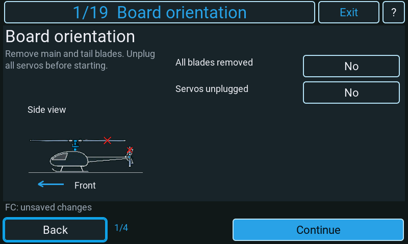

**2. Receiver** (the receiver card with its settings locked behind *Advanced*, and the guided stick check once every control reached both end stops)

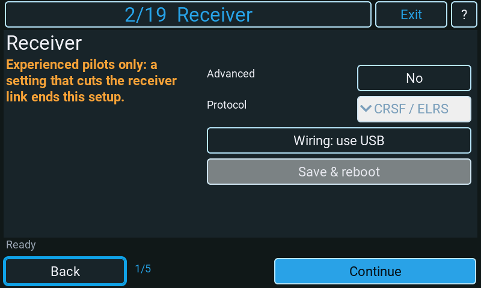
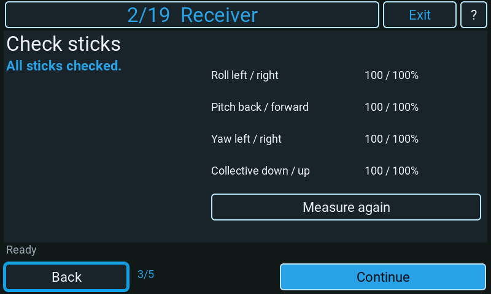

**3. Mode switches** (first card)

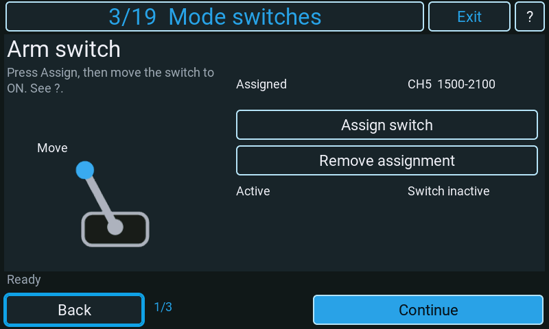

**4. Profiles & gain** (first card, after the profile switch was detected)

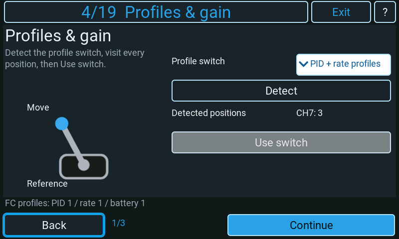

**5. Rates** (first card, after *Suggest profiles 1-3*)

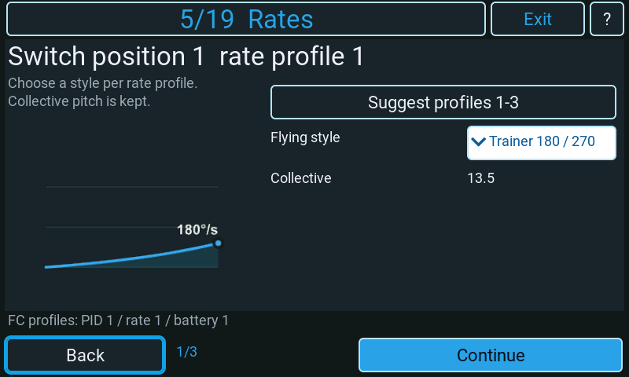

**6. Swashplate** (first card)

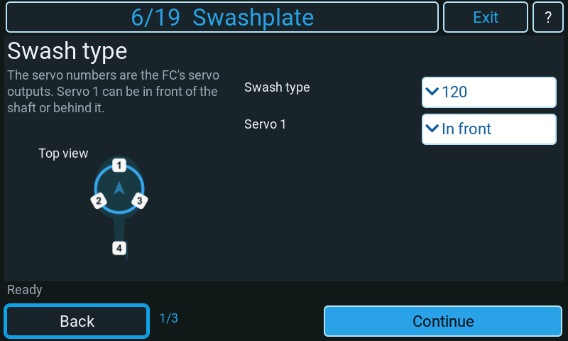

**7. Servo type** (first card)

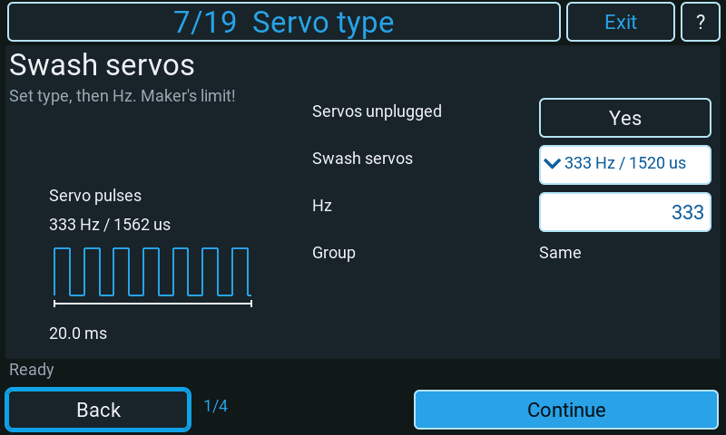

**8. Governor** (first card)

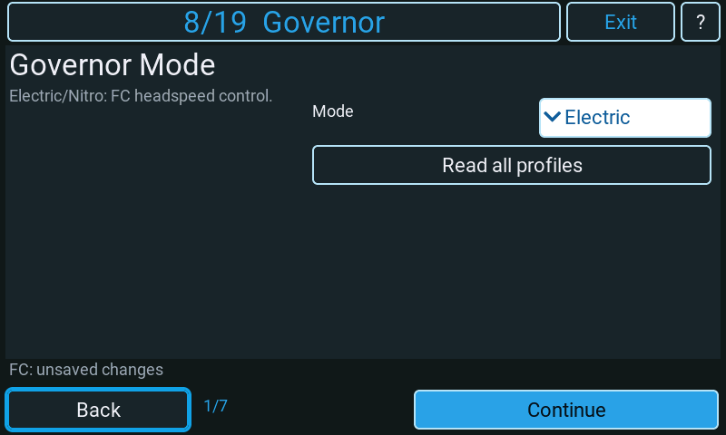

**9. Motor & ESC** (first card)

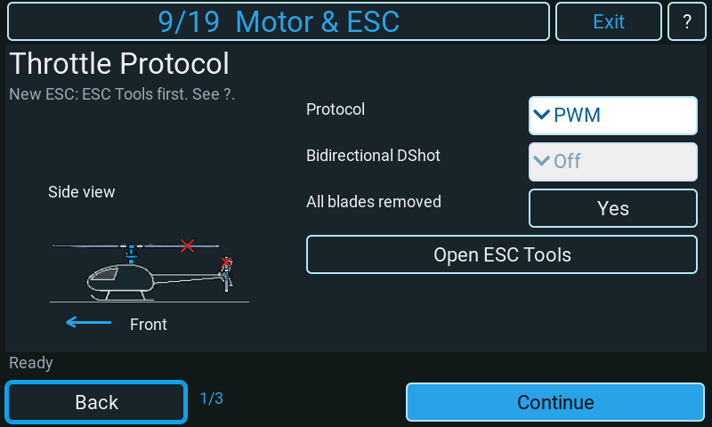

**10. Connect the servos** (first card, both checks answered)

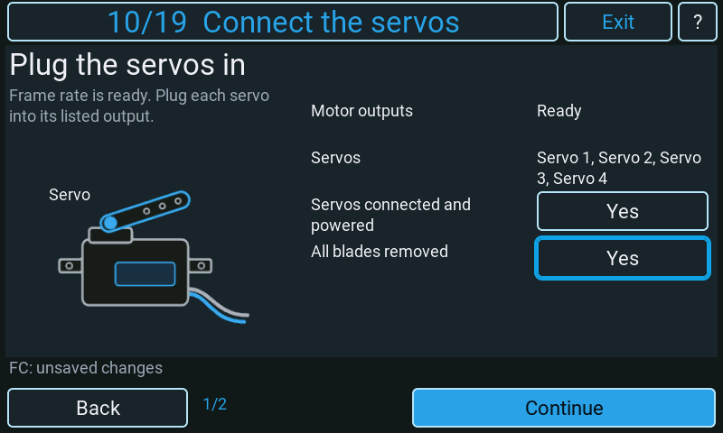

**11. ESC telemetry** (the protocol card, after the battery-connection card)

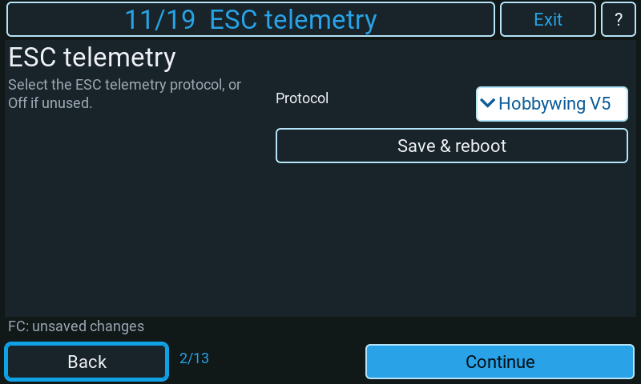

**12. ESC & spin test** (PWM ESC after its calibration, the main motor held at 10 %)

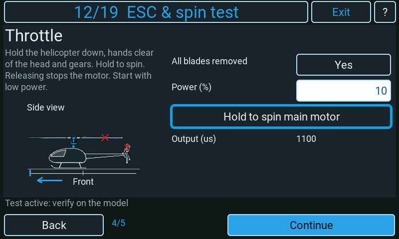

**13. Servo direction & centre** (the servos held at centre, before a direction test)

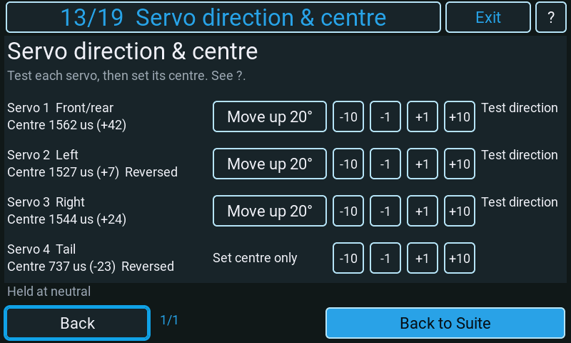

**14. Control directions** (first card, roll test active with the stick centred)

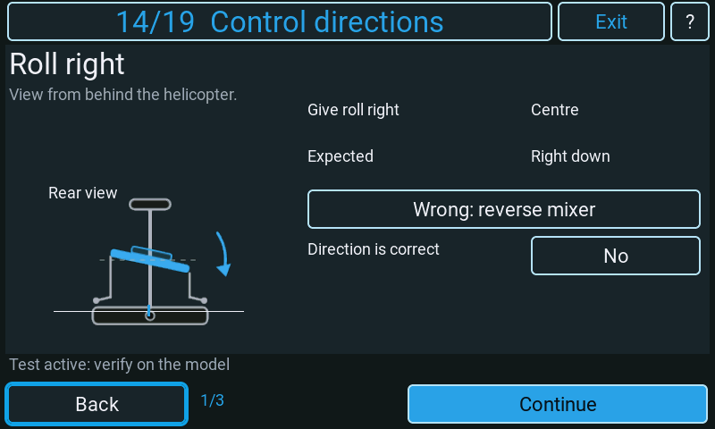

**15. Level the swash** (first card)

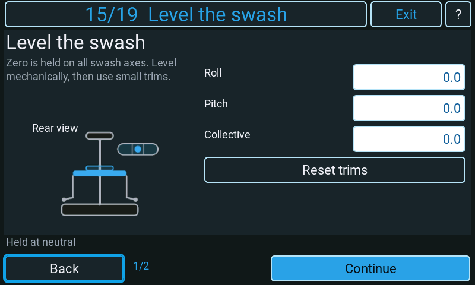

**16. Blade pitch** (first card)

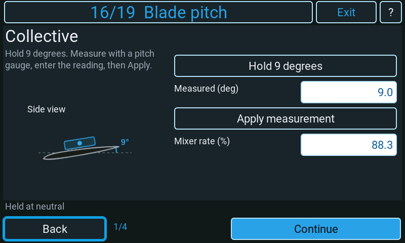

**17. Tail rotor** (the 22.5° pitch calibration card)

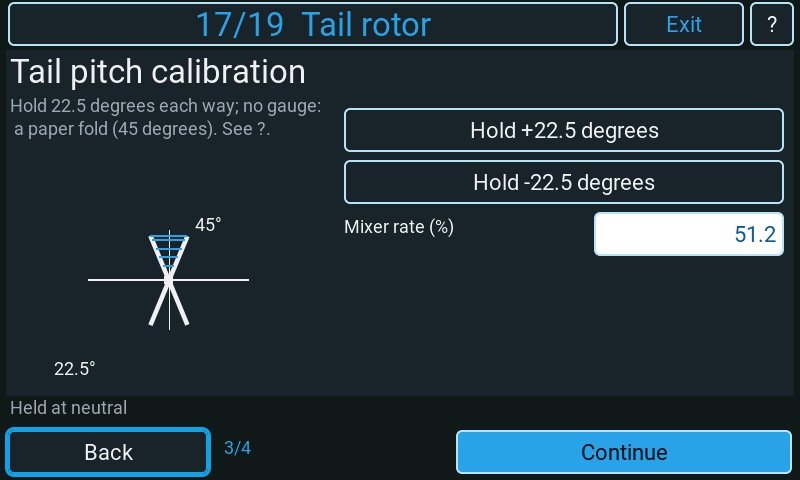

**18. Gyro check** (first card)

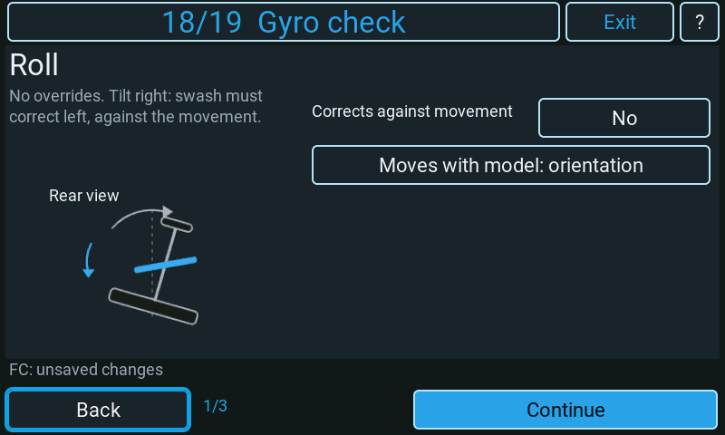

**19. Finish** (the summary card with the final checks answered)

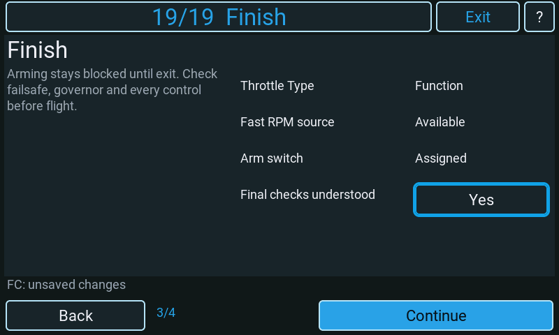

<!-- radio pictures: end -->

## Completion history and prerequisites

The Suite stores a small history for each connected FC's MCU identity. A step is
recorded only after its required answers and successful settings save; incomplete,
discarded or failed steps are not marked. A former completion is shown as
**Completed before. Check again.** It never supplies a physical answer or skips a
preparation, direction, blades-off, arming-lock or restart check.

If related earlier steps have no recorded completion, a short footer hint gives the
count and **?** lists them. These are advisory dependencies: for example receiver
mapping before modes, swash/servo type/connection before servo centring, and
control directions/levelling before pitch measurement. A correctly configured FC
may have been set up elsewhere. History does not prove the current FC settings or
mechanics, and does not block such a model merely because no visit is recorded.

**Setup history** shows the recorded count. Select **Clear this FC history**, then
**Reset history**, to clear all 19 markers for that FC. It changes no FC settings,
transmitter settings, other FC's history or old Setup Assistant data. Readable FC
identity and a connected, disarmed model are required. This page reads only the
arming status needed to keep the visit locked; resetting never writes FC EEPROM.

An unwritable card or failed record readback reports that history was not saved.
Retry is explicit. For a completed setup step, **Continue without history** finishes
the action without claiming a stored completion. Back cancels that notice without
advancing. Unreadable history must be explicitly reset before it can record more
steps. Records are separate, versioned files under `rfsuite.user/wizard-history/`.

## Loading and live feedback

Startup reads adjustment ranges and servo settings one indexed record per request.
The progress text updates in place while loading. The larger USB bulk replies do
not fit the firmware telemetry response buffer and are never requested here.

When live System Status (`STAT`) or System Config (`SCFG`) telemetry is available,
the footer can show FC saving, unsaved changes, restart needed, active override,
missing receiver link, accelerometer calibration or active PID/rate/battery profiles.
Specific operation messages, errors and permanent-override warnings take priority.
Missing or stale packed words add no hint and do not prevent normal MSP operation.
Their values never acknowledge a save, clear a local restart requirement or replace
the fresh MSP arming-lock check. EdgeTX can retain per-sensor current status for up
to 20 seconds; treat these as supplementary observations.

## Overrides, connection loss and saving

MSP_ARMING_DISABLE blocks arming while the page is open and is asserted again after
a restart. The MSP arming-disable flag is independently read back before controls
are enabled and checked throughout the visit. Servo, mixer and motor overrides are explicitly released on each task/step
exit and on page teardown. Leaving drops unsent override keepalives. Configuration
writes are acknowledged before EEPROM and before moving to the next step.

Timeout support is **probed independently** for servo and mixer commands, never
inferred from API 12.10. An OFF request with a valid five-byte timeout payload must
succeed and an invalid four-byte OFF payload must be explicitly refused. A timeout
does not prove support. Firmware that ignores trailing bytes therefore stays on
legacy three-byte holds. Supported holds use a 3000 ms timeout; releases always
use the legacy payload. Motor overrides retain the fixed one-second expiry.

Leaving a task waits for OFF acknowledgements before another hold can start.
Normal exit restores arming availability only after confirmed cleanup and
Save/Discard. Failed cleanup keeps arming disabled and offers explicit retry.
On link loss, Back explains that the FC must be powered off before leaving:
permanent overrides cannot be released over a missing link. Reconnect allows
cleanup to resume for the same FC.

An externally interrupted visit retains the FC's arming lock. On reopening in the
same Suite session, a recovery gate asks for an FC power cycle before continuing;
this clears permanent overrides and unsaved RAM changes. Power-cycle the FC after
an unexpected tool/widget termination even if the radio has also restarted.
The Suite's independent ARMED banner remains visible above the wizard's frame.

Back across a dirty step asks to save or discard before loading another step, so
profile-specific changes retain their originating commit. Discard clears pending
pitch/rate drafts. ESC calibration has its own fresh blades-removed confirmation;
reloading configuration invalidates all physical answers.

Do not switch helicopters during a visit. The wizard binds itself to the FC identity.
An armed transition, lost connection, refused operation or malformed response blocks
progress; it does not report a successful save. Retry is an explicit action.
Returning to a physical-check step requires fresh answers.

The connection gate batches the initial restart. Receiver wiring and later ESC
telemetry can need their own restart, as in the Configurator sequence. Unsupported
automatic wiring/alignment commands do not prevent using the manual settings.
If automatic board alignment is refused, the status line explicitly asks for the
angles to be entered manually; that refusal does not change the current angles.

## Feedback and detailed settings

Governor headspeed and ramp cards appear only in **Electric** and **Nitro**, where
the FC governs. All editors start with values read from the FC. One headspeed card
is offered for each PID profile selected by the Profiles & gain adjustment range,
bounded by the configured positions (at most three) and the FC profile count.
Without a known assignment, only PID profile 1 is offered. Entry reads only the
active profile without switching profiles; other targets show **--** until
**Read all profiles** is pressed. That button runs the sequential read and restores
the active profile. Save uses the same transaction for edited targets only.
The native wizard editor retains exact RPM
values, including values between the Governor page's 10-RPM increments.

- **Full headspeed (rpm)**: Full-throttle target for the named PID profile, 0–30000 RPM; no recommended target is substituted.
- **Spoolup time**: Time to reach headspeed, 0–60.0 seconds in 0.1-second increments.
- **Spooldown time**: Time to reduce headspeed, 0–60.0 seconds in 0.1-second increments.
- **Recovery time**: Time to recover headspeed, 0–10.0 seconds in 0.1-second increments.
- **RPM source**: Frequency sensor or bidirectional DShot for the governor and RPM filter. The card also appears with governor Off when RPM filtering is enabled.
- **RPM filter**: A separate warning card says when filtering has no selected RPM source. Choose a source here or turn RPM filtering off on the Filters page. The wizard never changes filter settings.

The suite's Filters page calls preset zero **CUSTOM**, not Off. Low/Medium/High
presets enable RPM filtering; CUSTOM needs a signal if any of its 16 notch sources
on any of the three axes is nonzero. With all custom sources zero it is off. Filter
configuration and custom notches are read once after entering the governor step;
they add no MSP work to scene construction or the startup read chain. The warning
applies in Off, Limit, Direct, Electric and Nitro. Selecting a source still requires
Save and reboot; existing status feedback remains the FC/configuration verdict.

Test buttons show when a held command is active; pressing a servo/mixer test again
returns it to neutral. Motor controls are momentary and remain disabled until the
required preparation and output checks pass. The status line distinguishes staged
changes, live edits, pending restart, running detection and a found combination.
A successful wiring trial changes Continue to **Save & reboot**. Cancel restores
the previous wiring flags. No ESC data is labelled as received until voltage or
temperature confirms reception.

The profile/gain cards show the existing assignments, the current mapped profile
and knob/button feedback, followed by a paginated channel-use plan. For the trim
method, create a spare channel with a MAX source at 100% when no button is pressed.
Add replacement mix actions for cyclic down/up at 30/40%, yaw down/up at 50/60%,
and disable those trims' effect on the flight sticks. The guide lists the expected
channel values. Confirm each button in the live feedback before flying.

For detailed adjustments beyond the guided fields, save and leave the wizard,
then use the Suite's Receiver, Modes, Adjustments, Rates, Mixer, Servos, Governor,
Motor or Power pages. The wizard's **?** opens the complete current task text.
It does not jump out of an active bench test through a web-style tab shortcut.

## Session Logs

For troubleshooting, the wizard writes short English lines under the tag
`rfsuite.helicopter_setup` once *Debug Level* in the developer settings is *INFO* or higher; at
*OFF* it writes nothing. *INFO* records loading (start, ready, or the error with the MSP name
and reason), each step and card entered, every change of the status line as it is shown (the
wizard's own messages, the flight controller hints and the cleanup and recovery notices) by its
label key, where a line filled in from a template is named by the template's key, a refused
tail pin move with the firmware's result code, save, discard, live writes, restart and
reconnect, and closing. *DEBUG* adds the picture file shown, the helpers loaded and released on
demand, and whether a step's cards were reused or built anew. The lines appear under *Session
Logs* and, with *Log Session To Card* on, in the card log; the level is read when the wizard
opens.

## Implementation and verification

[Artwork sources and PNG export workflow](../developer/helicopter-wizard-artwork.md)
describe the illustration collection maintained alongside the wizard.

The reference is [Configurator PR #491](https://github.com/rotorflight/rotorflight-configurator/pull/491),
snapshot `b8f0eca5a73e8ea00a21a8122a8f7029ad705ee7`. Timeout/tail-output semantics follow
[firmware PR #541](https://github.com/rotorflight/rotorflight-firmware/pull/541).
The sequence is fixed; conditional variants stay inside their steps.

API loads, reply decoding, indexed writes, profile transactions and scene assembly
are resumed across calls. MSP replies update cached values; they do not rebuild LVGL.
Reactive properties read cached page state. `bin/wizard/verify.lua` exercises the
protocol, failure paths, lifecycle, geometry and per-call instruction costs without
starting an EdgeTX or flight-controller simulator.
The previously published native tree remains valid while a replacement scene is
staged. Its getters tolerate navigation, reload, discarded rate drafts and teardown;
controls from a replaced card cannot edit the new step. Regression checks retain
every old card across these transitions at all four supported preview sizes.
Consumed MSP batches are released when a new idle batch starts, keeping completed
polling jobs from accumulating throughout a visit.
Completion history uses a separate versioned Lua data file per FC under
`rfsuite.user/wizard-history/`. Each record is read directly within 64 bytes;
compiled overlays are ignored. Unreleased text records are ignored; there is no
text-format migration or compatibility path.

[Source-to-port coverage and deliberate adaptations](../reference/helicopter-wizard-source-coverage.md)
record the function inventory, behavior contracts and independent golden vectors.

The preview images are approximate renders of the actual scene definitions, using
desktop fonts. They are not native EdgeTX screenshots or radio acceptance evidence.

[Compact live orientation](../images/helicopter_setup/01-small-task-4.png) ·
[Compact roll movement](../images/helicopter_setup/motion-attitude-roll-small.gif) ·
[Compact pitch movement](../images/helicopter_setup/motion-attitude-pitch-small.gif) ·
[800×480 orientation](../images/helicopter_setup/01-large-task-4.png) ·
[Swash layout](../images/helicopter_setup/06-small.png) ·
[Rotor direction](../images/helicopter_setup/06-small-task-2.png) ·
[Tail](../images/helicopter_setup/06-small-task-3.png) ·
[Swashplate set](../images/helicopter_setup/06-small-task-4.png)

[Switches done](../images/helicopter_setup/03-small-task-3.png) ·
[Rates set](../images/helicopter_setup/05-small-task-2.png) ·
[800×480 stick check](../images/helicopter_setup/02-large-task-3.png)

[Stick check](../images/helicopter_setup/02-small-task-3.png) ·
[Throttle-switch endpoints](../images/helicopter_setup/02-small-task-4.png) ·
[Swash servo type](../images/helicopter_setup/07-small.png) ·
[Tail servo type](../images/helicopter_setup/07-small-task-2.png) ·
[Servos with no type](../images/helicopter_setup/07-small-task-type-none.png)

[480×272 illustrated tasks](../images/helicopter_setup/illustrations-small.png) ·
[800×480 illustrated tasks](../images/helicopter_setup/illustrations-large.png)

[Small-display preview sheet](../images/helicopter_setup/overview-small.png) ·
[Large-display preview sheet](../images/helicopter_setup/overview-large.png)

*Documented against RFSuite 0.2.1. Physical-radio acceptance remains required.*
