# Helicopter wizard flow

Generated by bin/wizard/flow.py - do not edit by hand.

The diagram follows the current model card and all 19 steps in controller order. Cards built by loops or runtime conditions are templates: alternatives can appear together here. Full source expressions and Configurator references are in [the JSON model](helicopter-wizard-flow.json).

Legend: blue = pilot sets; green = read; orange = pilot confirms; red = MSP write; grey = gate. A dashed purple border means **differs from the Configurator** or **beyond the Configurator** as recorded in source-map.json; a thin grey border means the mapped flow is the same. Each card is one node, colored by its strongest kind: write, confirms, sets, read, then gate. Details name up to three action groups; long lists end in "...". Diamonds mark conditional step validation; simple confirmation gates use a final "blocks until" line. Arrows between cards show source order, including conditional alternatives, rather than callback execution order.

```mermaid
flowchart LR
  subgraph A["Phase A"]
    direction TB
    subgraph S0["Model: Prepare the radio model"]
      direction TB
      S0c0["<b>Interrupted session</b><br/>confirms: FC power-cycled"]:::k2
      class S0c0 deviation
      S0c1["<b>Prepare the radio model</b><br/>sets: FC name<br/>confirms: Model checked<br/>writes: name.name, telemetry_config, telemetr..."]:::k3
      class S0c1 deviation
      S0c0 --> S0c1
    end
    subgraph S1["1. Board orientation"]
      direction TB
      S1c0["<b>Board orientation</b><br/>confirms: All blades removed, Servos unplugged<br/>reads: MSP status, MSP attitude, MSP servo"]:::k2
      S1c1["<b>Calibrate the accelerometer</b><br/>reads: Accelerometer, Calibrated<br/>writes: acc_calibration"]:::k3
      S1c0 --> S1c1
      S1c2["<b>Board orientation</b><br/>sets: Roll, Pitch, Yaw<br/>reads: MSP board_auto_align (trial)<br/>writes: board_auto_align, board_alignment_config"]:::k3
      S1c1 --> S1c2
      S1c3["<b>Check orientation</b><br/>confirms: Direction is correct<br/>blocks until: Direction is correct"]:::k2
      S1c2 --> S1c3
    end
    S0 --> S1
    subgraph S2["2. Receiver"]
      direction TB
      S2c0["<b>Receiver</b><br/>sets: Protocol, Advanced<br/>reads: MSP status, MSP servo, MSP rx_channels<br/>writes: rx_config, feature_config"]:::k3
      S2c1["<b>Channel order</b><br/>sets: Standard channel order<br/>writes: rx_map"]:::k3
      S2c0 --> S2c1
      S2c2["<b>Check sticks</b>"]:::k4
      S2c1 --> S2c2
      S2c3["<b>Throttle range</b><br/>sets: Minimum (us), Maximum (us)<br/>reads: Throttle<br/>writes: rc_config.rc_min_throttle, rc_config...."]:::k3
      S2c2 --> S2c3
      S2c4["<b>ELRS link</b><br/>reads: Status"]:::k1
      S2c3 --> S2c4
      S2gate{"Advance?<br/>validation passes"}:::k4
      S2c4 --> S2gate
      S2gate -->|blocked| S2gate
    end
    S1 --> S2
    subgraph S3["3. Mode switches"]
      direction TB
      S3c0["<b>Arm switch</b><br/>reads: Assigned, MSP status, MSP rc, MSP servo<br/>writes: mode_ranges, set_mode_range, set_adju..."]:::k3
      S3c1["<b>Rescue switch</b><br/>reads: Assigned"]:::k1
      S3c0 --> S3c1
      S3c2["<b>Trainer switch</b><br/>reads: Assigned"]:::k1
      S3c1 --> S3c2
      S3c3["<b>Switches done</b>"]:::k4
      S3c2 --> S3c3
      S3gate{"Advance?<br/>validation passes"}:::k4
      S3c3 --> S3gate
      S3gate -->|blocked| S3gate
    end
    S2 --> S3
    subgraph S4["4. Profiles #amp; gain"]
      direction TB
      S4c0["<b>Profiles #amp; gain</b><br/>sets: Profile switch<br/>reads: Detected positions, MSP status, MSP r...<br/>writes: adjustment_ranges, set_adjustment_range"]:::k3
      S4c1["<b>Master gain</b><br/>sets: Method<br/>reads: Channel, Gain now"]:::k0
      S4c0 --> S4c1
      S4c2["<b>Trim-button guide</b><br/>reads: Cyclic gain down, Cyclic gain up, Yaw..."]:::k1
      S4c1 --> S4c2
      S4c3["<b>Channel use</b><br/>reads: Profile now, Receiver channels, CH{n}"]:::k1
      S4c2 --> S4c3
      S4c4["<b>Channel use</b>"]:::k4
      S4c3 --> S4c4
    end
    S3 --> S4
    subgraph S5["5. Rates"]
      direction TB
      S5c0["<b>Switch position {n} · rate profile {n} / Rate p…</b><br/>reads: MSP rc_tuning, MSP status, MSP servo<br/>writes: set_pid_profile, rc_tuning"]:::k3
      S5c1["<b>Rates set</b>"]:::k4
      S5c0 --> S5c1
    end
    S4 --> S5
  end
  subgraph B["Phase B"]
    direction TB
    subgraph S6["6. Swashplate"]
      direction TB
      S6c0["<b>Swash type</b><br/>sets: Swash type, Servo 1<br/>reads: MSP governor_profile, MSP status, MSP...<br/>writes: tail_motor_output, mixer_input, mixer..."]:::k3
      S6c1["<b>Rotor direction</b><br/>sets: Rotor direction<br/>writes: mixer_config.main_rotor_dir"]:::k3
      S6c0 --> S6c1
      S6c2["<b>Tail type</b><br/>sets: Tail type<br/>reads: Tail output, Tail servo<br/>writes: mixer_config.tail_rotor_mode"]:::k3
      S6c1 --> S6c2
      S6c3["<b>Swashplate set</b><br/>reads: Swash type, Rotor direction, Tail typ..."]:::k1
      S6c2 --> S6c3
    end
    subgraph S7["7. Servo type"]
      direction TB
      S7c0["<b>Swash servos</b><br/>sets: Geometry correction<br/>confirms: Servos unplugged<br/>writes: servo_configurations"]:::k3
      S7c1["<b>Tail servo</b><br/>sets: Geometry correction<br/>confirms: Servos unplugged<br/>writes: servo_configurations, servo_configura..."]:::k3
      S7c0 --> S7c1
      S7c2["<b>Servo type</b><br/>sets: Swash servos, Tail servo<br/>reads: Servo"]:::k0
      S7c1 --> S7c2
    end
    S6 --> S7
    subgraph S8["8. Governor"]
      direction TB
      S8c0["<b>Governor Mode</b><br/>sets: Mode<br/>reads: MSP filter_config, MSP rpm_filter_v2...<br/>writes: governor_config, feature_config, set_..."]:::k3
      class S8c0 deviation
      S8c1["<b>RPM source</b><br/>sets: RPM source<br/>reads: Status<br/>writes: feature_config.enabledFeatures, motor..."]:::k3
      S8c0 --> S8c1
      S8c2["<b>RPM filter</b>"]:::k4
      class S8c2 deviation
      S8c1 --> S8c2
      S8c3["<b>Throttle Type</b><br/>sets: Throttle Type<br/>writes: governor_config.gov_throttle_type"]:::k3
      S8c2 --> S8c3
      S8c4["<b>PID profile {n}</b><br/>sets: Full headspeed (rpm)<br/>reads: MSP governor_profile<br/>writes: governor_profile"]:::k3
      class S8c4 deviation
      S8c3 --> S8c4
      S8c5["<b>Ramp Time</b><br/>sets: Spoolup time, Spooldown time, Recover...<br/>reads: governor_config.gov_spoolup_time, gov...<br/>writes: governor_config.gov_spoolup_time, gov..."]:::k3
      class S8c5 deviation
      S8c4 --> S8c5
    end
    S7 --> S8
    subgraph S9["9. Motor #amp; ESC"]
      direction TB
      S9c0["<b>Throttle Protocol</b><br/>sets: Bidirectional DShot, Protocol<br/>confirms: All blades removed<br/>writes: motor_config, esc_sensor_config, feat..."]:::k3
      S9c1["<b>Motor and gearing</b><br/>sets: Main motor poles, Motor pinion teeth...<br/>reads: Reduction ratio<br/>writes: motor_config.motor_pole_count_0, moto..."]:::k3
      S9c0 --> S9c1
      S9c2["<b>Motor and gearing (cont.)</b><br/>sets: Tail motor poles, Tail input gear tee...<br/>writes: motor_config.motor_pole_count_1, moto..."]:::k3
      S9c1 --> S9c2
    end
    S8 --> S9
    subgraph S10["10. Connect the servos"]
      direction TB
      S10c0["<b>Connect the servos</b><br/>confirms: Servos unplugged<br/>reads: Reboot, MSP status, MSP servo, MSP motor"]:::k2
      S10c1["<b>Plug the servos in</b><br/>confirms: Servos connected and powered, All bla...<br/>reads: Motor outputs, Servos"]:::k2
      S10c0 --> S10c1
      S10c2["<b>Battery</b>"]:::k4
      S10c1 --> S10c2
      S10gate{"Advance?<br/>validation passes<br/>Servos unplugged, Servos connected an..."}:::k4
      S10c2 --> S10gate
      S10gate -->|blocked| S10gate
    end
    S9 --> S10
  end
  subgraph C["Phase C"]
    direction TB
    subgraph S11["11. ESC telemetry"]
      direction TB
      S11c0["<b>Connect the battery</b><br/>reads: MSP motor_config, esc_parameters_yge....<br/>writes: serial_config, esc_sensor_config, fea..."]:::k3
      class S11c0 deviation
      S11c1["<b>ESC telemetry</b><br/>sets: Protocol<br/>reads: esc_sensor_config.protocol<br/>writes: esc_sensor_config.protocol"]:::k3
      class S11c1 deviation
      S11c0 --> S11c1
      S11c2["<b>Port</b><br/>sets: Port<br/>writes: serial_config.port_{n}_function_mask"]:::k3
      class S11c2 deviation
      S11c1 --> S11c2
      S11c3["<b>Check</b><br/>reads: Voltage, Temperature, MSP esc_sensor_...<br/>writes: esc_sensor_trial"]:::k3
      class S11c3 deviation
      S11c2 --> S11c3
      S11c4["<b>Telemetry readings</b><br/>reads: Current, RPM, Active, Protocol"]:::k1
      class S11c4 deviation
      S11c3 --> S11c4
      S11c5["<b>Voltage Source</b><br/>sets: Voltage Source<br/>reads: Voltage / Current, battery_config.vol...<br/>writes: battery_config.voltageMeterSource, ba..."]:::k3
      class S11c5 deviation
      S11c4 --> S11c5
      S11c6["<b>Current Source</b><br/>sets: Current Source<br/>reads: Current, battery_config.currentMeterS...<br/>writes: battery_config.currentMeterSource"]:::k3
      class S11c6 deviation
      S11c5 --> S11c6
      S11c7["<b>Battery</b><br/>sets: Cell count<br/>reads: Cell count, Selected, battery_config....<br/>writes: battery_config.{cellKey}, battery_con..."]:::k3
      class S11c7 deviation
      S11c6 --> S11c7
      S11c8["<b>Capacity</b><br/>writes: battery_config.batteryCapacity"]:::k3
      class S11c8 deviation
      S11c7 --> S11c8
      S11c9["<b>Capacity</b><br/>writes: battery_config.batteryCapacity"]:::k3
      class S11c9 deviation
      S11c8 --> S11c9
      S11c10["<b>Capacity</b><br/>sets: Battery, Capacity<br/>reads: battery_config.batteryCapacity<br/>writes: battery_config"]:::k3
      class S11c10 deviation
      S11c9 --> S11c10
      S11c11["<b>SmartFuel Mode</b><br/>sets: Firmware Source<br/>reads: smartfuel_config.smartfuel_mode<br/>writes: smartfuel_config.smartfuel_mode"]:::k3
      class S11c11 deviation
      S11c10 --> S11c11
      S11c12["<b>Throttle range</b><br/>sets: How is the ESC&#35;x27;s throttle range set?<br/>reads: MSP motor_config<br/>writes: motor_config"]:::k3
      class S11c12 deviation
      S11c11 --> S11c12
      S11c13["<b>Throttle range</b><br/>confirms: I confirm the ESC range is set"]:::k2
      class S11c13 deviation
      S11c12 --> S11c13
      S11c14["<b>ESC parameter link</b>"]:::k4
      class S11c14 deviation
      S11c13 --> S11c14
      S11c15["<b>Restart the ESC</b><br/>confirms: Battery unplugged and reconnected"]:::k2
      class S11c15 deviation
      S11c14 --> S11c15
      S11c16["<b>ESC operating mode</b><br/>sets: Expected ESC mode<br/>reads: Current ESC mode"]:::k0
      class S11c16 deviation
      S11c15 --> S11c16
      S11c17["<b>ESC parameter link</b><br/>reads: Current ESC mode"]:::k1
      class S11c17 deviation
      S11c16 --> S11c17
      S11c18["<b>Current ESC values</b><br/>reads: ESC model, ESC firmware, Stick zero (..."]:::k1
      class S11c18 deviation
      S11c17 --> S11c18
      S11c19["<b>Throttle range</b><br/>sets: Minimum pulse (us), Maximum pulse (us)<br/>reads: Stop pulse (us)"]:::k0
      class S11c19 deviation
      S11c18 --> S11c19
      S11gate{"Advance?<br/>validation passes"}:::k4
      class S11gate deviation
      S11c19 --> S11gate
      S11gate -->|blocked| S11gate
    end
    subgraph S12["12. ESC #amp; spin test"]
      direction TB
      S12c0["<b>Full throttle</b><br/>sets: Power (%)<br/>confirms: All blades removed<br/>writes: motor_override.index, motor_override...."]:::k3
      class S12c0 deviation
      S12c1["<b>Connect the battery</b>"]:::k4
      class S12c1 deviation
      S12c0 --> S12c1
      S12c2["<b>Low throttle</b><br/>reads: Output (us)"]:::k1
      class S12c2 deviation
      S12c1 --> S12c2
      S12c3["<b>Connect the battery</b>"]:::k4
      class S12c3 deviation
      S12c2 --> S12c3
      S12c4["<b>Throttle</b><br/>confirms: All blades removed"]:::k2
      class S12c4 deviation
      S12c3 --> S12c4
      S12c5["<b>Main rotor direction</b><br/>confirms: Direction is correct<br/>blocks until: Direction is correct"]:::k2
      class S12c5 deviation
      S12c4 --> S12c5
    end
    S11 --> S12
  end
  subgraph D["Phase D"]
    direction TB
    subgraph S13["13. Servo direction #amp; centre"]
      direction TB
      S13c0["<b>Servo arms</b><br/>confirms: Servo arms<br/>reads: MSP status, MSP servo<br/>writes: servo_configurations, servo_override"]:::k3
      S13c1["<b>{c . title .. #quot; #quot; .. c . role}</b>"]:::k4
      S13c0 --> S13c1
      S13c2["<b>{nil . title .. #quot; #quot; .. nil . role}</b>"]:::k4
      S13c1 --> S13c2
      S13gate{"Advance?<br/>validation passes"}:::k4
      S13c2 --> S13gate
      S13gate -->|blocked| S13gate
    end
    subgraph S14["14. Control directions"]
      direction TB
      S14c0["<b>Roll right</b><br/>confirms: Direction is correct<br/>reads: Give roll right, Expected, MSP status...<br/>writes: mixer_input, mixer_input.rate, mixer_..."]:::k3
      S14c1["<b>Pitch forward</b><br/>confirms: Direction is correct<br/>reads: Give pitch forward, Expected"]:::k2
      S14c0 --> S14c1
      S14c2["<b>Collective up</b><br/>confirms: Direction is correct<br/>reads: Give collective up, Expected<br/>blocks until: Direction is correct"]:::k2
      S14c1 --> S14c2
    end
    S13 --> S14
    subgraph S15["15. Level the swash"]
      direction TB
      S15c0["<b>Level the swash</b><br/>sets: Roll, Pitch, Collective<br/>reads: MSP status, MSP servo<br/>writes: mixer_config, mixer_override"]:::k3
      S15c1["<b>Check swash level</b><br/>confirms: Swash is level<br/>blocks until: Swash is level"]:::k2
      S15c0 --> S15c1
    end
    S14 --> S15
    subgraph S16["16. Blade pitch"]
      direction TB
      S16c0["<b>Collective</b><br/>sets: Measured (deg), Mixer rate (%)<br/>reads: MSP rc_tuning, MSP status, MSP servo<br/>writes: mixer_input, mixer_override, set_pid_..."]:::k3
      S16c1["<b>Cyclic</b><br/>sets: Measured (deg), Mixer rate (%)<br/>writes: mixer_input, mixer_input.rate"]:::k3
      S16c0 --> S16c1
      S16c2["<b>Blade pitch limits</b><br/>sets: Cyclic (deg), Collective (deg), Total...<br/>writes: mixer_input, mixer_config"]:::k3
      S16c1 --> S16c2
      S16c3["<b>Full-stick collective</b><br/>sets: Degrees<br/>writes: rc_tuning<br/>blocks until: Full travel without binding"]:::k3
      S16c2 --> S16c3
    end
    S15 --> S16
    subgraph S17["17. Tail rotor"]
      direction TB
      S17c0["<b>Tail rotor</b><br/>sets: Power (%)<br/>confirms: All blades removed<br/>writes: motor_override, mixer_override, mixer..."]:::k3
      S17c1["<b>Tail motor idle</b><br/>sets: Idle (%)<br/>writes: mixer_config.tail_motor_idle"]:::k3
      S17c0 --> S17c1
      S17c2["<b>Tail centre</b><br/>sets: Centre trim (deg)<br/>confirms: Tail neutral pitch checked<br/>writes: mixer_config.tail_center_trim"]:::k3
      S17c1 --> S17c2
      S17c3["<b>Tail control direction</b><br/>confirms: Direction is correct<br/>reads: Give yaw right"]:::k2
      S17c2 --> S17c3
      S17c4["<b>Tail pitch calibration</b><br/>sets: Mixer rate (%)<br/>writes: mixer_input, mixer_input.rate"]:::k3
      S17c3 --> S17c4
      S17c5["<b>Tail pitch limits</b><br/>sets: CW limit (deg), CCW limit (deg)<br/>writes: mixer_input<br/>blocks until: Tail neutral pitch checked, Direction..."]:::k3
      S17c4 --> S17c5
    end
    S16 --> S17
    subgraph S18["18. Gyro check"]
      direction TB
      S18c0["<b>Roll</b><br/>confirms: Corrects against movement<br/>reads: MSP status, MSP servo"]:::k2
      S18c1["<b>Pitch</b><br/>confirms: Corrects against movement"]:::k2
      S18c0 --> S18c1
      S18c2["<b>Yaw</b><br/>confirms: Corrects against movement<br/>blocks until: Corrects against movement"]:::k2
      S18c1 --> S18c2
    end
    S17 --> S18
    subgraph S19["19. Finish"]
      direction TB
      S19c0["<b>Finish</b><br/>reads: Swash type, Rotor direction, Tail typ..."]:::k1
      S19c1["<b>Finish</b><br/>reads: Cyclic (deg), Protocol, ESC telemetry..."]:::k1
      S19c0 --> S19c1
      S19c2["<b>Finish</b><br/>confirms: Final checks understood<br/>reads: Throttle Type, Fast RPM source, Arm s..."]:::k2
      S19c1 --> S19c2
      S19c3["<b>Finish</b><br/>reads: Throttle range<br/>blocks until: Final checks understood"]:::k1
      S19c2 --> S19c3
    end
    S18 --> S19
  end
  A --> B --> C --> D
  classDef k0 fill:#dbeafe,stroke:#9ca3af,stroke-width:1px
  classDef k1 fill:#dcfce7,stroke:#9ca3af,stroke-width:1px
  classDef k2 fill:#ffedd5,stroke:#9ca3af,stroke-width:1px
  classDef k3 fill:#fee2e2,stroke:#9ca3af,stroke-width:1px
  classDef k4 fill:#f3f4f6,stroke:#9ca3af,stroke-width:1px
  classDef deviation stroke:#7e22ce,stroke-width:2px,stroke-dasharray:5 3
```

MSP writes include deferred dirty records and immediate commands. The inventory below lists source-level writes; the JSON retains each originating expression. MSP reads here distinguish step-triggered reads from the shared startup/poll transport.

| Step | Cards | Pilot sets | Pilot confirms | MSP reads | MSP writes | Configurator status |
| --- | --- | --- | --- | --- | --- | --- |
| Model. Prepare the radio model | Interrupted session Prepare the radio model | FC name | FC power-cycled Model checked | — | name.name telemetry_config telemetry_config.buffer | differs from the Configurator |
| 1. Board orientation | Board orientation Calibrate the accelerometer Check orientation | Roll Pitch Yaw | All blades removed Servos unplugged Direction is correct | status attitude servo board_auto_align | acc_calibration board_auto_align board_alignment_config.roll_degrees board_alignment_config.pitch_degrees board_alignment_config.yaw_degrees | same |
| 2. Receiver | Receiver Channel order Check sticks Throttle range ELRS link | Protocol Advanced Standard channel order Minimum (us) Maximum (us) | — | status servo rx_channels | rx_config.serialrx_provider rx_config feature_config feature_config.enabledFeatures rx_map rc_config.rc_min_throttle rc_config.rc_max_throttle | same |
| 3. Mode switches | Arm switch Rescue switch Trainer switch Switches done | — | — | status rc servo | mode_ranges set_mode_range set_adjustment_range | same |
| 4. Profiles & gain | Profiles & gain Master gain Trim-button guide Channel use | Profile switch Method | — | status rc servo | adjustment_ranges set_adjustment_range | same |
| 5. Rates | Switch position {n} · rate profile {n} / Rate profile {n} Rates set | — | — | rc_tuning status servo | set_pid_profile rc_tuning | same |
| 6. Swashplate | Swash type Rotor direction Tail type Swashplate set | Swash type Servo 1 Rotor direction Tail type | — | governor_profile status servo | tail_motor_output.action mixer_input mixer_config.swash_type mixer_input.rate set_pid_profile governor_profile governor_profile.governor_tta_gain mixer_config.main_rotor_dir mixer_config.tail_rotor_mode | same |
| 7. Servo type | Swash servos Tail servo Servo type | Geometry correction Swash servos Tail servo | Servos unplugged | status servo | servo_configurations servo_configurations.mid servo_configurations.min servo_configurations.max servo_configurations.rneg servo_configurations.rpos servo_configurations.rate servo_configurations.flags | same |
| 8. Governor | Governor Mode RPM source RPM filter Throttle Type PID profile {n} Ramp Time | Mode RPM source Throttle Type Full headspeed (rpm) Spoolup time Spooldown time Recovery time | — | filter_config rpm_filter_v2 governor_profile status governor_profile.governor_headspeed filter_config.rpm_preset rpm_filter_v2.notch_source_1..16 (axes 0..2, CUSTOM only) servo governor_config.gov_spoolup_time governor_config.gov_spooldown_time governor_config.gov_recovery_time | governor_config.gov_mode feature_config.enabledFeatures governor_config.gov_throttle_type set_pid_profile governor_profile governor_profile.governor_headspeed motor_config.use_dshot_telemetry governor_config.gov_spoolup_time governor_config.gov_spooldown_time governor_config.gov_recovery_time | beyond the Configurator |
| 9. Motor & ESC | Throttle Protocol Motor and gearing Motor and gearing (cont.) | Bidirectional DShot Protocol Main motor poles Motor pinion teeth Main gear teeth Tail motor poles Tail input gear teeth Tail output gear teeth | All blades removed | status servo | motor_config.use_dshot_telemetry motor_config.motor_pwm_protocol esc_sensor_config feature_config.enabledFeatures motor_config.motor_pole_count_0 motor_config.main_rotor_gear_ratio_0 motor_config.main_rotor_gear_ratio_1 motor_config.motor_pole_count_1 motor_config.tail_rotor_gear_ratio_0 motor_config.tail_rotor_gear_ratio_1 | same |
| 10. Connect the servos | Connect the servos Plug the servos in Battery | — | Servos unplugged Servos connected and powered All blades removed | status servo motor | — | same |
| 11. ESC telemetry | Connect the battery ESC telemetry Port Check Telemetry readings Voltage Source Current Source Battery Capacity SmartFuel Mode Throttle range ESC parameter link Restart the ESC ESC operating mode Current ESC values | Protocol Port Voltage Source Current Source Cell count Battery Capacity Firmware Source How is the ESC's throttle range set? Expected ESC mode Minimum pulse (us) Maximum pulse (us) | I confirm the ESC range is set Battery unplugged and reconnected | motor_config esc_parameters_yge.governor esc_parameters_yge.stick_zero_us esc_parameters_yge.stick_range_us esc_parameters_yge.esc_model esc_parameters_yge.esc_type esc_parameters_yge.firmware_version esc_parameters_hw5.flight_mode esc_parameters_hw5.model_name esc_parameters_hw5.firmware_version esc_parameters_hw5._supported motor_config.mincommand motor_config.minthrottle motor_config.maxthrottle esc_sensor_config.half_duplex motor_telemetry.voltage motor_telemetry.temperature status servo motor_telemetry analog esc_sensor_config.protocol esc_sensor_trial battery_config.voltageMeterSource battery_config.vbatmincellvoltage battery_config.vbatmaxcellvoltage battery_config.vbatfullcellvoltage battery_config.vbatwarningcellvoltage battery_config.lvcPercentage battery_config.consumptionWarningPercentage battery_config.batteryCapacity_0..5 battery_config.batteryCellCount_0..5 battery_config.vbatmincellvoltage_0..5 battery_config.vbatmaxcellvoltage_0..5 battery_config.vbatfullcellvoltage_0..5 battery_config.vbatwarningcellvoltage_0..5 battery_config.hasProfileCells battery_profile.batteryProfile smartfuel_config.voltage_drop_rate smartfuel_config.charge_drop_rate smartfuel_config.sag_gain motor_telemetry.current analog.voltage analog.current battery_config.currentMeterSource battery_config.batteryCellCount battery_config.batteryCapacity smartfuel_config.smartfuel_mode | serial_config esc_sensor_config feature_config.enabledFeatures motor_config.use_dshot_telemetry motor_config esc_parameters_yge.governor esc_parameters_yge.stick_zero_us esc_parameters_yge.stick_range_us esc_parameters_hw5.flight_mode motor_config.mincommand motor_config.minthrottle motor_config.maxthrottle esc_sensor_config.protocol serial_config.port_{n}_function_mask esc_sensor_trial battery_config.voltageMeterSource battery_config.batteryCapacity_0..5 battery_config.batteryCellCount_0..5 battery_config.currentMeterSource battery_config.{cellKey} battery_config.batteryCellCount battery_config.batteryCapacity battery_config.batteryCapacity_0 battery_config.batteryCapacity_1 battery_config.batteryCapacity_2 battery_config.batteryCapacity_3 battery_config.batteryCapacity_4 battery_config.batteryCapacity_5 smartfuel_config.smartfuel_mode | differs from the Configurator beyond the Configurator |
| 12. ESC & spin test | Full throttle Connect the battery Low throttle Throttle Main rotor direction | Power (%) | All blades removed Direction is correct | status servo motor | motor_override.index motor_override.value | differs from the Configurator |
| 13. Servo direction & centre | Servo arms {c . title .. " " .. c . role} {nil . title .. " " .. nil . role} | — | Servo arms | status servo | servo_configurations servo_configurations.flags servo_configurations.mid servo_override | same |
| 14. Control directions | Roll right Pitch forward Collective up | — | Direction is correct | status servo rc_command | mixer_input mixer_input.rate mixer_override | same |
| 15. Level the swash | Level the swash Check swash level | Roll Pitch Collective | Swash is level | status servo | mixer_config.swash_trim_0 mixer_config.swash_trim_1 mixer_config.swash_trim_2 mixer_override | same |
| 16. Blade pitch | Collective Cyclic Blade pitch limits Full-stick collective | Measured (deg) Mixer rate (%) Cyclic (deg) Collective (deg) Total (deg) Degrees | Full travel without binding | rc_tuning status servo | mixer_input mixer_input.rate mixer_override set_pid_profile rc_tuning mixer_config.swash_pitch_limit mixer_input.min mixer_input.max | same |
| 17. Tail rotor | Tail rotor Tail motor idle Tail centre Tail control direction Tail pitch calibration Tail pitch limits | Power (%) Idle (%) Centre trim (deg) Mixer rate (%) CW limit (deg) CCW limit (deg) | All blades removed Tail neutral pitch checked Direction is correct | status servo motor rc_command | motor_override.index motor_override.value mixer_override mixer_input mixer_input.rate mixer_config.tail_motor_idle mixer_config.tail_center_trim | same |
| 18. Gyro check | Roll Pitch Yaw | — | Corrects against movement | status servo | — | same |
| 19. Finish | Finish | — | Final checks understood | status servo | — | same |

Diagram: 97 nodes; 19 numbered steps plus the model card.
