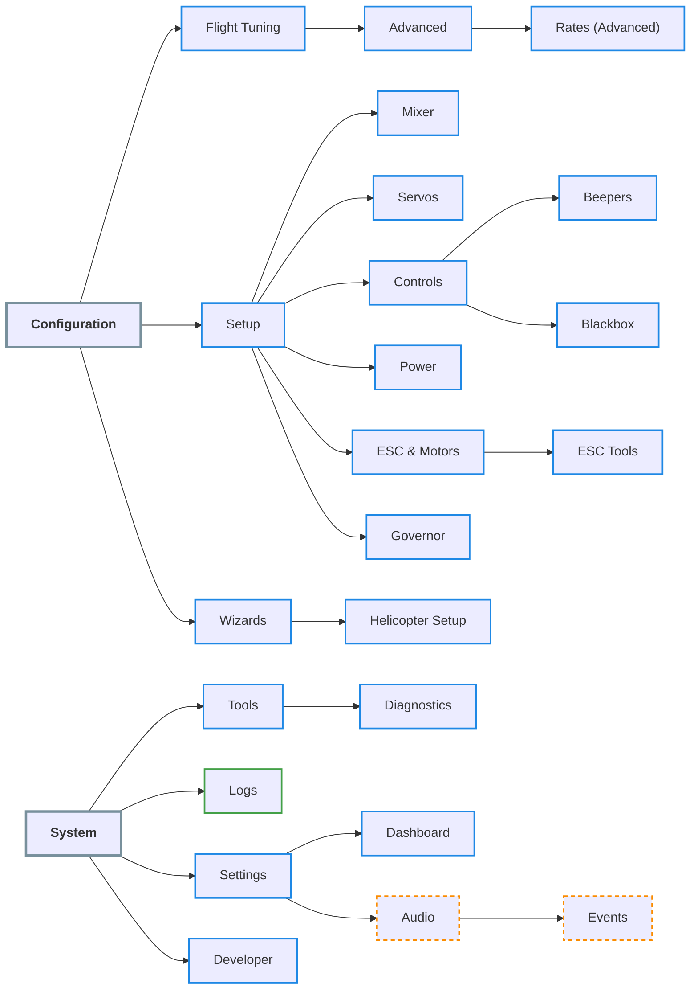
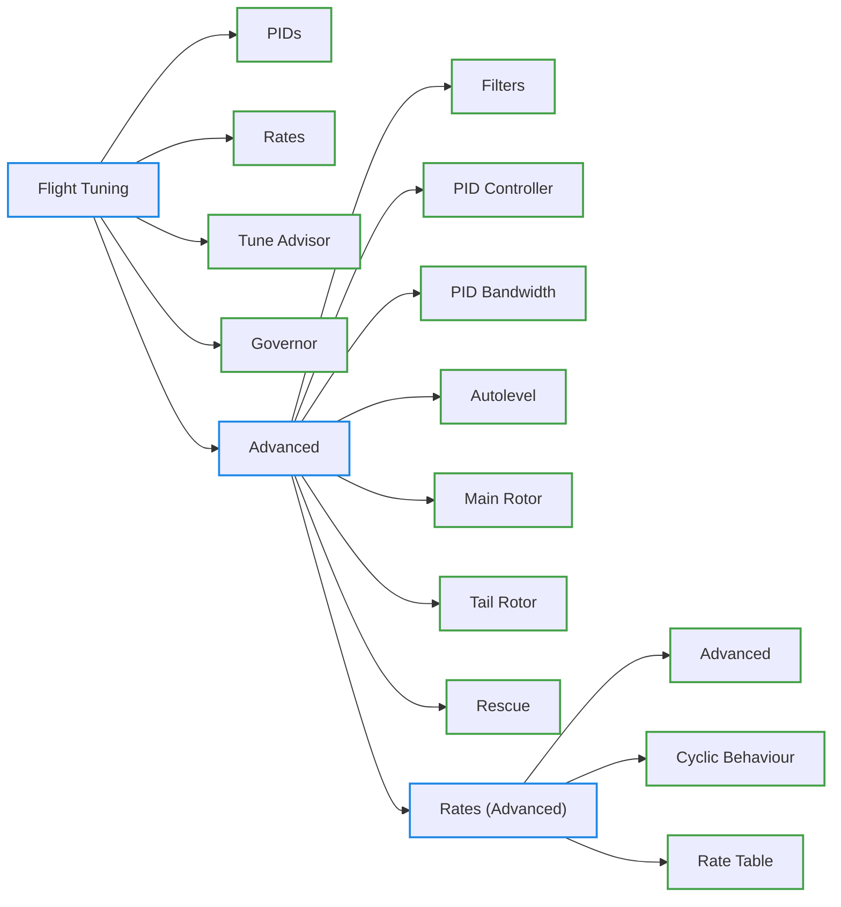
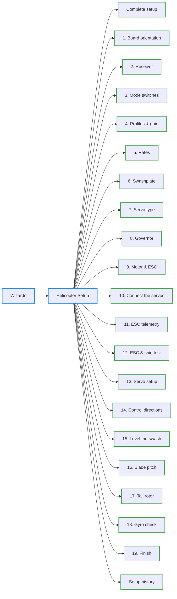
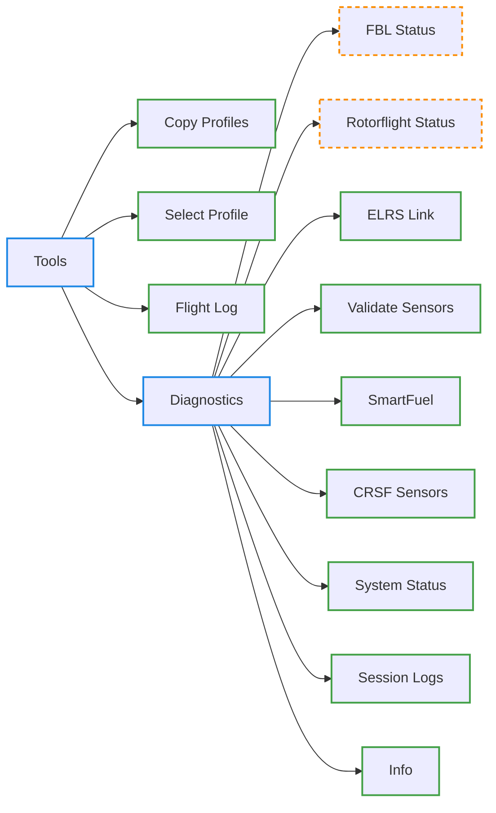
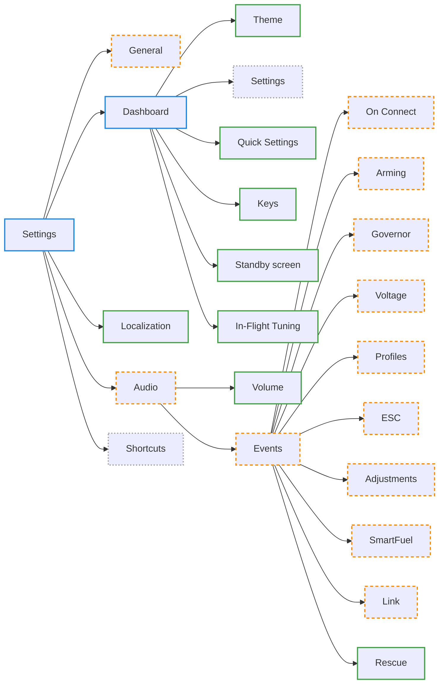
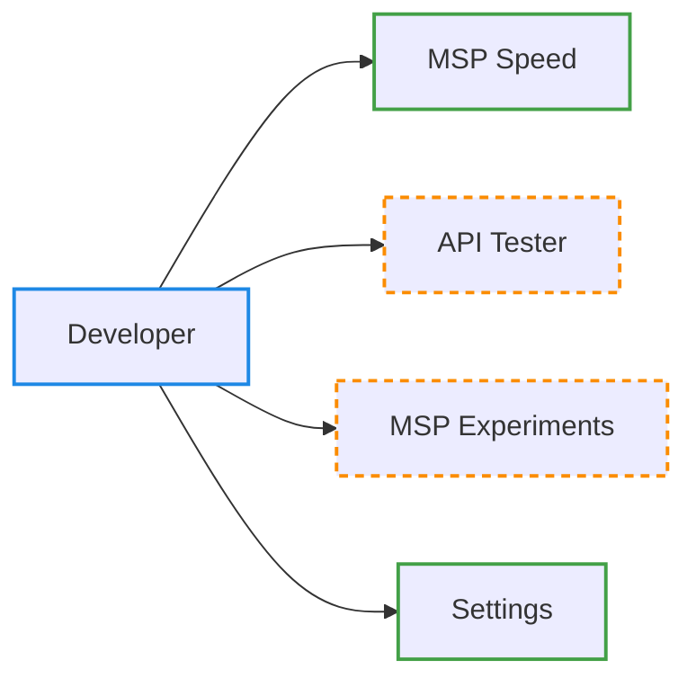

<!-- Generated by bin/docs/menu_structure.py from src/rfsuite/app/manifest.lua and
     src/rfsuite/app/pages/init.lua. Do not edit by hand: run
     `python3 bin/docs/menu_structure.py` and commit the result. -->

# Menu structure

Every entry of the configuration tool's menus, in the order the tool shows them, with
the page it opens, the documentation of that page and the conditions the menu
definition attaches to it. The page is generated from the sources and checked in CI,
so it matches the code it was generated from.

- **Menu path** -- the titles in English, from the section down.
- **Entry id**, **Menu id** -- the entry's `id` and the `menuId` it opens.
- **Opens** -- the page file under `src/rfsuite/app/pages/` (`<path>/page.lua`), a
  submenu, or both.
- **Documentation** -- the file under `docs/pages/` that documents the page;
  **none** where that file does not exist yet, &mdash; where nothing opens a page.
- **Conditions** -- every other key of the entry as the menu definition writes it,
  and the keys of the submenu it opens (`menu:`). The keys that only identify or place
  an entry (`id`, `title`, `menuId`, `icon`, `row`, `col`) are left out. What a condition
  does is not explained here.

**141 entries, 119 of them open a page, 84 of those pages are documented.**

## Diagrams

The same tree drawn as charts, generated with the tables below. The border says what
an entry is: blue a menu, green a page that is documented, orange and dashed a page
with no documentation yet, grey and dotted an entry that opens neither a page file
nor a menu with entries. A page that also opens a menu is drawn as a page.

### Overview

The sections and every menu in them; the pages of each menu are in the charts that
follow.

### Flight Tuning

### Setup

```mermaid
flowchart LR
  n0["Setup"]:::menu
  n1["Configuration"]:::undocumented
  n0 --> n1
  n2["Radio Config"]:::undocumented
  n0 --> n2
  n3["Telemetry"]:::documented
  n0 --> n3
  n4["Accelerometer"]:::documented
  n0 --> n4
  n5["Alignment"]:::documented
  n0 --> n5
  n6["Ports"]:::documented
  n0 --> n6
  n7["Mixer"]:::menu
  n0 --> n7
  n8["Swash"]:::undocumented
  n7 --> n8
  n9["Geometry"]:::undocumented
  n7 --> n9
  n10["Tail"]:::undocumented
  n7 --> n10
  n11["Trims"]:::undocumented
  n7 --> n11
  n12["Servos"]:::menu
  n0 --> n12
  n13["PWM Output"]:::undocumented
  n12 --> n13
  n14["BUS Output"]:::undocumented
  n12 --> n14
  n15["Controls"]:::menu
  n0 --> n15
  n16["Modes"]:::documented
  n15 --> n16
  n17["Adjustments"]:::documented
  n15 --> n17
  n18["Failsafe"]:::documented
  n15 --> n18
  n19["Beepers"]:::menu
  n15 --> n19
  n20["Configuration"]:::undocumented
  n19 --> n20
  n21["ESC Beacon"]:::undocumented
  n19 --> n21
  n22["Blackbox"]:::menu
  n15 --> n22
  n23["Configuration"]:::undocumented
  n22 --> n23
  n24["Logging"]:::undocumented
  n22 --> n24
  n25["Status"]:::documented
  n22 --> n25
  n26["Stats"]:::undocumented
  n15 --> n26
  n27["In-Flight Tuning"]:::documented
  n15 --> n27
  n28["Power"]:::menu
  n0 --> n28
  n29["Battery"]:::documented
  n28 --> n29
  n30["Alerts"]:::undocumented
  n28 --> n30
  n31["Sources"]:::documented
  n28 --> n31
  n32["SmartFuel"]:::documented
  n28 --> n32
  n33["Preferences"]:::documented
  n28 --> n33
  n34["ESC #amp; Motors"]:::menu
  n0 --> n34
  n35["Throttle"]:::documented
  n34 --> n35
  n36["Telemetry"]:::documented
  n34 --> n36
  n37["RPM"]:::undocumented
  n34 --> n37
  n38["ESC Tools"]:::menu
  n34 --> n38
  n39["AM32"]:::documented
  n38 --> n39
  n40["BLHeli_S"]:::documented
  n38 --> n40
  n41["Bluejay"]:::documented
  n38 --> n41
  n42["Flyrotor"]:::documented
  n38 --> n42
  n43["Hobbywing V5"]:::documented
  n38 --> n43
  n44["OMP"]:::documented
  n38 --> n44
  n45["Scorpion"]:::documented
  n38 --> n45
  n46["XDFly"]:::documented
  n38 --> n46
  n47["YGE"]:::documented
  n38 --> n47
  n48["ZTW"]:::documented
  n38 --> n48
  n49["Motor Override"]:::undocumented
  n34 --> n49
  n50["Governor"]:::menu
  n0 --> n50
  n51["General"]:::documented
  n50 --> n51
  n52["Ramp Time"]:::documented
  n50 --> n52
  n53["Filters"]:::undocumented
  n50 --> n53
  n54["Bypass Curve"]:::undocumented
  n50 --> n54
  n55["Model"]:::documented
  n0 --> n55
  n56["GPS"]:::undocumented
  n0 --> n56
  classDef section stroke:#78909c,stroke-width:3px,font-weight:bold
  classDef menu stroke:#1e88e5,stroke-width:2px
  classDef documented stroke:#43a047,stroke-width:2px
  classDef undocumented stroke:#fb8c00,stroke-width:2px,stroke-dasharray:5 4
  classDef empty stroke:#9e9e9e,stroke-width:2px,stroke-dasharray:2 3
```

### Wizards

### Tools

### Settings

### Developer

## Configuration

Section `configuration`.

| Menu path | Entry id | Menu id | Opens | Documentation | Conditions |
| --- | --- | --- | --- | --- | --- |
| Flight Tuning | `flight_tuning` | `flight_tuning_menu` | menu, 5 entries | &mdash; | `enabledWhen = "fblConnected"`, `lockedWhileArmed = true` |
| Flight Tuning &rsaquo; PIDs | `pids` | `flight_tuning_pids_page` | `flight_tuning/pids` | [flight_tuning/pids.md](../pages/flight_tuning/pids.md) | `lockedWhileArmed = true` |
| Flight Tuning &rsaquo; Rates | `rates` | `flight_tuning_rates_page` | `flight_tuning/rates` | [flight_tuning/rates.md](../pages/flight_tuning/rates.md) | `lockedWhileArmed = true` |
| Flight Tuning &rsaquo; Tune Advisor | `tune_advisor` | `flight_tuning_tune_advisor_page` | `flight_tuning/tune_advisor` | [flight_tuning/tune_advisor.md](../pages/flight_tuning/tune_advisor.md) | `minApiVersion = { 12, 0, 10 }`, `lockedWhileArmed = true` |
| Flight Tuning &rsaquo; Governor | `governor` | `flight_tuning_governor_page` | `flight_tuning/governor` | [flight_tuning/governor.md](../pages/flight_tuning/governor.md) | `minApiVersion = { 12, 0, 9 }`, `lockedWhileArmed = true` |
| Flight Tuning &rsaquo; Advanced | `advanced` | `flight_tuning_advanced_menu` | menu, 8 entries | &mdash; | `enabled = true` |
| Flight Tuning &rsaquo; Advanced &rsaquo; Filters | `filters` | `flight_tuning_advanced_filters_page` | `flight_tuning/advanced/filters` | [flight_tuning/advanced/filters.md](../pages/flight_tuning/advanced/filters.md) | `lockedWhileArmed = true` |
| Flight Tuning &rsaquo; Advanced &rsaquo; PID Controller | `pid_controller` | `flight_tuning_advanced_pid_controller_page` | `flight_tuning/advanced/pid_controller` | [flight_tuning/advanced/pid_controller.md](../pages/flight_tuning/advanced/pid_controller.md) | `lockedWhileArmed = true` |
| Flight Tuning &rsaquo; Advanced &rsaquo; PID Bandwidth | `pid_bandwidth` | `flight_tuning_advanced_pid_bandwidth_page` | `flight_tuning/advanced/pid_bandwidth` | [flight_tuning/advanced/pid_bandwidth.md](../pages/flight_tuning/advanced/pid_bandwidth.md) | `lockedWhileArmed = true` |
| Flight Tuning &rsaquo; Advanced &rsaquo; Autolevel | `autolevel` | `flight_tuning_advanced_autolevel_page` | `flight_tuning/advanced/autolevel` | [flight_tuning/advanced/autolevel.md](../pages/flight_tuning/advanced/autolevel.md) | `lockedWhileArmed = true` |
| Flight Tuning &rsaquo; Advanced &rsaquo; Main Rotor | `main_rotor` | `flight_tuning_advanced_main_rotor_page` | `flight_tuning/advanced/main_rotor` | [flight_tuning/advanced/main_rotor.md](../pages/flight_tuning/advanced/main_rotor.md) | `lockedWhileArmed = true` |
| Flight Tuning &rsaquo; Advanced &rsaquo; Tail Rotor | `tail_rotor` | `flight_tuning_advanced_tail_rotor_page` | `flight_tuning/advanced/tail_rotor` | [flight_tuning/advanced/tail_rotor.md](../pages/flight_tuning/advanced/tail_rotor.md) | `lockedWhileArmed = true` |
| Flight Tuning &rsaquo; Advanced &rsaquo; Rescue | `rescue` | `flight_tuning_advanced_rescue_page` | `flight_tuning/advanced/rescue` | [flight_tuning/advanced/rescue.md](../pages/flight_tuning/advanced/rescue.md) | `lockedWhileArmed = true` |
| Flight Tuning &rsaquo; Advanced &rsaquo; Rates (Advanced) | `rates_advanced` | `flight_tuning_advanced_rates_advanced_menu` | menu, 3 entries | &mdash; | &mdash; |
| Flight Tuning &rsaquo; Advanced &rsaquo; Rates (Advanced) &rsaquo; Advanced | `advanced` | `flight_tuning_advanced_rates_advanced_advanced_page` | `flight_tuning/advanced/rates_advanced/advanced` | [flight_tuning/advanced/rates_advanced/advanced.md](../pages/flight_tuning/advanced/rates_advanced/advanced.md) | `lockedWhileArmed = true` |
| Flight Tuning &rsaquo; Advanced &rsaquo; Rates (Advanced) &rsaquo; Cyclic Behaviour | `cyclic_behaviour` | `flight_tuning_advanced_rates_advanced_cyclic_behaviour_page` | `flight_tuning/advanced/rates_advanced/cyclic_behaviour` | [flight_tuning/advanced/rates_advanced/cyclic_behaviour.md](../pages/flight_tuning/advanced/rates_advanced/cyclic_behaviour.md) | `lockedWhileArmed = true` |
| Flight Tuning &rsaquo; Advanced &rsaquo; Rates (Advanced) &rsaquo; Rate Table | `table` | `flight_tuning_advanced_rates_advanced_table_page` | `flight_tuning/advanced/rates_advanced/table` | [flight_tuning/advanced/rates_advanced/table.md](../pages/flight_tuning/advanced/rates_advanced/table.md) | `lockedWhileArmed = true` |
| Setup | `setup` | `setup_menu` | menu, 14 entries | &mdash; | `enabledWhen = "fblConnected"`, `lockedWhileArmed = true` |
| Setup &rsaquo; Configuration | `configuration` | `setup_configuration_page` | `setup/configuration` | **none** | `lockedWhileArmed = true` |
| Setup &rsaquo; Radio Config | `radio_config` | `setup_radio_config_page` | `setup/radio_config` | **none** | `lockedWhileArmed = true` |
| Setup &rsaquo; Telemetry | `telemetry` | `setup_telemetry_page` | `setup/telemetry` | [setup/telemetry.md](../pages/setup/telemetry.md) | `lockedWhileArmed = true` |
| Setup &rsaquo; Accelerometer | `accelerometer` | `setup_accelerometer_page` | `setup/accelerometer` | [setup/accelerometer.md](../pages/setup/accelerometer.md) | `lockedWhileArmed = true` |
| Setup &rsaquo; Alignment | `alignment` | `setup_alignment_page` | `setup/alignment` | [setup/alignment.md](../pages/setup/alignment.md) | `lockedWhileArmed = true` |
| Setup &rsaquo; Ports | `ports` | `setup_ports_page` | `setup/ports` | [setup/ports.md](../pages/setup/ports.md) | `lockedWhileArmed = true` |
| Setup &rsaquo; Mixer | `mixer` | `mixer_menu` | menu, 4 entries | &mdash; | &mdash; |
| Setup &rsaquo; Mixer &rsaquo; Swash | `swash` | `setup_mixer_swash_page` | `setup/mixer/swash` | **none** | `lockedWhileArmed = true` |
| Setup &rsaquo; Mixer &rsaquo; Geometry | `swashgeometry` | `setup_mixer_swashgeometry_page` | `setup/mixer/swashgeometry` | **none** | `lockedWhileArmed = true` |
| Setup &rsaquo; Mixer &rsaquo; Tail | `tail` | `setup_mixer_tail_page` | `setup/mixer/tail` | **none** | `lockedWhileArmed = true` |
| Setup &rsaquo; Mixer &rsaquo; Trims | `trims` | `setup_mixer_trims_page` | `setup/mixer/trims` | **none** | `lockedWhileArmed = true` |
| Setup &rsaquo; Servos | `servos` | `servos_menu` | menu, 2 entries | &mdash; | &mdash; |
| Setup &rsaquo; Servos &rsaquo; PWM Output | `pwm` | `setup_servos_pwm_page` | `setup/servos/pwm` | **none** | `lockedWhileArmed = true` |
| Setup &rsaquo; Servos &rsaquo; BUS Output | `bus` | `setup_servos_bus_page` | `setup/servos/bus` | **none** | `lockedWhileArmed = true` |
| Setup &rsaquo; Controls | `controls` | `controls_menu` | menu, 7 entries | &mdash; | &mdash; |
| Setup &rsaquo; Controls &rsaquo; Modes | `modes` | `setup_controls_modes_page` | `setup/controls/modes` | [setup/controls/modes.md](../pages/setup/controls/modes.md) | `lockedWhileArmed = true` |
| Setup &rsaquo; Controls &rsaquo; Adjustments | `adjustments` | `setup_controls_adjustments_page` | `setup/controls/adjustments` | [setup/controls/adjustments.md](../pages/setup/controls/adjustments.md) | `lockedWhileArmed = true` |
| Setup &rsaquo; Controls &rsaquo; Failsafe | `failsafe` | `setup_controls_failsafe_page` | `setup/controls/failsafe` | [setup/controls/failsafe.md](../pages/setup/controls/failsafe.md) | `lockedWhileArmed = true` |
| Setup &rsaquo; Controls &rsaquo; Beepers | `beepers` | `beepers_menu` | menu, 2 entries | &mdash; | &mdash; |
| Setup &rsaquo; Controls &rsaquo; Beepers &rsaquo; Configuration | `configuration` | `setup_controls_beepers_configuration_page` | `setup/controls/beepers/configuration` | **none** | `lockedWhileArmed = true` |
| Setup &rsaquo; Controls &rsaquo; Beepers &rsaquo; ESC Beacon | `dshot` | `setup_controls_beepers_dshot_page` | `setup/controls/beepers/dshot` | **none** | `lockedWhileArmed = true` |
| Setup &rsaquo; Controls &rsaquo; Blackbox | `blackbox` | `blackbox_menu` | menu, 3 entries | &mdash; | &mdash; |
| Setup &rsaquo; Controls &rsaquo; Blackbox &rsaquo; Configuration | `configuration` | `setup_controls_blackbox_configuration_page` | `setup/controls/blackbox/configuration` | **none** | `lockedWhileArmed = true` |
| Setup &rsaquo; Controls &rsaquo; Blackbox &rsaquo; Logging | `logging` | `setup_controls_blackbox_logging_page` | `setup/controls/blackbox/logging` | **none** | `lockedWhileArmed = true` |
| Setup &rsaquo; Controls &rsaquo; Blackbox &rsaquo; Status | `status` | `setup_controls_blackbox_status_page` | `setup/controls/blackbox/status` | [setup/controls/blackbox/status.md](../pages/setup/controls/blackbox/status.md) | `lockedWhileArmed = true` |
| Setup &rsaquo; Controls &rsaquo; Stats | `stats` | `setup_controls_stats_page` | `setup/controls/stats` | **none** | `lockedWhileArmed = true` |
| Setup &rsaquo; Controls &rsaquo; In-Flight Tuning | `inflight` | `setup_controls_inflight_page` | `setup/controls/inflight` | [setup/controls/inflight.md](../pages/setup/controls/inflight.md) | `enabledWhen = "fblConnected"`, `visibleWhen = "previewInflightTuning"`, `lockedWhileArmed = true` |
| Setup &rsaquo; Power | `power` | `power_menu` | menu, 5 entries | &mdash; | &mdash; |
| Setup &rsaquo; Power &rsaquo; Battery | `battery` | `setup_power_battery_page` | `setup/power/battery` | [setup/power/battery.md](../pages/setup/power/battery.md) | `lockedWhileArmed = true` |
| Setup &rsaquo; Power &rsaquo; Alerts | `alerts` | `setup_power_alerts_page` | `setup/power/alerts` | **none** | &mdash; |
| Setup &rsaquo; Power &rsaquo; Sources | `sources` | `setup_power_sources_page` | `setup/power/sources` | [setup/power/sources.md](../pages/setup/power/sources.md) | `lockedWhileArmed = true` |
| Setup &rsaquo; Power &rsaquo; SmartFuel | `smartfuel` | `setup_power_smartfuel_page` | `setup/power/smartfuel` | [setup/power/smartfuel.md](../pages/setup/power/smartfuel.md) | `minApiVersion = { 12, 0, 9 }`, `lockedWhileArmed = true` |
| Setup &rsaquo; Power &rsaquo; Preferences | `preferences` | `setup_power_preferences_page` | `setup/power/preferences` | [setup/power/preferences.md](../pages/setup/power/preferences.md) | &mdash; |
| Setup &rsaquo; ESC & Motors | `esc_motors` | `esc_motors_menu` | menu, 5 entries | &mdash; | &mdash; |
| Setup &rsaquo; ESC & Motors &rsaquo; Throttle | `throttle` | `setup_esc_motors_throttle_page` | `setup/esc_motors/throttle` | [setup/esc_motors/throttle.md](../pages/setup/esc_motors/throttle.md) | `lockedWhileArmed = true` |
| Setup &rsaquo; ESC & Motors &rsaquo; Telemetry | `telemetry` | `setup_esc_motors_telemetry_page` | `setup/esc_motors/telemetry` | [setup/esc_motors/telemetry.md](../pages/setup/esc_motors/telemetry.md) | `lockedWhileArmed = true` |
| Setup &rsaquo; ESC & Motors &rsaquo; RPM | `rpm` | `setup_esc_motors_rpm_page` | `setup/esc_motors/rpm` | **none** | `lockedWhileArmed = true` |
| Setup &rsaquo; ESC & Motors &rsaquo; ESC Tools | `esc_tools` | `esc_tools_menu` | menu, 10 entries | &mdash; | `lockedWhileArmed = true` |
| Setup &rsaquo; ESC & Motors &rsaquo; ESC Tools &rsaquo; AM32 | `am32` | `setup_esc_motors_esc_tools_am32_page` | `setup/esc_motors/esc_tools/escmfg/am32` | [setup/esc_motors/esc_tools/escmfg/am32.md](../pages/setup/esc_motors/esc_tools/escmfg/am32.md) | `enabledWhen = "escProto1"`, `lockedWhileArmed = true` |
| Setup &rsaquo; ESC & Motors &rsaquo; ESC Tools &rsaquo; BLHeli_S | `blheli_s` | `setup_esc_motors_esc_tools_blheli_s_page` | `setup/esc_motors/esc_tools/escmfg/blheli_s` | [setup/esc_motors/esc_tools/escmfg/blheli_s.md](../pages/setup/esc_motors/esc_tools/escmfg/blheli_s.md) | `enabledWhen = "escProto1"`, `lockedWhileArmed = true` |
| Setup &rsaquo; ESC & Motors &rsaquo; ESC Tools &rsaquo; Bluejay | `bluejay` | `setup_esc_motors_esc_tools_bluejay_page` | `setup/esc_motors/esc_tools/escmfg/bluejay` | [setup/esc_motors/esc_tools/escmfg/bluejay.md](../pages/setup/esc_motors/esc_tools/escmfg/bluejay.md) | `enabledWhen = "escProto1"`, `lockedWhileArmed = true` |
| Setup &rsaquo; ESC & Motors &rsaquo; ESC Tools &rsaquo; Flyrotor | `flrtr` | `setup_esc_motors_esc_tools_flrtr_page` | `setup/esc_motors/esc_tools/escmfg/flrtr` | [setup/esc_motors/esc_tools/escmfg/flrtr.md](../pages/setup/esc_motors/esc_tools/escmfg/flrtr.md) | `enabledWhen = "escProto10"`, `lockedWhileArmed = true` |
| Setup &rsaquo; ESC & Motors &rsaquo; ESC Tools &rsaquo; Hobbywing V5 | `hw5` | `setup_esc_motors_esc_tools_hw5_page` | `setup/esc_motors/esc_tools/escmfg/hw5` | [setup/esc_motors/esc_tools/escmfg/hw5.md](../pages/setup/esc_motors/esc_tools/escmfg/hw5.md) | `enabledWhen = "escProto3"`, `lockedWhileArmed = true` |
| Setup &rsaquo; ESC & Motors &rsaquo; ESC Tools &rsaquo; OMP | `omp` | `setup_esc_motors_esc_tools_omp_page` | `setup/esc_motors/esc_tools/escmfg/omp` | [setup/esc_motors/esc_tools/escmfg/omp.md](../pages/setup/esc_motors/esc_tools/escmfg/omp.md) | `enabledWhen = "escProto6"`, `lockedWhileArmed = true` |
| Setup &rsaquo; ESC & Motors &rsaquo; ESC Tools &rsaquo; Scorpion | `scorp` | `setup_esc_motors_esc_tools_scorp_page` | `setup/esc_motors/esc_tools/escmfg/scorp` | [setup/esc_motors/esc_tools/escmfg/scorp.md](../pages/setup/esc_motors/esc_tools/escmfg/scorp.md) | `enabledWhen = "escProto4"`, `lockedWhileArmed = true` |
| Setup &rsaquo; ESC & Motors &rsaquo; ESC Tools &rsaquo; XDFly | `xdfly` | `setup_esc_motors_esc_tools_xdfly_page` | `setup/esc_motors/esc_tools/escmfg/xdfly` | [setup/esc_motors/esc_tools/escmfg/xdfly.md](../pages/setup/esc_motors/esc_tools/escmfg/xdfly.md) | `enabledWhen = "escProto12"`, `lockedWhileArmed = true` |
| Setup &rsaquo; ESC & Motors &rsaquo; ESC Tools &rsaquo; YGE | `yge` | `setup_esc_motors_esc_tools_yge_page` | `setup/esc_motors/esc_tools/escmfg/yge` | [setup/esc_motors/esc_tools/escmfg/yge.md](../pages/setup/esc_motors/esc_tools/escmfg/yge.md) | `enabledWhen = "escProto9"`, `lockedWhileArmed = true` |
| Setup &rsaquo; ESC & Motors &rsaquo; ESC Tools &rsaquo; ZTW | `ztw` | `setup_esc_motors_esc_tools_ztw_page` | `setup/esc_motors/esc_tools/escmfg/ztw` | [setup/esc_motors/esc_tools/escmfg/ztw.md](../pages/setup/esc_motors/esc_tools/escmfg/ztw.md) | `enabledWhen = "escProto7"`, `lockedWhileArmed = true` |
| Setup &rsaquo; ESC & Motors &rsaquo; Motor Override | `motor_override` | `setup_esc_motors_motor_override_page` | `setup/esc_motors/motor_override` | **none** | `minApiVersion = { 12, 0, 9 }`, `lockedWhileArmed = true` |
| Setup &rsaquo; Governor | `governor` | `governor_menu` | menu, 4 entries | &mdash; | &mdash; |
| Setup &rsaquo; Governor &rsaquo; General | `general` | `setup_governor_general_page` | `setup/governor/general` | [setup/governor/general.md](../pages/setup/governor/general.md) | `lockedWhileArmed = true` |
| Setup &rsaquo; Governor &rsaquo; Ramp Time | `time` | `setup_governor_time_page` | `setup/governor/time` | [setup/governor/time.md](../pages/setup/governor/time.md) | `lockedWhileArmed = true` |
| Setup &rsaquo; Governor &rsaquo; Filters | `filters` | `setup_governor_filters_page` | `setup/governor/filters` | **none** | `lockedWhileArmed = true` |
| Setup &rsaquo; Governor &rsaquo; Bypass Curve | `curves` | `setup_governor_curves_page` | `setup/governor/curves` | **none** | `lockedWhileArmed = true` |
| Setup &rsaquo; Model | `model` | `setup_model_page` | `setup/model` | [setup/model.md](../pages/setup/model.md) | `enabledWhen = "fblConnected"`, `lockedWhileArmed = true` |
| Setup &rsaquo; GPS | `gps` | `setup_gps_page` | `setup/gps` | **none** | `lockedWhileArmed = true` |
| Wizards | `wizards` | `wizards_menu` | menu, 1 entry | &mdash; | `enabledWhen = "fblConnected"`, `visibleWhen = "previewSetupWizard"`, `lockedWhileArmed = true` |
| Wizards &rsaquo; Helicopter Setup | `helicopter_setup` | `helicopter_setup_menu` | menu, 21 entries | &mdash; | `enabledWhen = "fblConnected"`, `lockedWhileArmed = true`, `minApiVersion = { 12, 0, 9 }`, menu: `help = "@i18n(app.modules.helicopter_setup.menuHelp)@"` |
| Wizards &rsaquo; Helicopter Setup &rsaquo; Complete setup | `all` | `helicopter_setup_page` | `helicopter_setup` | [helicopter_setup.md](../pages/helicopter_setup.md) | `enabledWhen = "fblConnected"`, `lockedWhileArmed = true`, `minApiVersion = { 12, 0, 9 }` |
| Wizards &rsaquo; Helicopter Setup &rsaquo; 1. Board orientation | `step_01` | `helicopter_setup_step_01_page` | `helicopter_setup` | [helicopter_setup.md](../pages/helicopter_setup.md) | `doneWhen = helicopterStepDone ( 1 )`, `enabledWhen = "fblConnected"`, `lockedWhileArmed = true`, `minApiVersion = { 12, 0, 9 }` |
| Wizards &rsaquo; Helicopter Setup &rsaquo; 2. Receiver | `step_02` | `helicopter_setup_step_02_page` | `helicopter_setup` | [helicopter_setup.md](../pages/helicopter_setup.md) | `doneWhen = helicopterStepDone ( 2 )`, `enabledWhen = "fblConnected"`, `lockedWhileArmed = true`, `minApiVersion = { 12, 0, 9 }` |
| Wizards &rsaquo; Helicopter Setup &rsaquo; 3. Mode switches | `step_03` | `helicopter_setup_step_03_page` | `helicopter_setup` | [helicopter_setup.md](../pages/helicopter_setup.md) | `doneWhen = helicopterStepDone ( 3 )`, `enabledWhen = "fblConnected"`, `lockedWhileArmed = true`, `minApiVersion = { 12, 0, 9 }` |
| Wizards &rsaquo; Helicopter Setup &rsaquo; 4. Profiles & gain | `step_04` | `helicopter_setup_step_04_page` | `helicopter_setup` | [helicopter_setup.md](../pages/helicopter_setup.md) | `doneWhen = helicopterStepDone ( 4 )`, `enabledWhen = "fblConnected"`, `lockedWhileArmed = true`, `minApiVersion = { 12, 0, 9 }` |
| Wizards &rsaquo; Helicopter Setup &rsaquo; 5. Rates | `step_05` | `helicopter_setup_step_05_page` | `helicopter_setup` | [helicopter_setup.md](../pages/helicopter_setup.md) | `doneWhen = helicopterStepDone ( 5 )`, `enabledWhen = "fblConnected"`, `lockedWhileArmed = true`, `minApiVersion = { 12, 0, 9 }` |
| Wizards &rsaquo; Helicopter Setup &rsaquo; 6. Swashplate | `step_06` | `helicopter_setup_step_06_page` | `helicopter_setup` | [helicopter_setup.md](../pages/helicopter_setup.md) | `doneWhen = helicopterStepDone ( 6 )`, `enabledWhen = "fblConnected"`, `lockedWhileArmed = true`, `minApiVersion = { 12, 0, 9 }` |
| Wizards &rsaquo; Helicopter Setup &rsaquo; 7. Servo type | `step_07` | `helicopter_setup_step_07_page` | `helicopter_setup` | [helicopter_setup.md](../pages/helicopter_setup.md) | `doneWhen = helicopterStepDone ( 7 )`, `enabledWhen = "fblConnected"`, `lockedWhileArmed = true`, `minApiVersion = { 12, 0, 9 }` |
| Wizards &rsaquo; Helicopter Setup &rsaquo; 8. Governor | `step_08` | `helicopter_setup_step_08_page` | `helicopter_setup` | [helicopter_setup.md](../pages/helicopter_setup.md) | `doneWhen = helicopterStepDone ( 8 )`, `enabledWhen = "fblConnected"`, `lockedWhileArmed = true`, `minApiVersion = { 12, 0, 9 }` |
| Wizards &rsaquo; Helicopter Setup &rsaquo; 9. Motor & ESC | `step_09` | `helicopter_setup_step_09_page` | `helicopter_setup` | [helicopter_setup.md](../pages/helicopter_setup.md) | `doneWhen = helicopterStepDone ( 9 )`, `enabledWhen = "fblConnected"`, `lockedWhileArmed = true`, `minApiVersion = { 12, 0, 9 }` |
| Wizards &rsaquo; Helicopter Setup &rsaquo; 10. Connect the servos | `step_10` | `helicopter_setup_step_10_page` | `helicopter_setup` | [helicopter_setup.md](../pages/helicopter_setup.md) | `doneWhen = helicopterStepDone ( 10 )`, `enabledWhen = "fblConnected"`, `lockedWhileArmed = true`, `minApiVersion = { 12, 0, 9 }` |
| Wizards &rsaquo; Helicopter Setup &rsaquo; 11. ESC telemetry | `step_11` | `helicopter_setup_step_11_page` | `helicopter_setup` | [helicopter_setup.md](../pages/helicopter_setup.md) | `doneWhen = helicopterStepDone ( 11 )`, `enabledWhen = "fblConnected"`, `lockedWhileArmed = true`, `minApiVersion = { 12, 0, 9 }` |
| Wizards &rsaquo; Helicopter Setup &rsaquo; 12. ESC & spin test | `step_12` | `helicopter_setup_step_12_page` | `helicopter_setup` | [helicopter_setup.md](../pages/helicopter_setup.md) | `doneWhen = helicopterStepDone ( 12 )`, `enabledWhen = "fblConnected"`, `lockedWhileArmed = true`, `minApiVersion = { 12, 0, 9 }` |
| Wizards &rsaquo; Helicopter Setup &rsaquo; 13. Servo setup | `step_13` | `helicopter_setup_step_13_page` | `helicopter_setup` | [helicopter_setup.md](../pages/helicopter_setup.md) | `doneWhen = helicopterStepDone ( 13 )`, `enabledWhen = "fblConnected"`, `lockedWhileArmed = true`, `minApiVersion = { 12, 0, 9 }` |
| Wizards &rsaquo; Helicopter Setup &rsaquo; 14. Control directions | `step_14` | `helicopter_setup_step_14_page` | `helicopter_setup` | [helicopter_setup.md](../pages/helicopter_setup.md) | `doneWhen = helicopterStepDone ( 14 )`, `enabledWhen = "fblConnected"`, `lockedWhileArmed = true`, `minApiVersion = { 12, 0, 9 }` |
| Wizards &rsaquo; Helicopter Setup &rsaquo; 15. Level the swash | `step_15` | `helicopter_setup_step_15_page` | `helicopter_setup` | [helicopter_setup.md](../pages/helicopter_setup.md) | `doneWhen = helicopterStepDone ( 15 )`, `enabledWhen = "fblConnected"`, `lockedWhileArmed = true`, `minApiVersion = { 12, 0, 9 }` |
| Wizards &rsaquo; Helicopter Setup &rsaquo; 16. Blade pitch | `step_16` | `helicopter_setup_step_16_page` | `helicopter_setup` | [helicopter_setup.md](../pages/helicopter_setup.md) | `doneWhen = helicopterStepDone ( 16 )`, `enabledWhen = "fblConnected"`, `lockedWhileArmed = true`, `minApiVersion = { 12, 0, 9 }` |
| Wizards &rsaquo; Helicopter Setup &rsaquo; 17. Tail rotor | `step_17` | `helicopter_setup_step_17_page` | `helicopter_setup` | [helicopter_setup.md](../pages/helicopter_setup.md) | `doneWhen = helicopterStepDone ( 17 )`, `enabledWhen = "fblConnected"`, `lockedWhileArmed = true`, `minApiVersion = { 12, 0, 9 }` |
| Wizards &rsaquo; Helicopter Setup &rsaquo; 18. Gyro check | `step_18` | `helicopter_setup_step_18_page` | `helicopter_setup` | [helicopter_setup.md](../pages/helicopter_setup.md) | `doneWhen = helicopterStepDone ( 18 )`, `enabledWhen = "fblConnected"`, `lockedWhileArmed = true`, `minApiVersion = { 12, 0, 9 }` |
| Wizards &rsaquo; Helicopter Setup &rsaquo; 19. Finish | `step_19` | `helicopter_setup_step_19_page` | `helicopter_setup` | [helicopter_setup.md](../pages/helicopter_setup.md) | `doneWhen = helicopterStepDone ( 19 )`, `enabledWhen = "fblConnected"`, `lockedWhileArmed = true`, `minApiVersion = { 12, 0, 9 }` |
| Wizards &rsaquo; Helicopter Setup &rsaquo; Setup history | `history` | `helicopter_setup_history_page` | `helicopter_setup` | [helicopter_setup.md](../pages/helicopter_setup.md) | `enabledWhen = "fblConnected"`, `lockedWhileArmed = true`, `minApiVersion = { 12, 0, 9 }` |

## System

Section `system`.

| Menu path | Entry id | Menu id | Opens | Documentation | Conditions |
| --- | --- | --- | --- | --- | --- |
| Tools | `tools` | `tools_menu` | menu, 4 entries | &mdash; | &mdash; |
| Tools &rsaquo; Copy Profiles | `copy_profiles` | `tools_copy_profiles_page` | `tools/copy_profiles` | [tools/copy_profiles.md](../pages/tools/copy_profiles.md) | `enabledWhen = "fblConnected"`, `lockedWhileArmed = true` |
| Tools &rsaquo; Select Profile | `select_profile` | `tools_select_profile_page` | `tools/select_profile` | [tools/select_profile.md](../pages/tools/select_profile.md) | `enabledWhen = "fblConnected"`, `lockedWhileArmed = true` |
| Tools &rsaquo; Flight Log | `flight_log` | `tools_flight_log_page` | `tools/flight_log` | [tools/flight_log.md](../pages/tools/flight_log.md) | `lockedWhileArmed = true` |
| Tools &rsaquo; Diagnostics | `diagnostics` | `diagnostics_menu` | menu, 9 entries | &mdash; | &mdash; |
| Tools &rsaquo; Diagnostics &rsaquo; FBL Status | `fblstatus` | `diagnostics_fblstatus_page` | `tools/diagnostics/fblstatus` | **none** | `enabledWhen = "fblConnected"`, `lockedWhileArmed = true` |
| Tools &rsaquo; Diagnostics &rsaquo; Rotorflight Status | `rfstatus` | `diagnostics_rfstatus_page` | `tools/diagnostics/rfstatus` | **none** | `enabledWhen = "fblConnected"`, `lockedWhileArmed = true` |
| Tools &rsaquo; Diagnostics &rsaquo; ELRS Link | `elrs_link` | `diagnostics_elrs_link_page` | `tools/diagnostics/elrs_link` | [tools/diagnostics/elrs_link.md](../pages/tools/diagnostics/elrs_link.md) | `lockedWhileArmed = true` |
| Tools &rsaquo; Diagnostics &rsaquo; Validate Sensors | `validate_sensors` | `diagnostics_validate_sensors_page` | `tools/diagnostics/validate_sensors` | [tools/diagnostics/validate_sensors.md](../pages/tools/diagnostics/validate_sensors.md) | `enabledWhen = "fblConnected"`, `lockedWhileArmed = true` |
| Tools &rsaquo; Diagnostics &rsaquo; SmartFuel | `smartfuel` | `diagnostics_smartfuel_page` | `tools/diagnostics/smartfuel` | [tools/diagnostics/smartfuel.md](../pages/tools/diagnostics/smartfuel.md) | `enabledWhen = "fblConnected"`, `minApiVersion = { 12, 0, 9 }`, `lockedWhileArmed = true` |
| Tools &rsaquo; Diagnostics &rsaquo; CRSF Sensors | `crsf_sensors` | `diagnostics_crsf_sensors_page` | `tools/diagnostics/crsf_sensors` | [tools/diagnostics/crsf_sensors.md](../pages/tools/diagnostics/crsf_sensors.md) | `enabledWhen = "fblConnected"`, `minApiVersion = { 12, 0, 10 }`, `lockedWhileArmed = true` |
| Tools &rsaquo; Diagnostics &rsaquo; System Status | `system_status` | `diagnostics_system_status_page` | `tools/diagnostics/system_status` | [tools/diagnostics/system_status.md](../pages/tools/diagnostics/system_status.md) | `lockedWhileArmed = true` |
| Tools &rsaquo; Diagnostics &rsaquo; Session Logs | `session_logs` | `diagnostics_session_logs_page` | `tools/diagnostics/session_logs` | [tools/diagnostics/session_logs.md](../pages/tools/diagnostics/session_logs.md) | &mdash; |
| Tools &rsaquo; Diagnostics &rsaquo; Info | `info` | `diagnostics_info_page` | `tools/diagnostics/info` | [tools/diagnostics/info.md](../pages/tools/diagnostics/info.md) | `lockedWhileArmed = true` |
| Logs | `logs` | `logs_page` | `logs` | [logs.md](../pages/logs.md) | &mdash; |
| Settings | `settings` | `settings_admin` | menu, 5 entries | &mdash; | &mdash; |
| Settings &rsaquo; General | `general` | `settings_general_page` | `settings/general` | **none** | &mdash; |
| Settings &rsaquo; Dashboard | `dashboard` | `settings_dashboard_menu` | menu, 6 entries | &mdash; | &mdash; |
| Settings &rsaquo; Dashboard &rsaquo; Theme | `dashboard_theme` | `settings_dashboard_theme_page` | `settings/dashboard/theme` | [settings/dashboard/theme.md](../pages/settings/dashboard/theme.md) | &mdash; |
| Settings &rsaquo; Dashboard &rsaquo; Settings | `dashboard_settings` | `settings_dashboard_settings_menu` | no page file and no entries | &mdash; | menu: `_dynamicThemes = true` |
| Settings &rsaquo; Dashboard &rsaquo; Quick Settings | `dashboard_quick_menu` | `settings_dashboard_quick_menu_page` | `settings/dashboard/quick_menu` | [settings/dashboard/quick_menu.md](../pages/settings/dashboard/quick_menu.md) | &mdash; |
| Settings &rsaquo; Dashboard &rsaquo; Keys | `dashboard_keys` | `settings_dashboard_keys_page` | `settings/dashboard/keys` | [settings/dashboard/keys.md](../pages/settings/dashboard/keys.md) | &mdash; |
| Settings &rsaquo; Dashboard &rsaquo; Standby screen | `dashboard_standby` | `settings_dashboard_standby_page` | `settings/dashboard/standby` | [settings/dashboard/standby.md](../pages/settings/dashboard/standby.md) | &mdash; |
| Settings &rsaquo; Dashboard &rsaquo; In-Flight Tuning | `dashboard_inflight` | `settings_dashboard_inflight_page` | `settings/dashboard/inflight` | [settings/dashboard/inflight.md](../pages/settings/dashboard/inflight.md) | `visibleWhen = "previewInflightTuning"` |
| Settings &rsaquo; Localization | `localization` | `settings_localization_page` | `settings/localization` | [settings/localization.md](../pages/settings/localization.md) | &mdash; |
| Settings &rsaquo; Audio | `audio` | `settings_audio_page` | `settings/audio` + menu, 2 entries | **none** | &mdash; |
| Settings &rsaquo; Audio &rsaquo; Volume | `audio_volume` | `settings_audio_volume_page` | `settings/audio/volume` | [settings/audio/volume.md](../pages/settings/audio/volume.md) | &mdash; |
| Settings &rsaquo; Audio &rsaquo; Events | `audio_events` | `settings_audio_events_page` | `settings/audio/events` + menu, 10 entries | **none** | &mdash; |
| Settings &rsaquo; Audio &rsaquo; Events &rsaquo; On Connect | `audio_events_connect` | `settings_audio_events_connect_page` | `settings/audio/events/connect` | **none** | &mdash; |
| Settings &rsaquo; Audio &rsaquo; Events &rsaquo; Arming | `audio_events_arming` | `settings_audio_events_arming_page` | `settings/audio/events/arming` | **none** | &mdash; |
| Settings &rsaquo; Audio &rsaquo; Events &rsaquo; Governor | `audio_events_governor` | `settings_audio_events_governor_page` | `settings/audio/events/governor` | **none** | &mdash; |
| Settings &rsaquo; Audio &rsaquo; Events &rsaquo; Voltage | `audio_events_voltage` | `settings_audio_events_voltage_page` | `settings/audio/events/voltage` | **none** | &mdash; |
| Settings &rsaquo; Audio &rsaquo; Events &rsaquo; Profiles | `audio_events_profiles` | `settings_audio_events_profiles_page` | `settings/audio/events/profiles` | **none** | &mdash; |
| Settings &rsaquo; Audio &rsaquo; Events &rsaquo; ESC | `audio_events_esc` | `settings_audio_events_esc_page` | `settings/audio/events/esc` | **none** | &mdash; |
| Settings &rsaquo; Audio &rsaquo; Events &rsaquo; Adjustments | `audio_events_adjustment` | `settings_audio_events_adjustment_page` | `settings/audio/events/adjustment` | **none** | &mdash; |
| Settings &rsaquo; Audio &rsaquo; Events &rsaquo; SmartFuel | `audio_events_fuel` | `settings_audio_events_fuel_page` | `settings/audio/events/fuel` | **none** | &mdash; |
| Settings &rsaquo; Audio &rsaquo; Events &rsaquo; Link | `audio_events_link` | `settings_audio_events_link_page` | `settings/audio/events/link` | **none** | &mdash; |
| Settings &rsaquo; Audio &rsaquo; Events &rsaquo; Rescue | `audio_events_rescue` | `settings_audio_events_rescue_page` | `settings/audio/events/rescue` | [settings/audio/events/rescue.md](../pages/settings/audio/events/rescue.md) | &mdash; |
| Settings &rsaquo; Shortcuts | `shortcuts` | `settings_shortcuts_page` | no page file and no entries | &mdash; | `enabled = false`, `hideWhenDisabled = true` |
| Developer | `developer` | `developer_menu` | menu, 4 entries | &mdash; | `enabledWhen = "developerTools"`, `hideWhenDisabled = true` |
| Developer &rsaquo; MSP Speed | `msp_speed` | `developer_msp_speed_page` | `developer/msp_speed` | [developer/msp_speed.md](../pages/developer/msp_speed.md) | `enabledWhen = "fblConnected"`, `lockedWhileArmed = true` |
| Developer &rsaquo; API Tester | `api_tester` | `developer_api_tester_page` | `developer/api_tester` | **none** | `enabledWhen = "fblConnected"`, `lockedWhileArmed = true` |
| Developer &rsaquo; MSP Experiments | `msp_experiments` | `developer_msp_experiments_page` | `developer/msp_experiments` | **none** | `enabledWhen = "fblConnected"`, `lockedWhileArmed = true` |
| Developer &rsaquo; Settings | `developer_settings` | `developer_settings_page` | `developer/developer_settings` | [developer/developer_settings.md](../pages/developer/developer_settings.md) | &mdash; |

## Not an entry of any menu

Menu ids that the menu definition (`src/rfsuite/app/manifest.lua`) or the page registry
(`src/rfsuite/app/pages/init.lua`) knows, but that no menu above lists. Whether code
outside the menus opens one of them is not read here.

| Menu id | Title | Defined in | Page file | Documentation |
| --- | --- | --- | --- | --- |
| `flight_tuning_advanced_rates_advanced_page` | Rates (Advanced) | manifest | &mdash; | &mdash; |
| `settings_dashboard_settings_page` | Settings | manifest + page registry | `settings/dashboard/settings` | [settings/dashboard/settings.md](../pages/settings/dashboard/settings.md) |
| `settings_activelook_page` | ActiveLook | manifest | &mdash; | &mdash; |
| `diagnostics_fblsensors_page` | FBL Sensors | manifest | &mdash; | &mdash; |
| `setup_esc_motors_esc_tools_page` | ESC Tools | manifest + page registry | `setup/esc_motors/esc_tools` | **none** |
| `setup_esc_motors_esc_tool_run_page` | ESC Configurator | manifest + page registry | `setup/esc_motors/esc_tools/run` | **none** |
| `settings_dashboard_overrides_page` | &mdash; | page registry | `settings/dashboard/overrides` | [settings/dashboard/overrides.md](../pages/settings/dashboard/overrides.md) |
| `setup_controls_beepers_page` | &mdash; | page registry | `setup/controls/beepers` | **none** |
| `setup_controls_blackbox_page` | &mdash; | page registry | `setup/controls/blackbox` | **none** |
